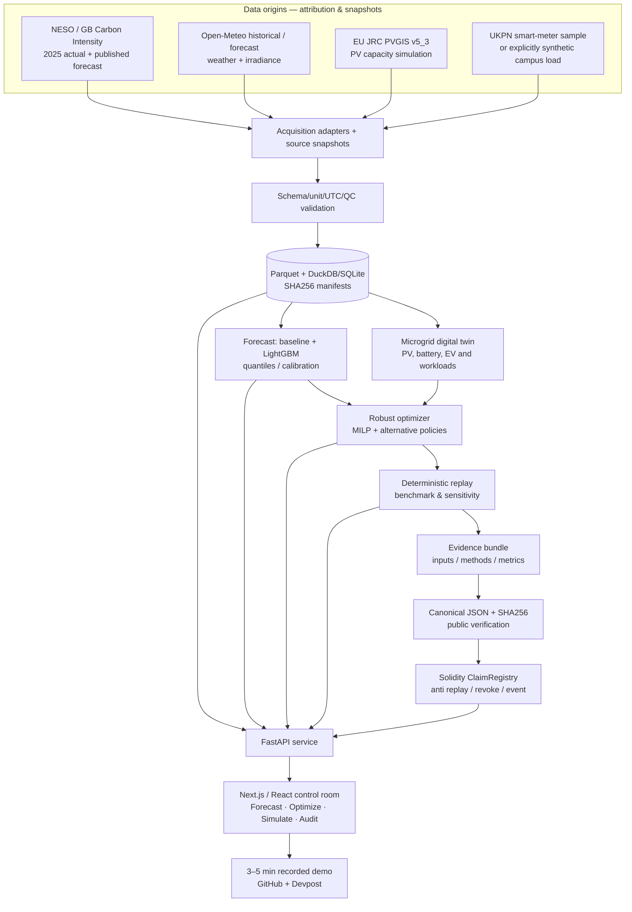

# GridProof — IEEE ClimateChain Global Hackathon 2026

> **Master implementation specification / Codex build contract**  
> Version: `2026-10-13`, timezone: `Asia/Taipei`  
> Project: **GridProof | Trustworthy Carbon-Aware Microgrid Orchestration**  
> Target track: **Renewable Energy & Energy Trading**; supporting innovation: Carbon Markets & Emissions Transparency.  
> Ambition: top-three-quality submission, not a promise of winning.  
> IMPORTANT: Evidence of modeled savings is **not** verified real-world emissions reduction and **not** a transferable carbon credit.

## 0. EXECUTIVE DIRECTIVE

Build a **working, reproducible, English-language** end-to-end system for a campus/commercial microgrid in London that (a) ingests authentic energy/weather data with source provenance, (b) forecasts carbon intensity / solar / flexible loads, (c) schedules EV charging + battery dispatch + shiftable work using constrained optimization, (d) evaluates the outcome against fair baselines on held-out historical periods, (e) creates cryptographically verifiable evidence with an anti-double-registration smart contract, and (f) presents an exceptional but honest interactive dashboard with a scripted 3–5-minute demo.

The differentiator is the complete **measure → predict → decide → independently reproduce → attest → audit** chain. Not a generic carbon calculator, not a simple token marketplace, not an AI chatbot with made-up CO2 numbers.

**Nonnegotiable:** ship the working vertical slice before optional expansion. Prioritize actual tests/data and excellent demo over maximum modules. Use deterministic replay and visible source/uncertainty tags. Any feature not backed by working behavior must be labeled `PLANNED`, never shown as live.

## 1. OFFICIAL COMPETITION INTELLIGENCE (VERIFIED 2026-10-13)

Sources: [official overview](https://ieee-climatechain-hack.devpost.com/), [official rules](https://ieee-climatechain-hack.devpost.com/rules), [official Oct 5 opening announcement](https://ieee-climatechain-hack.devpost.com/updates/46814-climatechain-hackathon-submissions-open-tomorrow-get-ready-to-submit), [2026 gallery](https://ieee-climatechain-hack.devpost.com/project-gallery).

### 1.1 Hard rules & constraints

| Item | What official page currently says | Execution / uncertainty |
|---|---|---|
| Organization | IEEE Blockchain Türkiye Group with IEEE technical / chapter collaborators | Organizing community, not IEEE Xtreme or IEEE journal publication |
| Deadline | `2026-10-25 17:00 MSK (UTC+03)` = **2026-10-25 22:00 Asia/Taipei** | Submit several hours early; don't confuse with registration deadline |
| Entry | Overview eligibility widget: legal adult, **students only**, excluded territories; Rules section separately lists researchers/developers etc. | **CONFLICT:** comply with the stricter student/adult eligibility and inspect own Devpost registration; do not assume broad categories override student-only widget |
| Team | Rules: 2–5 member teams; **individual submissions allowed**; one team per person | Solo is explicitly okay |
| Tracks | Carbon Markets & Emissions Transparency; Renewable Energy & Energy Trading; Sustainable Supply Chains; Climate Data & Environmental Monitoring | Pick exactly one primary track in submission; explain crossover |
| Deliverables | Track alignment, description of problem/solution/users/scalability, **public source repo**, **3–5-min demo video**, working prototype/mockup/PoC | Public repo cannot expose unrelated/private projects; English text/video strongly recommended |
| Scoring | Climate Impact; Innovation & Creativity; Technical Execution; Practical Usefulness; Presentation & Communication | **No official percentage weights published**; do not invent them |
| Prize | US$1,500 / US$1,000 / US$500 top three; IEEE Certificate of Merit top three | Site lists award details; verify if changed before submit |
| Participation cert | Text: for all eligible participants; Devpost prize slot says `10 winners` | **CONFLICT**. Do not promise everyone a certificate; organizer clarification desirable, not blocker to coding |
| Opening window | Rules say not to submit before `2026-10-25 08:00 PT`; Oct 4/5 organizer update expressly says **Oct 5 submission opens** | **CONFLICT**. Trust live Devpost submission UI and direct recent announcement; do not delay to Oct 25 merely due to stale rules text |
| Disallowed | Organizers/judges and immediate family; prior grand-prize winners may not receive grand prize | Check official Terms/eligibility before submission; avoid public claims beyond what was verified |

The contest lists prizes and judging criteria but **does not publish numerical score percentages**, data requirements, mandated chain, mandatory API provider, or a required training of a custom foundation model. All engineering choices below are our design, not organizer mandates.

### 1.2 History and competitive references — distinguish carefully

- **No verified 2025-or-earlier winners for this exact ClimateChain-branded competition were found.** Its 2026 gallery currently says managers have not published it. Do not make up past champions.
- **Same-year entry** [CarbonShield](https://devpost.com/software/carbonshield) already explores carbon-credit auditing + ML + anchored evidence. **Same-year entry** [AION V3](https://devpost.com/software/aion-v3-sovereign-value-os) explores value and emissions decisions. These are other submissions, **not winners**. Differentiate by physically constrained schedule optimization and reproducible counterfactuals.
- **Different event (not ClimateChain):** [DLT Climate Hackathon 2024 winner Agrify](https://www.dltearth.com/news/dlt-climate-hackathon-winners-event-highlights), which combined agriculture carbon claims, technology, and finance. **Different event:** [Hello Future Hackathon 2.0 winner Ecosphere Prime](https://hedera.com/blog/these-are-the-winners-of-the-hellofuture-hackathon-2-0/), a hyperlocal climate oracle. Lessons: credible source evidence + coherent real user + end-to-end functional demo matter. Do not call them past ClimateChain winners.

### 1.3 Judge-facing thesis and positioning

- **Problem:** organizations see forecasts and emissions dashboards, but lack a trustworthy, operational plan and an independently auditable estimate of its benefit.
- **Customer:** campus energy manager, community microgrid operator, small factory with flexible loads, fleet charging operator.
- **Action:** submit job deadlines and battery/PV configuration → find least-impact feasible dispatch plan.
- **Trust:** public data and hashes, explicit method and baseline, deterministic simulator, contract enforces no duplicate active attestations over same claim scope.
- **Demo proof:** toggle `Before` / `GridProof` / `Cost-prioritized`; move an EV deadline; demonstrate a feasibility constraint; generate attestation; change a source input and watch verification fail; display real contract event.
- **Honest claim wording:** “estimated *location-based emissions exposure* under the selected carbon-intensity series and simulated consumption profile,” not “X tons of carbon credits created,” not proof of causally avoided physical grid emissions.

## 2. SYSTEM ARCHITECTURE (EDITABLE MERMAID)

Optional rendered overview: [ARCHITECTURE.png](ARCHITECTURE.png) / [ARCHITECTURE.svg](ARCHITECTURE.svg). The Mermaid below remains editable.



Trust boundaries: source data **not authenticated by a blockchain alone**; source URL + acquisition timestamp + digest + raw snapshot are auditability signals. Contract proves that a specified actor wrote a digest at a point in time, and enforces a registry uniqueness policy; it does **not** prove an electrical meter or carbon removal physically occurred.

### 2.1 Stack (prefer small and robust)

- **Frontend:** Next.js + TypeScript + Tailwind + shadcn/ui + Recharts; React Flow or custom SVG for energy-flow digital twin; responsive 16:9 recording-friendly pages. Avoid unnecessary map assets.
- **Backend:** Python 3.11, FastAPI, Pydantic v2, pandas / numpy, DuckDB and Parquet snapshots, SQLite for runs; pydantic schema and OpenAPI docs.
- **ML:** `lightgbm` / scikit-learn; time-series naive baseline; quantile/conformal evaluation only if calibrated; optional minimal SHAP plots; versioned model artifacts.
- **Optimization:** `scipy.optimize.milp` (HiGHS) first; optionally OR-Tools if complexity warrants. Fully deterministic with a timeout, constraint checks, fallback heuristic and solver status.
- **Web3:** Solidity 0.8.x contract + Hardhat 3 + viem; local Hardhat node for zero-cost continuous demo, **optional** public EVM testnet deployment if faucets/keys readily available. Never require a mainnet transaction.
- **Dev:** pytest, Vitest, Playwright, Hardhat tests; Docker Compose backend/web optional, Windows-compatible scripts. Pin dependencies in lockfiles and validate against official current docs.
- **Deployment:** publicly reachable frontend + backend only if free/permissioned and stable; offline `demo fixture mode` must work with real, cached source snapshots. Never hard-code a fake testnet transaction receipt.

### 2.2 Proposed monorepo

```text
gridproof/
  README.md                    # impressive judge-facing English entry point
  IMPLEMENTATION.md            # this specification
  .env.example                 # only placeholder keys
  .gitignore
  Makefile / scripts/          # Windows .ps1 equivalents
  docker-compose.yml
  docs/
    COMPETITION_RULES.md       # citations + conflicts + checked date
    DATA_CATALOG.md            # access, license, time coverage, units
    ASSUMPTIONS.md             # source, simplification, uncertainty
    CLAIMS_AND_LIMITS.md       # what blockchain and CO2 estimates prove
    THREAT_MODEL.md
    ARCHITECTURE.md
    DEMO_SCRIPT.md
    EVALUATION.md
    SUBMISSION_CHECKLIST.md
  data/
    raw/                        # gitignored, checksummed
    processed/                  # gitignored, Parquet
    sample/                     # tiny public reproducible fixture
    manifests/sources.json
  backend/
    app/main.py
    app/api/{health,sources,forecast,scenario,optimization,replay,evidence,verify}.py
    app/domain/{schemas,units,scenario,solver,baselines,carbon,claim}.py
    app/data/{carbon_neso,weather_openmeteo,pvgis,load_ukpn,normalize,quality}.py
    app/ml/{features,train,forecast,calibrate,backtest}.py
    app/services/{storage,evidence,chain,simulator}.py
    tests/{test_data,test_solver,test_replay,test_integrity,test_api}.py
  frontend/
    app/{page.tsx,forecast,optimizer,simulator,audit,methodology}/
    components/{EnergyTwin,ForecastChart,ScheduleGantt,ImpactCards,ProofInspector}/
    lib/{api,types,format,fixtures}/
    tests/
  contracts/
    contracts/GridProofRegistry.sol
    test/GridProofRegistry.test.ts
    scripts/{deploy,verify}.ts
    hardhat.config.ts
  experiments/
    benchmark_config.yaml
    replay_results.csv
    baseline_comparison.csv
    forecast_metrics.csv
    robustness.csv
  scripts/
    discover_sources.py
    fetch_neso.py
    fetch_openmeteo.py
    fetch_pvgis.py
    fetch_ukpn_sample.py
    validate_sources.py
    build_snapshot.py
    train_models.py
    run_benchmark.py
    make_demo_fixture.py
    smoke_test.py
```

## 3. ALL REQUIRED DATA / EVIDENCE SOURCES

**IMPORTANT:** These links have been researched at the documentation level, but the datasets are **NOT downloaded by this planning document**. Codex must independently test exact endpoints/permissions and record successes or failures. Use **London, GB** as the initial common geographic anchor; UTC throughout backend. Do **not** mix UK grid carbon intensity with Taiwanese grid load and claim true Taiwanese emission results.

### 3.1 Primary: UK national carbon intensity (NESO; no key documented)

- Docs: https://api.carbonintensity.org.uk/
- API: `https://api.carbonintensity.org.uk/intensity/{from}/{to}`; live 24/48h forward endpoints also documented. Use ISO UTC timestamps, verify date limits and response envelopes.
- Historical CSV: https://www.neso.energy/data-portal/national-carbon-intensity-forecast
- CKAN resource: `https://api.neso.energy/api/3/action/datastore_search?resource_id=0e5fde43-2de7-4fb4-833d-c7bca3b658b0&limit=5`
- Exact columns in NESO public portal: `datetime` (UTC), `forecast` (gCO2/kWh), `actual` (gCO2/kWh), `index` (label). Real grid carbon intensity is **estimated from metered generation**, not individual household emissions.
- Download only 2025 and 2026-to-date subsets (or 2024–2025), not every year. Prefer CKAN/filter/API with pagination and retry/backoff. Snapshot with raw SHA256, source link, status, and license.
- Regional API: `https://api.carbonintensity.org.uk/regional/intensity/{from}/{to}/regionid/13` for London (region 13). Regional forecast/actual endpoints differ; check schema and do NOT assume historical regional series offers the same `actual` as national.
- Primary reproducible benchmark: **national actual carbon intensity (GB), 30-minute slots**. Region-13 view is a secondary demo only when compatible data fields exist.
- License: API says CC BY 4.0, plus actual [terms](https://github.com/carbon-intensity/terms/) (attribution, service limit, no endorsement, don't replicate NESO core UX). Brand as `GridProof`, **not** `NESO certified`.

### 3.2 Grid context: NESO demand and renewable outturn

- Portal: https://www.neso.energy/data-portal/historic-demand-data
- 2025 CSV resource: `https://api.neso.energy/dataset/8f2fe0af-871c-488d-8bad-960426f24601/resource/b2bde559-3455-4021-b179-dfe60c0337b0/download/demanddata_2025.csv`
- 2026 CSV resource: `https://api.neso.energy/dataset/8f2fe0af-871c-488d-8bad-960426f24601/resource/8a4a771c-3929-4e56-93ad-cdf13219dea5/download/demanddataupdate_2026.csv`
- Columns include `SETTLEMENT_DATE`, `SETTLEMENT_PERIOD`, demand, wind/solar outturn; verify exact column names and GB daylight-saving 46/48/50-slot day handling. NESO warns some values have revisions and a reporting delay. **Do not turn settlement period into UTC by naïvely assuming 48 every day.**
- Alternative historic mix: https://www.neso.energy/data-portal/historic-generation-mix
- Use for contextual charts, forecast features, and weather sensitivity. Don't use future observed national demand as a look-ahead optimization input in historical backtests.

### 3.3 Historical weather: Open-Meteo (noncommercial free tier)

- Official docs: https://open-meteo.com/en/docs/historical-weather-api
- Endpoint template: `https://archive-api.open-meteo.com/v1/archive?latitude=51.5074&longitude=-0.1278&start_date=2025-01-01&end_date=2025-12-31&hourly=temperature_2m,shortwave_radiation,cloud_cover,wind_speed_10m&timezone=UTC`
- Coordinates: London anchor **51.5074, -0.1278** (regional approximation, not a monitored real facility).
- Historical reanalysis is **not** a future weather forecast. Do not use future observed weather as a backtest predictor except an explicitly labeled **oracle ceiling**; live forecasts can use weather forecasts genuinely available at prediction time.
- License terms: https://open-meteo.com/en/terms — CC BY 4.0 attribution; free access **noncommercial only**, published rate limits; never assume hackathon licensing authorizes later commercial SaaS. Implement caching and source credit.

### 3.4 Solar generation: EU JRC PVGIS 5.3

- Official API reference: https://joint-research-centre.ec.europa.eu/photovoltaic-geographical-information-system-pvgis/using-pvgis-5/api-non-interactive-service_en
- Official basics: https://joint-research-centre.ec.europa.eu/photovoltaic-geographical-information-system-pvgis/using-pvgis-5/pvgis-5-user-manual_en
- API root `https://re.jrc.ec.europa.eu/api/v5_3/`; candidate tool `seriescalc` with `lat, lon, startyear, endyear, pvcalculation=1, peakpower, loss, angle, aspect, outputformat=json`. **Check supported years per chosen irradiation DB; never assume 2025 is available.**
- Design: e.g. a **20-kWp hypothetical London rooftop**. PVGIS is a model-based production potential, **not** measured production at this hypothetical site. Derive the 2025 simulated PV production from period-aligned Open-Meteo radiation + a documented simple efficiency/derating model calibrated or sanity-checked against PVGIS seasonal curves. Mark source/derived status and parameter uncertainty.
- Keep actual and hypothetical sources sharply separated. Never label PVGIS data as observed generation.

### 3.5 Optional actual load profile: UK Power Networks sample

- Source: https://ukpowernetworks.opendatasoft.com/explore/dataset/ukpn-smart-meter-consumption-lv-feeder/?tab=metas
- Advertised sample: approx. 10,000 **records** of aggregated half-hourly smart-meter import, with meter counts; determine actual freely downloadable endpoint, time range, license and access rights before using. Provider indicates historical full archive may require registration.
- Historic London household dataset: https://data.london.gov.uk/dataset/smartmeter-energy-consumption-data-in-london-households-vqm0d — approx. 10GB uncompressed, 2011–2014, so **do not download entire corpus** for a 12-day hackathon. Only sample a few households / days if allowed and note noncontemporaneous period.
- Fallback core demonstration: **explicitly simulated** campus loads + EV charging jobs, based on parameter assumptions (weekday/weekend, fixed loads, flexible jobs). Save reproducible seed and `data_origin=synthetic`. No misleading claim of smart meters physically connected to the prototype.

### 3.6 Data priorities / acceptance criteria

| Priority | Source | Mandatory output | Failure handling |
|---|---|---|---|
| P0 | NESO CI 2025 actual/forecast | valid half-hour UTC series and held-out split | fail loudly, then ship a clearly labeled cached official sample |
| P0 | NESO 2025 historic generation/demand | usable demand/solar/wind context or explicit unavailability | forecast still usable without it |
| P0 | Open-Meteo 2025 London | hourly weather data, 30m resample with explicit interpolation | use historically cached London periods; mark no weather uncertainty |
| P0 | PVGIS solar curves | simulation parameters, response metadata, season check | simple physical model with explanation if service offline |
| P0 | Reproducible simulated load jobs | battery/load constraints, deterministic seed | must always work offline |
| P1 | UKPN feeder sample | `license`, time range, unit, aggregate load | omit if auth/coverage limited; no fake real-load claim |
| P2 | regional London carbon | region-13 intensity view | secondary feature; don't silently substitute national without label |
| P2 | public EVM testnet | real explorer URL and tx receipt | local chain as valid fallback; UI labels `LOCAL DEV CHAIN` |

**Manifest format:** every artifact records `source_id`, original URL, retrieval UTC timestamp, license and attribution, HTTP/ETag where available, byte-size, SHA256, raw snapshot location, schema, units, timezone, date span, missing values, lineage, limitations and `status=verified|restricted|failed|synthetic`. Gitignore bulk raw data; commit only small attributed and permissible samples plus acquisition scripts.

## 4. CANONICAL DATA MODEL / UNITS

Use ISO-8601 UTC, store interval as `[start_utc, end_utc)`. Decision resolution **30 minutes** (`dt_hours=0.5`). Converting hourly sources to half-hour requires documented **interpolation/forward-fill policy** depending on physical semantics and explicit confidence limitation; avoid inventing precision. Electricity energy is `kWh per interval`, power `kW`, carbon intensity `gCO2/kWh`, cost `GBP/kWh`, SoC `kWh`.

```python
# data contract (conceptual; implement with Pydantic v2)
IntervalRecord = {
  "start_utc": "2025-08-12T12:00:00Z", "end_utc": "2025-08-12T12:30:00Z",
  "grid_ci_actual_g_per_kwh": 126.0, # null when unavailable
  "grid_ci_forecast_g_per_kwh": 131.0, # historic forecast: issuance unknown unless evidenced
  "grid_demand_mw": None,
  "solar_model_kwh": 3.1, # never labelled observed
  "fixed_load_kwh": 6.5, # synthetic unless attached measured dataset
  "tariff_gbp_per_kwh": 0.20, # explicit hypothetical constant, not claimed actual UK tariff
  "source_refs": ["neso-...", "openmeteo-..."],
  "quality_flags": ["national_ci", "simulated_facility"]
}
```

Model `Scenario`: `site_id_hash`, `location`, `solar_kwp`, `battery_capacity_kwh`, `soc_initial_kwh`, `soc_min/max_kwh`, `charge/discharge_kw`, `eta_c/eta_d`, `max_grid_import_kw`, `ev_jobs[{energy_kwh,arrival,deadline,max_kw,interruptible}]`, `batch_jobs[{energy_kwh, duration_slots, allowed_start/end, contiguous}]`, `tariff`, and selected `policy`.

## 5. AI FORECASTING — STRICT EXPERIMENT DESIGN

Forecast three quantities separately and never silently blur measured vs modeled:

1. **Grid carbon intensity:** national GB intensity; strong baseline = latest known historical value, same-slot-prev-day, 7-day seasonal median, and NESO's published forecast. Custom LightGBM model may use only *past* observed CI, calendar features, **past** available demand and renewable outturn. Weather-related future features ONLY from a genuinely issued forecast, never 2025 retrospective actuals masquerading as available foresight.
2. **Solar:** physical PV production estimate using irradiance & assumed PV parameters. For future interval forecast use only contemporaneously available weather forecast or predict from calendar/history; show model uncertainty as hypothesis.
3. **Facility load:** given a synthetic or imported fixed load profile, forecast with seasonal naive; flexible EV/batch jobs are **explicit user requirements**, not mysteriously inferred actual activity.

Train/valid/test: chronological and source-consistent, e.g. train `2025-01-01..06-30`, validation `2025-07-01..08-31`, locked test `2025-09-01..12-31`; 2026 Jan–Sep is optional recent out-of-time test. Handle DST and missingness. **No shuffled CV, no feature leakage**, train statistics from training split only, fixed seed. No test-period tuning.

Metrics: MAE & RMSE for CI; quantile pinball loss and interval coverage if uncertainty model exists; baseline comparisons. Publish failure cases (storms, price/carbon disagreement). It is fine if the custom model fails to beat NESO: describe forecast as hybrid using NESO, not claim to improve published state of the art without proof.

Rolling backtest must separate `decision_time` and `outcome_time`. At decision time, only use permitted observations/forecasts. Actual outcome used **after** optimization for scoring. If historical NESO `forecast` records lack issuance-time provenance, flag as `historical forecast, issuance unverified`, and present true no-look-ahead experiment with own past-only features as primary scientifically controlled result.

## 6. OPTIMIZATION MODEL — THE TECHNICAL CENTERPIECE

### 6.1 Scope and variables

- 24h horizon = `T=48` half-hour slots; optional 48h = `T=96`. Campus has `fixed_load[t]`, `PV[t]`, EV energy and deadlines, shiftable batch workloads, battery.
- Decision variables: `import[t]≥0`, `export[t]≥0` (optional only if legal/export enabled), `charge[t]≥0`, `discharge[t]≥0`, `soc[t]`, EV charge per job/time, batch start binary `y[j,s]`, battery charge/discharge mode binary if essential. Optional curtailable PV `curtail[t]≥0`. All energy balance terms in kWh/slot.
- Solve using SciPy `milp` / HiGHS with explicit solver status, time limit, and reconstruct feasibility check.

### 6.2 Minimize real objective, not fictitious emissions

For one scenario, indicative location-based emissions exposure:

\[
E_{g} = \sum_{t=1}^{T} I_t\,(g^{import}_t - \kappa g^{export}_t)/1000\quad [kgCO_2]
\]

where `I_t` is gCO2/kWh, import/export are kWh, and `κ=0` **by default** so exported energy does **not** receive unjustified negative-emission credit. If model explicitly accounts for marginal avoided generation, requires a separate defensible methodology and MUST NOT be introduced as default. Fixed site PV reduces imports through energy balance, but not automatically double counted as separate offset credits.

Cost `C=Σ tariff[t]*import[t]` with optional service penalties. Objective `J = w_c * (E_g / E_ref) + w_p*(C / C_ref) + w_d*degradation_cost + penalty_unserved` where reference denominators are positive, fixed, and disclosed. Provide one-carbon-priority, one-cost-priority, and Pareto compromise; never show a result with hidden tradeoffs.

### 6.3 Constraints (must test numerically)

- Power/energy conservation: `import + discharge + PV_used = fixed_load + EV_charge + batch_load + battery_charge + export` per slot.
- Battery: `soc[t+1] = soc[t] + eta_charge*charge_kwh[t] - discharge_kwh[t]/eta_discharge`.
- SoC min/max, device kW limits ×0.5h, terminal SoC condition or cycling penalty to prevent stealing stored energy at test end.
- No simultaneous charging/discharging (binary or correct convex reasoning), no simultaneous import/export if it could spur arbitrage; no negative energy.
- For each EV job: `Σ charge_kwh[j,t] = target_energy`, no charge before arrival/after deadline, charging <= job kW cap, simultaneous station kW limit, no overscheduling.
- Contiguous batch jobs: `Σ_allowed_starts y[j,s] = 1`, occupied slots derived linearly from starts; enforce maximum concurrency/peak power.
- If infeasible, return reason and a safe fallback (e.g. deadline cannot be met), not false `optimized` state.
- Price/carbon data bounds, missing slots and provenance validity checked before scheduling.
- If PV exceeds load and export forbidden, curtail rather than create negative grid imports.

### 6.4 Baselines & robustness

Same site/load/jobs/constraints/input data for all policies:

1. **Immediate / unmanaged**: EV starts immediately, batch runs earliest, no smart dispatch (battery rule must be stated).
2. **Cost-first**: minimizes stated tariff cost subject to same constraints.
3. **Carbon-first**: modeled grid carbon intensity (with carbon estimate only, not causal avoided emissions).
4. **Hybrid**: Pareto slider with cost/carbon balance.
5. **Oracle upper bound**: perfect future intensity — only as an *unrealistic benchmark ceiling*, explicitly labelled, not a deployable method.

Report average, median and p10/p90 across many locked day windows, with table of `baseline_E`, `optimized_E`, `% difference`, `cost delta`, violations, solve latency. Include bootstrap CIs at day level (not interval level if autocorrelated); night/solar-low/volatile-grid scenarios and sensitivity to forecast bias, battery efficiency, missing inputs. Never invent percent savings before execution.

## 7. VERIFIABLE EVIDENCE & BLOCKCHAIN

### 7.1 Why blockchain is substantively needed

An outsider can verify the organization did not silently revise a reported scenario after publishing the claim; the registry prevents the **same site, time interval and claim category** from having duplicate active claim registrations under our protocol. The public verifier recomputes digest from evidence JSON, checks algorithm/schema versions and contract event/transaction. Blockchain attests **a claim record's integrity/timestamp**, not the truth of source measurements or actual avoided carbon emissions.

### 7.2 Canonical evidence JSON (deterministic)

```json
{
  "schema_version": "1.0.0",
  "methodology": "gridproof/location-based-operational-scenario/v1",
  "claim_scope": {"site_hash":"0x...", "from_utc":"...", "to_utc":"...", "category":"modelled-grid-emissions-exposure"},
  "observational_status": "simulation_using_public_grid_data",
  "source_snapshots": [{"source_id":"neso-national-ci-2025", "sha256":"...", "retrieved_utc":"...", "license":"CC-BY-4.0"}],
  "scenario_parameters": {"solar_kwp":20,"battery_capacity_kwh":40},
  "forecast_model": {"version":"...","training_window_utc":["...","..."]},
  "solver": {"name":"HiGHS","version":"...","status":"optimal","constraints_verified":true},
  "baseline_id": "immediate-unmanaged-v1",
  "results": {"baseline_kgco2": 0, "plan_kgco2":0, "difference_kgco2":0,"cost_gbp":0},
  "reproduction": {"seed":42,"code_commit":"...","artifact_hashes":["..."]},
  "limitations": ["modeled scenario", "not a regulatory carbon credit", "average not marginal grid intensity"]
}
```

**Values above are schema placeholders; NEVER seed production report with zeros as if measured.** Store evidence bundle locally / downloadable from UI, normalize timestamps, `null` vs missing, numeric precision, list ordering; canonical JSON specification e.g. RFC 8785/JCS or explicitly tested deterministic encoder. `sha256(canonical_json_bytes)` (32 bytes), with verifier reproduction using exactly same serialization. Source sub-bundles should have stable content hashes.

### 7.3 Smart contract: `GridProofRegistry.sol`

Minimal robust contract state:

- `claimKey = keccak256(abi.encode(siteHash, fromUtc, toUtc, categoryHash))` — **do not include `scenario_id` or `model_version` in uniqueness key**, otherwise double claims are trivial.
- `mapping(bytes32 => Record)` with `digest`, `submitter`, `createdAt`, `status`, and replacement relation; active claims unique for scope.
- `registerClaim(claimKey, digest)` requires nonzero digest and unregistered/authorized-replacement status; `ClaimRegistered` event.
- `revokeClaim(claimKey, reasonDigest)` only original submitter (or explicit audited admin if necessary); `ClaimRevoked` event; immutable history retained.
- `getClaim(claimKey)` and `verifyClaim(claimKey, expectedDigest)` return explicit state; `already registered` reverts replay/duplicate.
- `replaceClaim` only after revoke (new digest linked in an event/record), never delete evidence/history.
- Read-only public verifier shows local vs testnet network, contract, chain ID, tx hash, digest, event log, revocation status. Unknown or unavailable RPC → `UNVERIFIABLE`, never green verified badge.

Tests MUST cover first register, duplicate, same-claim variant scenario, wrong submitter, revoke/replacement, data-bit tamper, wrong digest, zero digest, wrong chain, RPC failure. Use contract code analysis and tests; do not expose real private keys. Testnet optional; local chain is functional but must be honestly labeled.

## 8. BACKEND API CONTRACT

| Method | Path | Input | Response |
|---|---|---|---|
| GET | `/api/health` | none | service/version/fixture status |
| GET | `/api/sources` | none | provenance, retrieval UTC, license, QC and real/synthetic tags |
| GET | `/api/forecast?from=...&hours=24` | scenario/time | forecasts + uncertainty + actual-known masking |
| GET | `/api/scenarios` | none | London microgrid presets |
| POST | `/api/optimize` | Scenario + selected objective | dispatch per 30m slot, constraints, solver status |
| POST | `/api/compare` | same scenario | baseline/cost/carbon/hybrid/oracle (oracle separately labeled) |
| POST | `/api/replay` | snapshot IDs/date range/seed | reproducible backtest ID and metric bundle |
| POST | `/api/evidence` | validated replay id | canonical claim + SHA256 + verification instructions |
| POST | `/api/attest` | prepared evidence id, explicit local/testnet chain choice | tx receipt or explicit error; no silent network writes |
| GET | `/api/verify/{claim_key}` | proof query | source digest vs onchain mismatch/status/trust boundary |

All server responses include `provenance_status` (`observed`, `forecast`, `modeled`, `synthetic`), `units`, `data_timestamp`, and meaningful errors. API calls shall not silently return invented measurements. Chain writes require explicit deliberate UI action; never issue automatically when viewer loads dashboard.

## 9. JUDGE-GRADE FRONTEND / PRODUCT DESIGN

Four excellent pages, no busy generic chatbot:

**A. CONTROL ROOM** — premium dark glass/sapphire aesthetics; London campus digital twin with PV roof, grid line, battery, EV lot, flexible compute lab. Animated energy-flow arrows based on numerical dispatch. Header source badges (`NESO real grid data`, `Modeled campus`, `UTC date`). Cards: predicted grid CI, scheduled kWh, modeled kgCO2, hypothetical tariff impact, no unsupported savings claims.

**B. INTELLIGENT DISPATCH** — carbon-intensity half-hour chart (actual vs forecast, quantile band), solar generation, load stacked area, battery SoC, EV slots and Gantt schedule, objective slider (`Carbon ↔ Cost`), EV deadline input and battery size slider. `Run optimization` recomputes on backend; show solver objective + constraint check + job schedule.

**C. DIGITAL TWIN / REPLAY** — 24h draggable playback scrubber; side-by-side immediate vs GridProof vs cost-only, chart of estimated exposure and expense and source uncertainty; fixed historical examples (one high/low variability day) plus selected dates. Export reproducible evidence package.

**D. TRUST / PUBLIC AUDIT** — before/after raw evidence fingerprint; chain transaction detail + public or local chain status; independent recompute button; tamper challenge toggle that modifies local copy and demonstrates `HASH MISMATCH`; source citations and `Not a tradable carbon credit` banner; threat model accordion.

Excellent UX: skeletons, loading/errors, empty states, proper keyboard accessibility, source footnotes, no overflow on 1366x768, optimized for recording at 1920x1080, responsive phone view. No stock diagrams in place of working computation. Fake tx IDs or mock verified data forbidden.

## 10. DEVELOPMENT PHASES / GATES / STOP RULES

Target delivery is **before October 25**, leaving final day for submission. Model or optimization fidelity wins over excessive feature count.

| Gate | Focus | Must pass before moving on |
|---|---|---|
| G0: Research & acquisition | verify URLs/licenses; download official 2025 CI/renewables/weather; build source manifest and QC | dataset file hashes, rows, UTC sanity, 3 documented source references, real/synthetic labeling |
| G1: Vertical slice | Python scenario + baseline + numerical optimizer + API | energy conservation / SoC / EV deadlines / feasible status tests; produce non-fabricated baseline metrics |
| G2: Evidence layer | canonical JSON, local contract, registry verification | duplicate claim and tamper tests passing; chain transaction receipt shown |
| G3: AI & benchmarking | no-leak historical ML, backtest, baselines, uncertainty | test-period report from real source data with explicit methodological limitations |
| G4: Premium app | digital twin, optimizer panel, audit page; connect all API functions | smoke-test clickthrough; actual schedule recomputes; errors honest |
| G5: Public deliverables | README, repo, architecture, English 3–5 min video, tested install | fresh-clone setup, offline demo, shareable screenshot and reproducible proof |
| G6: Submission | confirm eligibility, Devpost track/description/public repo/video/prototype | submit well before `2026-10-25 22:00 Asia/Taipei`; store Devpost confirmation |

**Priority cuts when short on time:** First remove live weather forecasts / regional zoom; next remove cloud testnet; next fancy LLM explanations; next UKPN optional sampling. Do **not** cut reproducibility, physical constraints, real core data, proof verifier, or clean functional demo.

### 10.1 Concrete definition of done

- `pytest` passes; `Hardhat` tests pass; frontend builds; typecheck passes; initial UI workflow E2E passes.
- One CLI (`make demo` or `scripts/run_demo.ps1`) launches every local piece; deterministic fixture mode needs no network once data is downloaded.
- At least two real sourced historical windows and one transparent hypothetical campus scenario.
- At least 3 policy comparisons, robust test including a case where optimizer does **not** improve carbon score.
- Benchmark reproducibility: fixed seed, train/test separation, no need to trust hand-written static dashboard numbers.
- One onchain *actual local-chain* transaction in recorded demo, then independent SHA256 verification and anti-double-registration rejection.
- GitHub public repo has LICENSE for project code, `.env.example`, attribution file, docs, source fetching and data licenses. Not the same as licensing upstream data indiscriminately.
- Demo makes three visual points in 5 minutes: forecast → actionable schedule → verifiable proof.
- Submit track chosen, author/solo rules verified, public URL + demo video + code + English description + known constraints.

## 11. TEST MATRIX / ATTACKS / CREDIBILITY

| Subsystem | Must-test case |
|---|---|
| Data | null `actual`, duplicate timestamps, ISO zone issues, DST (46/48/50 settlements), out-of-order records, changed API schema, rate limiting |
| ML | leakage through future weather/observed demand, train contamination, shuffled CV, missing hidden forecast issuance metadata |
| MILP | basic feasible case, deliberately infeasible deadline, battery SoC bound, charge/discharge not simultaneous, nonnegative import, EV energy exact, time limit, solver failure fallback |
| Metrics | baseline controls exact same jobs, no double PV credit, kg vs g conversion, fixed terminal SOC, export not given unearned carbon credit |
| Smart contract | duplicate scope with new scenario id, unauthorized revoke, bit-change evidence, wrong chain, stale/cancelled transaction, missing event |
| UI | live source errors show `unavailable` not synthetic disguised as live; chart subtitles identify observed/predicted/simulated; no false 100% improvement |
| Security | input validation, DoS/rate limits, read-only public API; no key in GitHub; user-triggered transactions only; data availability ≠ authenticity |

### 11.1 Specific scientific limitations to expose

1. Using national average GB carbon intensity for scheduling approximates **location-based grid emissions**, not marginal causal system-wide carbon abatement; do not call it certified avoided emissions.
2. PV generation / campus loads are simulated unless a site provides a validated meter. Real source data doesn't turn a simulated facility into a field trial.
3. Retrospective forecast columns may not be point-in-time archived; if publication timestamps unverified, mark them and test a past-only model as fair alternative.
4. A blockchain hash guards integrity *after commitment*, not whether measurement or source was true; independent source and actor attestation remains open problem.
5. Solar forecast, weather and renewable series differ in temporal/spatial resolutions; sample and uncertainty statements mandatory.
6. No ERC20 token, offset certificate issuance, tradable RECs or real-money peer-to-peer energy transactions without appropriate authority/protocol and regulatory basis.

## 12. DEMO STORYBOARD (English; exactly 3–5 minutes)

**0:00–0:25 — Problem.** “A campus can see its energy use but can't yet decide and independently prove when flexible demand should run. GridProof closes that loop.” One animated campus graph.

**0:25–1:10 — Sources & forecast.** London / GB source labels and retrievable provenance; carbon-intensity curves with uncertainty. Explain modeled campus and real grid carbon series.

**1:10–2:15 — Dispatch.** EV deadline and solar/battery setup; click optimize; compare baseline vs carbon-aware plan and cost objective; show conservation/feasibility checks.

**2:15–3:05 — Independent replay.** Pick historical day; fixed benchmark and source hashes; compare costs and **modeled** location-based emissions; include uncertainty/not-overclaim note.

**3:05–4:05 — Chain proof.** Generate evidence → submit to local/testnet registry → verify digest → modify evidence and show failure; attempt duplicate scope and show rejection.

**4:05–4:35 — Impact & adoption.** Campus/fleet/SME value, what's simulated vs measured, environmental credibility and next steps. Include 1 sentence for all five judging criteria, without inventing scores.

## 13. OFFICIAL & TECHNICAL SOURCE INDEX

**Competition**
- https://ieee-climatechain-hack.devpost.com/
- https://ieee-climatechain-hack.devpost.com/rules
- https://ieee-climatechain-hack.devpost.com/updates
- https://ieee-climatechain-hack.devpost.com/project-gallery
- https://ieee-climatechain-hack.devpost.com/updates/46814-climatechain-hackathon-submissions-open-tomorrow-get-ready-to-submit

**Same-year/analogue competition evidence**
- https://devpost.com/software/carbonshield
- https://devpost.com/software/aion-v3-sovereign-value-os
- https://www.dltearth.com/news/dlt-climate-hackathon-winners-event-highlights
- https://hedera.com/blog/these-are-the-winners-of-the-hellofuture-hackathon-2-0/

**Energy + weather data / licenses**
- https://api.carbonintensity.org.uk/
- https://www.neso.energy/data-portal/national-carbon-intensity-forecast
- https://www.neso.energy/data-portal/historic-generation-mix
- https://www.neso.energy/data-portal/historic-demand-data
- https://github.com/carbon-intensity/terms/
- https://open-meteo.com/en/docs/historical-weather-api
- https://open-meteo.com/en/terms
- https://joint-research-centre.ec.europa.eu/photovoltaic-geographical-information-system-pvgis/using-pvgis-5/api-non-interactive-service_en
- https://joint-research-centre.ec.europa.eu/photovoltaic-geographical-information-system-pvgis/using-pvgis-5/pvgis-5-user-manual_en
- https://ukpowernetworks.opendatasoft.com/explore/dataset/ukpn-smart-meter-consumption-lv-feeder/?tab=metas
- https://data.london.gov.uk/dataset/smartmeter-energy-consumption-data-in-london-households-vqm0d

**Engineering references**
- https://docs.scipy.org/doc/scipy/reference/generated/scipy.optimize.milp.html
- https://hardhat.org/docs/getting-started
- https://hardhat.org/ignition/docs/getting-started
- https://www.rfc-editor.org/rfc/rfc8785

## 14. FINAL INSTRUCTIONS FOR CODEX

1. Read **both** `IMPLEMENTATION.md` and `CODEX_START_PROMPT.md`, then execute research/data fetch and proceed to first working vertical slice. Don't ask obvious questions; preserve user files and do not touch unrelated repositories.
2. Run data acquisition before claiming a source has been downloaded. Show source SHA256 and actual row counts from filesystem; never invent download results.
3. Commit only reproducible public-safe assets. Use public data responsibly, obey rate limits/licensing, and never open accounts or spend money without user approval.
4. At every gate, report exact working commands, test pass/fail, source assets, major limitations, and next gate. Continuously keep a functional demo.
5. Don't promise to win. Build a project serious enough to compete for top three and demonstrate real technical depth.
