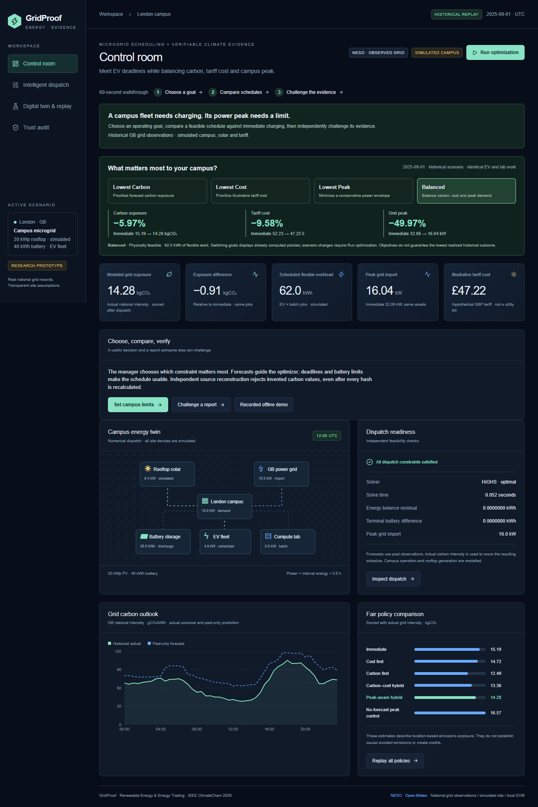
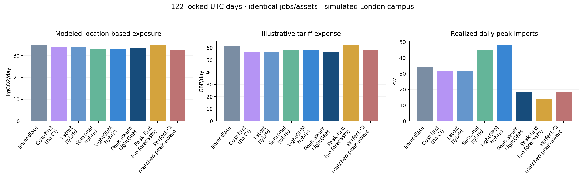

# GridProof

**Microgrid scheduling + verifiable climate evidence** — for campus energy managers who need vehicles charged on time without creating a costly power peak. Choose a goal, inspect a feasible schedule and challenge its evidence. IEEE ClimateChain 2026 track: Renewable Energy & Energy Trading — Microgrid Coordination.

GridProof turns authentic GB grid records into constrained campus energy schedules and independently verifiable evidence. It connects source acquisition, forecasts, a mixed-integer optimizer, numerical replay and a Solidity scope registry. The hypothetical London campus has 20 kWp PV, a 40 kWh battery, two EV jobs and a contiguous compute-lab batch.



## Run the local demo

Prerequisites: **Python 3.11** and **Node 24**. All application dependencies are pinned in requirements.txt and npm lockfiles. Setup downloads dependencies. The release includes four demo days, separately pinned original CI/weather snapshots and a portable trained model; after installation no provider network is needed.

```powershell
# Windows, from the repository root
.\scripts\setup.ps1
.\scripts\run_demo.ps1
```

```sh
# macOS / Linux
sh scripts/setup.sh
sh scripts/run_demo.sh
```

Open **http://127.0.0.1:3000**. FastAPI docs: http://127.0.0.1:8000/docs. The zero-cost local EVM is at 127.0.0.1:8545, chain 31337. The startup command deploys or reuses a local registry; it does not attest evidence automatically. Stop the command with Ctrl+C to stop the API/dashboard processes it started. The independently managed local chain can be reused for later demonstrations.

PowerShell users with script execution restricted can invoke `.\.venv\Scripts\python.exe scripts/run_demo.py` after setup, or run the setup commands directly. No Python `py` launcher is required. The local demo uses cached official records, transparently simulated site data and an illustrative tariff. A fresh source copy runs seasonal forecasts before September 1 and the actual validation-selected LightGBM model on September 1 and October 13. The portable JSON contains the original trained trees; it does not deserialize uploaded pickle.

## Four working pages

- **Control room:** operator problem, three-step walkthrough, four goals and same-workload Carbon/Cost/Peak deltas, plus the numerical campus twin.
- **Intelligent dispatch:** select Lowest Carbon / Lowest Cost / Lowest Peak / Balanced; metrics and curves use that computed policy. Change source day, battery, EV deadline or hybrid preference and run a real recomputation. Export the selected 48-interval CSV/JSON. Infeasible inputs retain the previous usable plan and show an error.
- **Digital twin & replay:** inspect each half-hour, the finite trade-off map and all equal-workload policies. Goal switching is labeled selection of computed results; full-period evaluation remains separate from the selected day.
- **Trust audit:** scope/source values before technical JSON, generate the selected policy's evidence, verify local layers and forge CI plus new hashes to demonstrate rejection. Fixed receipt reads are separate from new reports; actual history/revocation fields are displayed. Missing RPC or mismatched evidence never becomes verified.

Follow the [60-second judge path](docs/ACCEPTANCE_60_SECONDS.md): **choose a goal → compare schedules → challenge the evidence**. Human comprehension is pending a real teach-back, not inferred from browser tests. The [product iteration report](docs/CHAMPIONSHIP_ITERATION.md) includes the direct review answers and actual changes; [release operations](docs/RELEASE_OPERATIONS.md) prepares the existing app plus a static recorded backup. Nothing has been publicly deployed or submitted.

## Measured results and limits

The current full held-out benchmark contains **all 122 UTC days from September through December 2025**. The original 24-day files remain unchanged; all 120 original policy-day carbon/cost outputs reproduce exactly.

| Fixed policy | Mean modeled kgCO2/day | Illustrative GBP/day | Mean daily peak kW | Aggregate exposure improvement | Mean daily relative improvement | Non-improving days |
| --- | ---: | ---: | ---: | ---: | ---: | ---: |
| Immediate | 34.945 | 61.703 | 34.053 | 0% | 0% | Reference |
| Original LightGBM hybrid | 32.884 | 58.420 | 48.227 | 5.897% | 6.365% | 7/122 |
| Peak-aware LightGBM hybrid | 33.491 | 56.785 | 18.517 | **4.162%** | **4.302%** | **4/122** |
| No-forecast peak control | 34.856 | 62.491 | 14.257 | 0.255% | -0.290% | 64/122 |

The fixed peak-aware setting reduces mean daily peak imports **45.62%** and illustrative cost **7.97%** relative to immediate charging. It sacrifices some carbon benefit compared with the original hybrid. Its aggregate exposure bootstrap interval is **3.710-4.613%** (ordinary day resampling); its mean-daily interval is **3.764-4.913%** (seven-day circular block resampling). Those are different estimands.

AI increment remains unproven. Across all 122 days, LightGBM versus seasonal hybrid gains only **0.202 percentage points** in mean daily improvement, with a paired seven-day block 95% interval **[-0.407, 0.747]**. For the peak-aware policy the gain is **0.182 pp**, interval **[-0.188, 0.557]**. Both intervals include zero. Original forecast test MAE remains 36.982 for LightGBM versus 34.836 for latest-value.



The 17-policy nominal evaluation has zero failed pairs, fallback days or returned constraint violations. Sensitivity reports retain **610 infeasible, 610 input-rejected and 195 verified fallback rows**. Those 195 fallbacks followed rejected replay candidates; zero violations of returned fallback schedules does **not** mean every candidate was valid. The fixed exploratory weight grid and all 9,760 sensitivity rows retain source/configuration hashes.

This is modeled national-average grid-emissions exposure. The facility, jobs, battery, PV conversion and tariff are simulated; weather is reanalysis. It is not measured campus deployment, marginal causal avoided emissions, certified abatement or a carbon credit. Source lineage proves correspondence to separately trusted snapshot bytes, not that the provider's physical measurements are true. Historic actual-publication latency/revisions remain unarchived.

See [complete evaluation](docs/COMPETITION_EVALUATION.md), [raw 122-day results](experiments/competition_v2/daily_results.csv), [paired AI ablation](experiments/competition_v2/paired_forecast_ablation.json), [source-lineage verification](docs/LINEAGE_VERIFICATION.md) and [original 24-day evaluation](docs/EVALUATION.md).

## Offline judge backup

Open **[offline/index.html](offline/index.html)** directly in a modern browser. It requires no Python, Node, wallet, registration, API or Internet. Four recorded days and policy comparisons are interactive; sliders replay stored dispatch, not a new solve. It demonstrates original-hash tampering and source-value forgery even after rehashing.

The offline browser check reconstructs pinned CI/radiation/PV/load/tariff values and energy balance. It explicitly does not replace the complete independent Python forecast, job and SoC verifier. On-chain status remains NOT CHECKED offline. A hosted Next.js build also serves the same backup at /offline/index.html.

## Reproduce full-data acquisition and experiments

```powershell
.\.venv\Scripts\python.exe scripts/discover_sources.py
.\.venv\Scripts\python.exe scripts/fetch_neso.py --year 2025
.\.venv\Scripts\python.exe scripts/fetch_neso.py --year 2026 --ci-only --through 2026-10-13
.\.venv\Scripts\python.exe scripts/fetch_openmeteo.py
.\.venv\Scripts\python.exe scripts/fetch_pvgis.py --year 2023
.\.venv\Scripts\python.exe scripts/build_snapshot.py
.\.venv\Scripts\python.exe scripts/profile_sources.py
.\.venv\Scripts\python.exe scripts/validate_sources.py --require-bulk --write-manifest
.\.venv\Scripts\python.exe scripts/train_models.py
.\.venv\Scripts\python.exe scripts/run_benchmark.py --days 24
.\.venv\Scripts\python.exe scripts/make_demo_fixture.py
.\.venv\Scripts\python.exe scripts/smoke_test.py
```

On Unix replace `.\.venv\Scripts\python.exe` with `.venv/bin/python`. `scripts/setup.ps1 -DownloadData` or `sh scripts/setup.sh --download-data` prepares the core 2025 datasets. 2026 and UKPN are optional separate commands. Acquisition caches responses, verifies checksums, implements bounded retry/backoff and timeouts, and records failures rather than inventing successful downloads. Diagnostic plotting, Parquet and DuckDB conversion operate on the cached normalized records.

The source audit is read-only unless `--write-manifest` is explicitly requested. `validate_sources.py` validates the shared fixture on a fresh clone; `--require-bulk` also requires all downloaded artifacts. A missing full dataset is visible, never silently reported as present. Retraining and re-evaluation require the full download, while the four-day demo uses the distributed source and portable-model release bundle.

## Verify evidence independently

V2 evidence has four separate layers: **Integrity**, **Source Lineage**, **Physical Validity**, and **On-chain Attestation**. Full offline VERIFIED requires the first three; on-chain verification is a separate receipt read, never inferred from a matching hash.

```powershell
.\\.venv\\Scripts\\python.exe scripts/verify_evidence.py data/sample/evidence.json --digest 0xTRUSTED_EXPECTED_SHA256
```

The standalone verifier imports no backend and uses only the Python standard library. It independently reconstructs raw snapshot timestamps, actual CI, past-only features/model inference, radiation alignment, forecast/outcome PV, declared synthetic load/tariff, immediate baseline, physical constraints and KPI arithmetic. The **separate trusted release** data/trust/source_anchors.v1.json pins original upstream/model bytes; a report cannot nominate new hashes as its own trust root.

Self-contained blobs use bounded deterministic gzip+base64 transport; SHA256 always covers the original uncompressed bytes. Missing required sources/model/pins return INCOMPLETE. Missing optional current local copies are labeled NOT_LOCALLY_CHECKED, while valid embedded original bytes can still be reconstructed. Legacy v1 remains readable as INTEGRITY_ONLY / LEGACY_UNVERIFIED; preserved sample is data/sample/evidence.v1.json.

Use a trusted original digest or on-chain commitment. The forgery demo deliberately rehashes zero-CI inputs and valid arithmetic: Integrity and Physical Validity pass, **Source Lineage rejects**. This distinction is the repair, not a claim that hashing authenticates a meter.

Canonical JSON remains the disclosed GridProof format, not RFC 8785. The registry preserves exact site/time/category scope, authorized revocation/replacement and linked history; it does not prove site ownership or globally prevent overlapping claims.

See [verification details](docs/LINEAGE_VERIFICATION.md), [deployment preparation](docs/PUBLIC_DEPLOYMENT.md) and [chain demo/history](docs/CHAIN_DEMO.md).

## Tests

```powershell
.\scripts\check.ps1
# With the local demo running; Windows uses installed Microsoft Edge:
npm --prefix frontend run test:e2e
```

```sh
sh scripts/check.sh
# Install Chromium for Playwright once on Linux/macOS:
cd frontend
npx playwright install chromium
npm run test:e2e
```

Tests exercise DST settlement conversion, source integrity and missingness, no future feature/weather leakage, feasible and infeasible deadlines, energy conservation, terminal SoC, battery exclusivity, shared charger caps, batch contiguity, solver failure/time limits, canonical tampering, independently reconstructed arithmetic, duplicate registry scopes, authorization, replacement history, wrong-chain/RPC handling and the browser workflow. [Execution worklog](docs/WORKLOG.md) records actual pass counts and verification limits.

The upgraded Windows release passed **91 Python/data tests, 32 contract/bridge tests and 6 browser tests**, plus the production build and TypeScript checks. `scripts/test_offline_copy.py` checks four days with ignored downloads/pickle/runtime absent and external network denied; pinned original source snapshots and portable trained trees remain deliberately distributed. A separate clean Python environment was installed from the pinned lockfile. Exact fresh-clone results and retained failures are recorded in [validation](docs/VALIDATION.md).

## Repository and submission

The original implementation specification and architecture assets remain at the root. Bulk downloads, processed databases, trained binary models, local-chain state, runtime evidence and dependency directories are gitignored. The attributed release now also includes pinned original CI/weather snapshots and portable JSON model trees for independent offline reconstruction. Their upstream licences and attribution remain applicable.

[Architecture](docs/ARCHITECTURE.md) · [source attribution](ATTRIBUTION.md) · [competition conflicts](docs/COMPETITION_RULES.md) · [4:35 English demo script](docs/DEMO_SCRIPT.md) · [submission description](docs/SUBMISSION_DESCRIPTION.md) · [submission checklist](docs/SUBMISSION_CHECKLIST.md).

The displayed public deadline is **October 25, 2026, 22:00 Asia/Taipei**. The Rules/submit-window conflict remains UNRESOLVED in the latest requirements audit. Eligibility and submission-window contradictions remain recorded; personal eligibility and authenticated submission availability require the entrant's review. The local prototype is prepared without public upload, paid deployment or contest submission. The public repository, recorded video and optional hosting remain publication steps.

Original code: [MIT](LICENSE). Upstream datasets retain their own terms and attribution.
