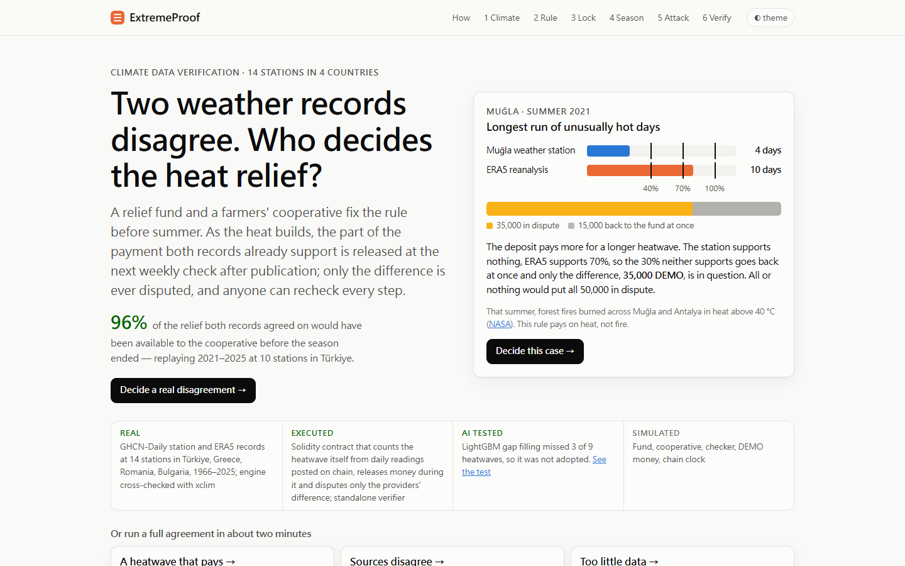
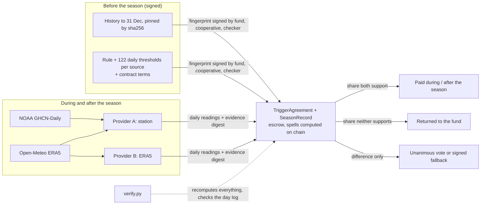

# ExtremeProof

**Heat relief agreed before the summer, paid by a rule both weather records can check, verifiable by anyone.**

IEEE ClimateChain Global Hackathon 2026 · Track 4: Climate Data & Environmental Monitoring

**Try it in the browser:** https://cs113062273-bot.github.io/IEEE-ClimateChain-Global-Hackathon/
(static edition, no install; for the live chain see [Run it locally](#run-it-locally))

**Watch the demo:** https://youtu.be/VtFjr0pjLpM



## The problem

Relief for climate extremes is increasingly promised in advance and paid when an index crosses a line. For heat, the index is a place's own climate statistics: days above the calendar-day 90th percentile of a 30-year normal (ETCCDI). Whether a summer counts depends on choices that move real money:

- **Which record.** Muğla, summer 2021: the weather station counted a 4-day hot spell, the ERA5 reanalysis 10 days. Under a 6-day rule one record pays, the other does not.
- **Which 30 years are "normal".** In Muğla the same ERA5 rule gives a different verdict in 10 summers since 1966 depending only on 1961–1990 versus 1991–2020.
- **How gaps are filled.** The Antalya station reported 31 of 122 days in summer 2024. Filled by linear correction the longest spell is 7 days; by quantile mapping, 13.
- **The climate is moving.** Against one fixed line, Muğla had a 6+ day hot spell in 9 of 30 summers in 1966–1995 and 19 of 30 in 1996–2025.

Today the paying side usually makes these choices and runs the calculation. The community the money is for cannot check it.

## What it does

A relief fund, a farmers' cooperative and an independent checker agree a heat rule before the season. Two data providers (station, ERA5) post daily readings. A contract computes the heatwave and moves the money.

1. **Climate.** For 14 stations (10 in Türkiye; Athens, Larissa, Bucharest, Sofia) see daily maximum temperature against two definitions of "unusually hot", and 60 summers of hot spells against one fixed line.
2. **Rule.** Choose how often the community should be paid (about 1 summer in 3, 5 or 10), all-or-nothing or graded (40 / 70 / 100 % at 6 / 9 / 12 days), and where unresolved disputes go. The finder compares complete rules on 1996–2025: payment frequency, payments that hinge on one day, money held in dispute, and drift between 1966–95 and 1996–2025. A decision brief shows what the rule would have done in each summer 2021–2025. The regional scan applies the same rule at all 14 stations.
3. **Lock.** The rule, the 122 daily thresholds per source and every contract term become one canonical JSON text and one sha256 fingerprint. The browser recomputes the fingerprint and the contract's terms are read back against it. The three parties sign it; the fund's signature escrows the deposit. The contract refuses to lock once the season has started. The cooperative gets a one-page member summary (EN/TR).
4. **Season.** Providers post the daily readings on chain. `SeasonRecord` compares each reading with the signed threshold and counts the spells itself. Weekly, the share both records already support is released. After the season, the share neither supports returns to the fund, and only the difference is disputed: a unanimous vote, or the signed fallback after 30 days.
5. **Attack.** Re-sign with another normal, lower the signed threshold by 2 °C, edit one temperature, flip a verdict, drop the evidence. The contract or the verifier rejects each one.
6. **Verify.** Download the bundle and run one standard-library Python file. It recomputes thresholds, gap filling, every season day and the settlement, and matches the contract's on-chain day log.

## Results

| | |
|---|---|
| Muğla 2021, graded rule | station 4 days, ERA5 10: 15,000 DEMO returned at once, 35,000 disputed (all-or-nothing: 50,000 disputed) |
| Antalya 2024 | 35,000 DEMO released on 15 June and 15,000 on 22 June, during the season instead of after 30 September |
| In-season release, 10 Turkish stations, 2021–2025 | in the 19 summers both records supported a payment, 96 % of that money released before the season ended, in 10 of them by end of July (5-day publication lag, weekly checks) |
| Regional scan, all-or-nothing rule | station and ERA5 give opposite answers in 46 of 358 decidable summers in Türkiye and 27 of 180 abroad; 4 of 10 Turkish stations (İzmir, Konya, Mersin, Adana) and Sofia hold under 60 % of 1991–2020, so a station-only scheme could not run there |
| AI gap filling | LightGBM had the lowest daily error (0.97 °C vs 1.07 °C) but missed 3 of 9 heatwaves; quantile mapping got 9 of 9, so the AI was **not adopted** ([ml/REPORT.md](extremeproof/ml/REPORT.md)) |
| Cost on chain | a disputed agreement: 10 transactions, about 1.7 million gas |
| Verifier, recorded bundles | 44/44, 42/42 and 39/39 checks passed offline |

Every data number is recomputed from pinned raw files ([FACTS.md](extremeproof/docs/FACTS.md), [experiments/](extremeproof/experiments)).

## Run it locally

The full version runs a local EVM chain, the contracts, two provider services, a hub and the web app on one machine. Needs **Python 3.11+** and **Node 24**. No accounts, keys or internet once set up; raw data are in the repository.

**1. One-time setup** (installs Python and npm packages, compiles the contracts, builds the web app; a few minutes):

```powershell
# Windows, from the repository root
powershell -ExecutionPolicy Bypass -File extremeproof\scripts\setup.ps1
```
```sh
# macOS / Linux
sh extremeproof/scripts/setup.sh
```

**2. Start everything:**

```powershell
extremeproof\.venv\Scripts\python -m extremeproof.scripts.stack      # Windows
```
```sh
extremeproof/.venv/bin/python -m extremeproof.scripts.stack          # macOS / Linux
```

Wait until the terminal prints `web    http://127.0.0.1:3000`, then open **http://127.0.0.1:3000**. Keep the terminal open; `Ctrl+C` stops everything. Ports used: 3000 (web), 8545 (chain), 8600 (hub), 8601–8602 (providers).

**3. Use it.** Click one of the three ready-made cases (*A heatwave that pays*, *Sources disagree*, *Too little data*). One click signs a real agreement on the local chain and plays the whole summer in under a minute: weekly releases, both providers' reports, one refused attack and the settlement. Then run the other attacks in step 5 and the verifier in step 6. Or design a rule in step 2 and sign it party by party in step 3.

The chain clock starts on 1 May 2021 (simulated) so summers 2021–2026 can be locked before they begin. A ready-made case rolls the local chain back by itself; **Reset demo chain** does it by hand.

**Check a bundle yourself** (standard-library Python 3.9+, works offline):

```sh
python verify.py sources-disagree.zip                      # 42/42 checks passed
python verify.py <bundle> --rpc http://127.0.0.1:8545      # also re-read the live chain
python verify.py <bundle> --refetch                        # compare with NOAA and Open-Meteo today
```

The bundles and `verify.py` are downloadable from step 6 of both editions, and in [extremeproof/web/public/recorded/](extremeproof/web/public/recorded). To check an included case directly from the repository root:

```sh
python extremeproof/verifier/verify.py extremeproof/web/public/recorded/sources-disagree.zip
```

The recorded Muğla case uses the `refund` fallback. The video selects `pay` before signing, so its disputed 35,000 DEMO goes to the cooperative instead. Both outcomes follow the rule chosen for that agreement.

**Static edition.** The online page runs steps 1–2 in the browser. Steps 3–6 replay three agreements recorded from the local stack, with their bundles. It is built by [.github/workflows/pages.yml](.github/workflows/pages.yml) (`EP_EDITION=static npx next build` in `extremeproof/web`).

## How it works



| Part | What it is |
|---|---|
| `climate/` | Standard-library Python engine: ETCCDI calendar-day percentiles (5-day window, Hyndman–Fan type 8), Zhang et al. (2005) bootstrap for in-base years, TX90p, WSDI, seasonal hot spells; gap filling fitted only on years before the season. Checked against xclim 0.58 during development. |
| `contracts/` | Solidity 0.8.28, Hardhat 3. `TriggerAgreement`: three-party lock, escrow, payout ladder, quorum, release, dispute, fallback. `SeasonRecord`: append-only daily readings, checked against the signed threshold fingerprint, spells and missing/filled counts computed on chain, every day folded into a keccak log. |
| `providers/` | One FastAPI process per data source with its own key. Refuses a spec whose hash or thresholds differ from what is on chain; posts newly published days weekly, the rest after the season with an evidence digest. Season fetch simulated from the pinned download by default; `EP_LIVE_FETCH=1` downloads it from NOAA and Open-Meteo. |
| `server/hub.py` | Stores specs and assembles public verification bundles. No authority over money. |
| `verifier/verify.py` | Independent re-implementation (percentiles, gap filling, spells, canonical hashing, Keccak) sharing no code with the engine. Checks every executed term against the signed text, every provider, every day against the on-chain log, and the settlement. |
| `ml/` | Frozen protocol and evaluation of LightGBM gap filling against three baselines, judged on trigger verdicts. |
| `web/` | Next.js 16, hand-built SVG charts; live edition (local chain) and static edition. |

### Why a blockchain

The verdict is public arithmetic; anyone with the rule and the data can recompute it. The chain adds what recomputation cannot:

- **One version of the rule, fixed before the season.** A signature shows who signed a text, not that no other text was signed. One ordered public record of the fingerprint, locked before the season, does.
- **The money is already there and moves by rule.** The deposit is escrowed at lock. The share both records support is released without anyone's approval; the fund cannot hold it back, the community cannot claim more.
- **The contract, not a provider, decides whether the heat counted.** Thresholds are fixed by the signed fingerprint, posted days cannot change, and the contract computes the spell. A provider vouches only for its readings, which anyone can compare with the publisher.

It does not make data true. A provider's post proves which bytes it used, not that the publisher served them; two sources and `--refetch` reduce that risk, they do not remove it. If every party already trusts one institution, a database and signatures are enough.

## Reproduce the numbers

From the repository root, with `extremeproof\.venv\Scripts\python` (Windows) or `extremeproof/.venv/bin/python`:

| Command | Writes |
|---|---|
| `python -m extremeproof.scripts.reproduce_facts` | every number in [FACTS.md](extremeproof/docs/FACTS.md) → `docs/facts.json` |
| `python -m extremeproof.scripts.rule_finder` | rule-finder outcomes and one-day hinge counts → `experiments/rule_finder.json` |
| `python -m extremeproof.scripts.compare_relief` | station-only / ERA5-only / two-source comparison → `experiments/decision_comparison.json` |
| `python -m extremeproof.scripts.inseason` | weekly in-season release, 14 stations, 2021–2025 → `experiments/inseason_release.json` |
| `python -m extremeproof.scripts.region_scan` | source verdicts at 14 stations → `experiments/region_scan.json` |
| `python -m extremeproof.ml.evaluate` | gap-filling evaluation → `ml/report.json` |
| `python -m extremeproof.scripts.demo_flow --site antalya --year 2024` | one full agreement on the local chain, without the browser |

## Data and licences

| Data | Source | Terms |
|---|---|---|
| GHCN-Daily, 14 stations | NOAA NCEI ([readme](https://www.ncei.noaa.gov/pub/data/ghcn/daily/readme.txt)) | No licence text; citation requested (Menne et al. 2012, doi:10.7289/V5D21VHZ) |
| ERA5 / ERA5-Land daily, 1950–2026-09 | [Open-Meteo historical API](https://open-meteo.com/en/docs/historical-weather-api) (Copernicus C3S / ECMWF) | CC BY 4.0 |
| Index definitions | [ETCCDI](https://etccdi.pacificclimate.org/list_27_indices.shtml) | Public definitions |

URL, retrieval time and sha256 of every file: [data/manifest.json](extremeproof/data/manifest.json). `scripts/fetch_data.py` re-downloads and re-pins them. Code: MIT ([LICENSE](LICENSE)).

## Limitations

- Adaptation, not mitigation: it does not reduce emissions. Pre-arranged relief, not insurance.
- Observed heat only, no forecast. Money follows the heat by about a week (assumed 5-day publication lag plus weekly checks).
- Parties, providers, DEMO money and the chain clock are simulated on one machine. No real users; not deployed to a public network.
- The demo's season fetch is cut from the same October 2026 download as the pinned history. Publisher revisions between signing and settlement are not modelled.
- The two providers are not fully independent: provider A fills station gaps with ERA5, provider B's source.
- Payment frequency is calibrated on 30 past summers with few events; the finder shows how many payments hinge on one day, it does not forecast.
- The 40 / 70 / 100 % ladder is an editable example, not calibrated to loss data.
- Daily maximum temperature only. Station records are not homogenised; ERA5 before the late 1970s rests on fewer observations.

## Repository map

```
extremeproof/
  climate/      engine.py, sources.py, fill.py, trigger.py, archive.py, specs.py
  contracts/    TriggerAgreement.sol, SeasonRecord.sol, DemoToken.sol, deploy scripts
  providers/    service.py      one process per data source
  server/       hub.py          spec registry and verification bundles
  verifier/     verify.py       standalone, standard library only
  ml/           protocol.json, evaluate.py, REPORT.md
  scripts/      setup, stack (start everything), reproduction scripts
  web/          Next.js app; public/recorded/ holds the recorded runs
  experiments/  outputs of the reproduction scripts
  data/         raw/ (pinned files), manifest.json, stations.json
  docs/         FACTS.md, facts.json, DEVPOST.md, assets/hero.png
```
