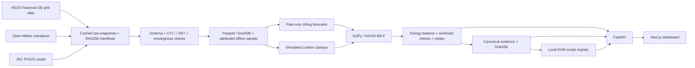

# GridProof architecture

The current main product is the service-readiness path (`services/readiness.py`): declared earliest departure → outcome-masked decision inputs → mandatory zero-PV guarded solve → fixed-action historical scoring → service plan. Event updates load that plan, freeze executed EV/battery actions and started batch jobs, then solve only remaining flexibility. Infeasible updates retain the previous plan and may return a separately solved later-deadline proposal. The operator must explicitly replan with that proposal.

`/api/service/plan`, `/api/service/update` and `/api/service/departure` drive the new `/` workspace. Its CSV, JSON and v2 evidence share the selected run identity. The independent standard-library verifier also checks event ordering, scenario changes, parent dispatch hashes, frozen prefixes and the zero-PV envelope. The original compare/replay research paths remain available and are distinct from the new decision-time-safe workflow. See [service engineering and results](READINESS_ENGINEERING.md).

The forecast is constructed before each decision cutoff; retrospective actual grid intensity is reserved for scoring and an explicitly labelled oracle ceiling. Weather reanalysis supports a simulated site outcome, never an issued weather forecast. Evidence embeds scenario, source digests, method and computed output so another process can reproduce the report.

The API serves local cached records; the dashboard makes no provider requests. Local-chain writes occur through an explicit attestation action. The registry enforces one active digest for the site/time/category scope, independent of scenario or model labels. A receipt proves a commitment was recorded, not that meters or physical emissions claims are true.

## Workplace car-park path (October 19, main page)

`backend/app/fleet`: `sessions.py` (raw 4TU sessions to UTC slots, splits, same-weekday GB grid mapping), `departure.py` and `model.py` (leakage-free driver features, calibrated LightGBM departure quantiles, cached in gitignored `data/processed/carpark`), `grid.py` (pinned NESO/ERA5 day, past-only seasonal forecast), `controller.py` (half-hourly online control, operator events, zero-solar cap, shortfall bound), `service.py` (API replay of held-out days), `evidence.py` (canonical record, forgeries). `scripts/verify_carpark.py` is the independent standard-library verifier. API: `/api/carpark/{config,day,results,evidence,verify,forge,attest}`. UI: `frontend/components/carpark.tsx`. Evaluation: `scripts/evaluate_carpark.py`, `sensitivity_carpark.py`, `report_carpark.py`, outputs in `experiments/carpark`. Details: [CARPARK.md](CARPARK.md).
