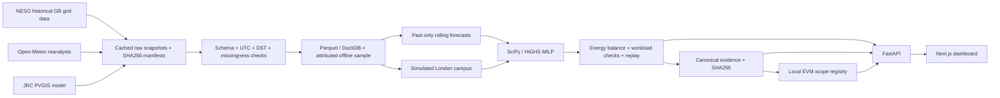

# GridProof architecture

The forecast is constructed before each decision cutoff; retrospective actual grid intensity is reserved for scoring and an explicitly labelled oracle ceiling. Weather reanalysis supports a simulated site outcome, never an issued weather forecast. Evidence embeds scenario, source digests, method and computed output so another process can reproduce the report.

The API serves local cached records; the dashboard makes no provider requests. Local-chain writes occur through an explicit attestation action. The registry enforces one active digest for the site/time/category scope, independent of scenario or model labels. A receipt proves a commitment was recorded, not that meters or physical emissions claims are true.
