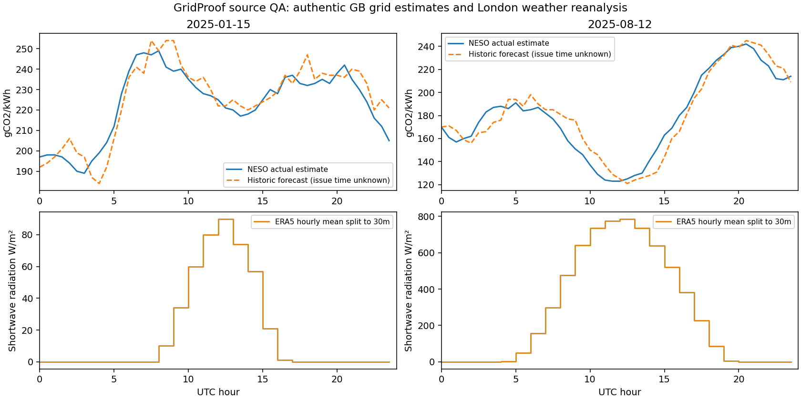

# Data catalog

Local audit checked **2026-10-13T05:23:25Z**. Client planning date: **2026-10-13**, Asia/Taipei. Timestamps below are actual UTC acquisition times; the YTD query stops at the last completed half-hour at retrieval.

Supported by National Energy SO Open Data. Weather data by Open-Meteo.com, using ERA5 / Copernicus Climate Change Service and ECMWF. Solar potential by European Commission Joint Research Centre / PVGIS / CM SAF SARAH3. These providers do not endorse GridProof.

| Source / status | Real records | Raw bytes | UTC coverage `[start,end)` | Missing primary values |
|---|---:|---:|---|---:|
| `neso-national-ci-2025` / verified | 17520 | 1657882 | 2025-01-01T00:00:00Z → 2026-01-01T00:00:00Z | 43 |
| `neso-national-ci-2026` / verified | 13690 | 1291221 | 2026-01-01T00:00:00Z → 2026-10-13T05:00:00Z | 1 |
| `neso-demand-2025` / verified | 17520 | 1869771 | 2025-01-01T00:00:00Z → 2026-01-01T00:00:00Z | 0 |
| `openmeteo-london-weather-2025` / verified | 8784 | 318992 | 2025-01-01T00:00:00Z → 2026-01-02T00:00:00Z | 0 |
| `pvgis-london-pv-model-2023` / verified | 8760 | 824475 | 2023-01-01T00:10:00Z → 2024-01-01T00:10:00Z | 0 |
| `ukpn-feeder-sample` / restricted | not downloaded | — | unavailable → unavailable | — |

The full 2025 CI index has **17,520 half-hours** with no gaps, duplicate timestamps or invalid durations. **43 actual and 43 forecast values are missing (0.2454%)**; they remain null. This is complete temporal coverage, not a claim of complete values. Demand has 17,520 rows, no missing fields used, and DST days **2025-03-30 = 46 periods**, **2025-10-26 = 50 periods**. Weather has 8,760 hours for 2025 plus 24 padding hours on January 1, 2026 for correct radiation/end-of-year interpolation; no missing requested weather values.

## Download and licensing evidence

| Source | Official documentation and licence | Meaning / access |
|---|---|---|
| National CI | [NESO dataset](https://www.neso.energy/data-portal/national-carbon-intensity-forecast), [NESO Open Data Licence](https://www.neso.energy/data-portal/neso-open-licence), [Carbon API terms](https://github.com/carbon-intensity/terms/) | The portal declares NESO Open Data Licence; the separate Carbon Intensity API states CC BY 4.0 and service terms. Actual estimates derive from metered generation; historical forecasts lack issuance timestamps. Bounded year SQL queries avoid the full archive. |
| National demand | [NESO dataset](https://www.neso.energy/data-portal/historic-demand-data), [licence](https://www.neso.energy/data-portal/neso-open-licence) | ND is national demand in MW; embedded wind and solar are context, not total system generation. Published 21 days in arrears, subject to corrections and stated quality issues. No future observed demand as scheduling input. |
| London weather | [Historical API](https://open-meteo.com/en/docs/historical-weather-api), [terms](https://open-meteo.com/en/terms) | Explicit ERA5 reanalysis, not an issued forecast or site weather meter. CC BY 4.0 data; free API access is noncommercial only, under 600/min, 5,000/hour and 10,000/day. One cached request. Commercial adoption requires compatible API access terms. |
| PVGIS | [API](https://joint-research-centre.ec.europa.eu/photovoltaic-geographical-information-system-pvgis/using-pvgis-5/api-non-interactive-service_en), [manual](https://joint-research-centre.ec.europa.eu/photovoltaic-geographical-information-system-pvgis/using-pvgis-5/pvgis-5-user-manual_en), [EC reuse policy](https://commission.europa.eu/legal-notice_en) | v5.3 SARAH3 documented coverage 2005–2023. Downloaded supported 2023; 2025 is not available in that documented database. Results freely usable per manual; EC-owned content uses CC BY 4.0 unless indicated, with third-party rights caveat. 30 calls/second service limit. |
| Optional UKPN | [Dataset](https://ukpowernetworks.opendatasoft.com/explore/dataset/ukpn-smart-meter-consumption-lv-feeder/?tab=metas) | Public metadata retrieved; consumption records explicitly returned HTTP 403 ForbiddenAccess. No account created, no bypass, no consumption data used. A deterministic simulated campus remains the facility model. |

The direct documentation cache recorded HTTP 403 for Devpost and NESO HTML pages; those official pages were successfully revalidated with the browser tool. Exact direct-request failure bodies are in `data/raw/discovery/*.error.json`, summarized in `data/manifests/discovery.json`. Public NESO data API downloads succeeded independently. Browser competition verification is recorded in `data/manifests/rules_verification.json`.

## Transformations and units

All joins use UTC half-hour `[start_utc,end_utc)` intervals. CI `datetime` is interval start, independently crosschecked against the Carbon Intensity API sample at January 1, 2025. Demand settlement dates use `Europe/London` midnight converted to UTC, then period offsets in absolute time. This handles 46/48/50-period days without repeated-time ambiguity.

Open-Meteo shortwave radiation at timestamp `h+1` is the mean for the preceding hour `[h,h+1)`. The same mean is assigned to its two half-hours, preserving radiation energy rather than inventing new precision. Temperature, cloud cover and wind are instantaneous hourly samples and are linearly interpolated to half-hour interval starts. These retrospective values may score realized modeled PV; they cannot be used as weather forecasts that existed at historical decision time.

CI: gCO2/kWh; national/embedded generation context: MW; shortwave radiation: W/m²; temperature: °C; cloud cover: %; wind: km/h. Site energy, battery and flexible jobs belong to the explicitly simulated scenario, not these observations. Tariff cost is illustrative until licensed actual pricing is supplied.

PVGIS parameters: London 51.5074, -0.1278; hypothetical 20 kWp; crystalline silicon; 14% system losses; tilt 35°; south aspect 0°. The actual fetched 2023 model integrates to **20,140.0634 kWh**. The monthly curve is a seasonal sanity check, not contemporaneous 2025 production or an empirical validation of a hypothetical campus.

## Files, offline sample and integrity

`data/processed/neso_ci_2025.csv`, `neso_ci_2026.csv`, `neso_demand_2025.csv`, `weather_2025.csv`, and `intervals_2025.csv` are normalized CSVs. Bulk raw and processed files are intentionally gitignored. A fresh clone uses the legal, attributed offline sample or fetches the full datasets.

`data/sample/intervals.json` holds 96 records for **2025-01-15** and **2025-08-12**, plus 672 real prior-week records for past-only offline forecasts. It carries licences, attribution, source URLs, original raw and processed digests, transformation descriptions and limitations. All 96 displayed actual CI values are present. `data/sample/pvgis_seasonal.json` holds a derived 12-month model summary. Source hashes prove the committed subset's lineage claims can be checked against downloaded provider responses; hashes alone do not authenticate measurements.

| Asset | SHA256 |
|---|---|
| `data/raw/neso_ci_2025.json` | `0c07bc094561e19c61826b693395b92e8334a34b613e5525ca016ae6c91fc815` |
| `data/raw/neso_ci_2026.json` | `5312d125ee06556a7431f0e979fd0e6e504a147b2ea6058f5938b574875f13df` |
| `data/raw/neso_demand_2025.csv` | `8b8be946bbb084bc28fbf95a71fad0fceb5543b98e02755235130a42beaee4e0` |
| `data/raw/openmeteo_london_2025.json` | `6098ffc0ecac7610670f34efcd4322717b04a9fdaba5a666ed265ce066506edd` |
| `data/raw/pvgis_london_2023.json` | `e91e05bf4ae36d1bc7f68aa207591b4cfabe346fdf609b23c5066ce626cd8c65` |
| `data/processed/intervals_2025.csv` | `8b7e5c77838fc56066278ed272db0434a525c46410a6f89daa62e1e3fb6c036d` |
| `data/sample/intervals.json` | `134251a6f846bd492b2208041cd6615ad892678dc8e94b4be9a6fa5cc8e3d8d5` |

Measured disk use at documentation generation: raw/cache **6,950,341 bytes**, normalized CSV/Parquet/DuckDB storage **17,594,930 bytes**. Acquisition/normalization use ordinary lists (~17,520 records) rather than loading a multi-gigabyte household corpus; allow roughly 250 MB RAM including Python and JSON overhead. No measured peak-RAM claim is made.

`profile_sources.py` additionally writes five typed UTC tables into `data/processed/gridproof.duckdb` and ZSTD `.parquet` versions of each normalized CSV. Their schema, count, byte size and hashes appear in the columnar-storage manifest. UTC endpoints use `TIMESTAMPTZ`; missing values remain null. See [DuckDB CSV](https://duckdb.org/docs/current/data/csv/overview), [Parquet](https://duckdb.org/docs/current/data/parquet/overview) and [timestamp documentation](https://duckdb.org/docs/current/sql/data_types/timestamp).

## Reproduce

Python 3.11+ and `tzdata` are needed on Windows. The download pipeline otherwise uses the standard library. Columnar storage uses DuckDB and diagnostic plotting uses matplotlib, installed by the backend requirements. Activate the project virtual environment before running these commands.

```powershell
. .\.venv\Scripts\Activate.ps1
python scripts/discover_sources.py
python scripts/fetch_neso.py --year 2025
python scripts/fetch_neso.py --year 2026 --ci-only --through 2026-10-13
python scripts/fetch_openmeteo.py
python scripts/fetch_pvgis.py --year 2023
python scripts/fetch_ukpn_sample.py
python scripts/build_snapshot.py
python scripts/profile_sources.py
python scripts/validate_sources.py --require-bulk --write-manifest
python -m unittest discover -s scripts/tests -v
python scripts/write_data_docs.py
```

The same Python commands work on Unix after `source .venv/bin/activate`. Successful snapshots are cached with SHA256 checks; use `--refresh` to check again (ETags used when supplied). Requests have timeouts, bounded retry/backoff for transient/rate-limit errors, 250ms throttling, and retained failure evidence. Verification is read-only by default: `validate_sources.py` checks shareable samples and marks unavailable bulk assets; `--require-bulk` fails if they are missing. Only explicit `--write-manifest` rebuilds source provenance after acquisition, so routine checks cannot mutate an attested manifest. No failure turns into fabricated successful acquisition.



## Primary scientific limits

The grid intensity is national average location-based emissions exposure, not marginal causal abatement. Weather is historical reanalysis. PVGIS is a modeled 2023 potential. Campus loads, battery, EV and tariffs are assumptions. Published forecast issuance metadata is unverified. Independent replay and hashes support report integrity, not physical meter truth, avoided emissions certification or transferable carbon credits.
