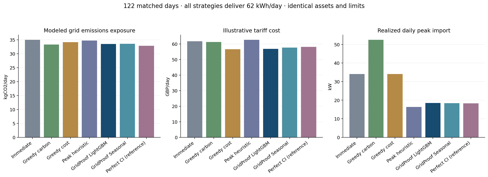

# GridProof 模型與排程演算法競爭力審查

2026-10-13 完成。**GridProof 已有強競爭作品的系統與多目標排程證據，但仍不能宣稱頂尖 AI 減碳演算法或冠軍實力已獲證明。** LightGBM 相對 Seasonal 的額外碳排收益未被統計區分；示範費率成本有較明確的收益。主要技術優勢是碳排、成本、尖峰之間的折衷，主要實用性缺口是未預告的車輛提早離開。

審查依據是當日重新讀取的 [IEEE ClimateChain 官方評分標準](https://ieee-climatechain-hack.devpost.com/)，尤其 Climate Impact、Innovation & Creativity、Technical Execution、Practical Usefulness。以下是工程證據與我們的判斷，並非官方分數或名次預測。官方公開頁面未給各項數值權重或模型門檻。本輪沒有修改 UI、部署或提交內容。

**比較條件與保存邊界**

測試期間仍是 2025-09-01 至 2025-12-31 全部 122 個 UTC 日。使用既有獨立釘選的完整 NESO CI 與 ERA5 快照，SHA256 都與信任清單相符。未重新下載、插補或篩選有利日期。原本 competition_v2、24 天結果、模型樹、訓練與驗證切分完全保留。

LightGBM 訓練期 Jan 8–Jun 30，驗證期 Jul 1–Aug 31，選擇從 Sep 1 才可用。每次午夜 issue 僅提供 issue 之前的 actual CI 及曆法特徵。Seasonal 使用前七天同時段中位數。正式可部署策略不能讀取當日 actual CI 或天氣；它們只在決策固定後進入評分。Oracle 明確允許當日真實 CI，僅作資訊參考。

所有名目策略共用 20 kWp PV、40 kWh 電池、相同效率與初末 SoC、60 kW 電網上限、22 kW 共享充電站、兩個 EV 工作與連續批次。每天需求是 EV 42 kWh + 批次 20 kWh = **62 kWh**。三個 heuristic 都可使用同一顆電池，沒有把智慧對手限定為無電池。Immediate 按既有定義立即工作、電池閒置，因此它的比較包含工作移動與電池調度的共同價值，不能全部歸功於 AI。

新 heuristic 重用既有 dispatch/replay/constraint checker，沒有新增測試服務或模擬框架：批次依截止時間找連續合法窗口；EV 依截止時間優先，Carbon/Cost 依預測 CI/費率挑時段，Peak 以 0.1 kWh 逐步填低負載時段。電池採貪婪充放配對，計入雙向效率、逐時 SoC、功率、互斥模式、期末還原與非出口限制。Peak 不以碳、費率或太陽能預測做決策。Heuristic 的電網容量使用零 PV 保守防護；它們不是保證最優的演算法，失敗會保留，不能視為所有智慧排程方法的代表。

這是看過前輪測試結果後的探索性審查，不能稱為新的預先註冊驗證。沒有依本輪測試結果重訓模型、挑最佳權重或替換展示預設。

**逐策略結果：同一 122 天，全部完整交付**

| 策略 | kgCO2/day | 示範 GBP/day | 平均每日尖峰 kW | 相對 Immediate 的全期碳排改善 | 碳排比 Immediate 差的天數 | 有效／嘗試 |
|---|---:|---:|---:|---:|---:|---:|
| Immediate | 34.945 | 61.703 | 34.053 | 0.000% | 0 | 122/122 |
| Greedy Lowest Carbon | 33.265 | 61.301 | 52.465 | 4.808% | 21 | 122/122 |
| Greedy Lowest Cost | 34.142 | 56.656 | 34.053 | 2.297% | 19 | 122/122 |
| Peak-Shaving Heuristic | 34.689 | 62.599 | 16.312 | 0.733% | 60 | 122/122 |
| GridProof：LightGBM + peak-aware solver | 33.491 | 56.785 | 18.517 | 4.162% | 4 | 122/122 |
| Seasonal + 相同 solver | 33.569 | 57.658 | 18.370 | 3.939% | 6 | 122/122 |
| Oracle 真實 CI + 相同 solver | 32.802 | 58.098 | 18.304 | 6.133% | 1 | 122/122 |

LightGBM／Seasonal／Oracle 的 solver、權重 0.7、peak weight 0.2、限制與交付量完全相同。Oracle 仍用曆法 PV，且目標同時考慮成本與尖峰；它不是實際碳排的嚴格全域下界，也不保證每一天在每個指標都比預測策略好。

所有名目策略的實際交付量直接從 dispatch 加總，範圍 61.999999999999 至 62.000000000000 kWh/day；截止時間、電網／設備容量與所有返回排程限制違規都是零。既有 `workload_kwh` 記的是需求量，不能單靠該欄位证明交付；新 CSV 分別保存 required、delivered、unserved。



**回答 1：LightGBM 是否真的提升最終效果？**

LightGBM 相對 Seasonal 平均少 0.077918 kgCO2/day。相對 Immediate 的平均每日碳排改善多 **0.181878 個百分點**，七天 circular block bootstrap 95% CI **[-0.204887, +0.552326] pp**，跨零。LightGBM 的碳排只在 56/122 天低於 Seasonal，66/122 天較高。不能宣稱它帶來穩定、已區分的額外減碳。

成本結果較有說服力：同 solver 下，LightGBM 平均少 **£0.872901/day**，配對七天區塊 95% CI **[-£1.419586, -£0.379370]**；成本更低 65 天、更高 10 天，其餘相同。尖峰差 +0.146826 kW，CI [-0.376079, +0.655733]，未區分。可說它在此模擬費率情境有成本價值，不能延伸為所有場域或減碳領先。

CI 使用 2,000 次、seed 42 的七天 circular block 重抽樣。這輪直接抽區塊；前輪在同一 RNG 先抽 IID 樣本後才抽區塊，因此兩輪區間端點略不同，但平均增益完全重現。區間只條件於這段資料與模擬場景；多項比較屬探索性，沒有多重比較校正。

**回答 2：相較合理智慧策略，可靠優勢是什麼？**

下表差異是 GridProof minus 對手；負數表示 GridProof 較低。括號是配對七天區塊 95% CI。

| 對手 | 碳排差 kg/day | 成本差 GBP/day | 尖峰差 kW |
|---|---|---|---|
| Greedy Carbon | +0.226 [-0.238, +0.684] | -4.516 [-4.816, -4.227] | -33.948 [-34.507, -33.318] |
| Greedy Cost | -0.652 [-0.853, -0.464] | +0.129 [+0.050, +0.223] | -15.536 [-16.024, -15.050] |
| Peak Heuristic | -1.198 [-1.609, -0.833] | -5.814 [-5.891, -5.719] | +2.205 [+1.927, +2.461] |

最可靠的優勢是多目標折衷：相對最低成本貪婪法，多付約 £0.13/day，換取較低碳排與大幅較低尖峰；相對削峰 heuristic，接受約 2.20 kW 較高尖峰，換取較低碳排與成本；相對碳優先貪婪法，成本和尖峰大幅較低。這些對手目標不同，不能把表格解讀為同一目標下的演算法最優性證明。

GridProof 距 matched perfect-CI 比較平均仍差 0.688985 kgCO2/day，全期碳排改善相差 1.971635 pp，但成本反而更低。預測仍有改善空間，多目標取捨也不能被忽略。

**回答 3：什麼情境會輸給簡單方法？**

Greedy Carbon 在 **75/122 天**碳排較低，且全期碳排平均較低；Greedy Cost 平均費率成本更低；Peak Heuristic 的平均尖峰更低。GridProof 不是三項指標的共同冠軍。

名目情境有四個相對 Immediate 的碳排失敗日，需求均完整交付：

| UTC 日期 | 當日碳排改善 |
|---|---:|
| 2025-09-06 | -4.535941% |
| 2025-09-15 | -0.475058% |
| 2025-10-04 | -0.446516% |
| 2025-10-13 | -0.031237% |

壓力測試的變換固定、對所有策略一致；不會用變造後資料回報原名目 benchmark 的進步：

| 情境 | 明確變換 | GridProof 有效日／122 | 相對匹配 Immediate 全期碳排改善 | 未完整交付日 |
|---|---|---:|---:|---:|
| 低太陽能 | 決策 PV、實際 PV 都縮至 20% | 122 | 3.907% | 0 |
| 突然高碳強度 | 14–18 UTC 實際 CI +200 g/kWh，預測不變；僅 Oracle 看得到 | 122 | 5.200% | 0 |
| 需求尖峰 | 固定负载與 EV 所需能源各加倍，批次不變；每天需求 104 kWh | 122 | 1.754% | 0 |
| 提早離開、事先知道 | 每台 EV 窗口縮至 arrival +6 slots | 122 | 3.396% | 0 |
| 充電窗口縮短 | 每台 EV arrival 改為 deadline -5 slots | 122 | 3.622% | 0 |
| 未預告的提早離開 | 排程仍收到原窗口；實際 departure 改為 arrival +6 slots | **0** | **沒有合法節省比較** | **122** |
| 不可能完成的窗口 | 每台 EV deadline = arrival +4 slots；fleet-a 需求 24 kWh >22 kWh 上限 | **0** | **明確拒絕，沒有節省比較** | **122** |

在前五個可行壓力情境中，所有七種策略都有 122/122 個有效返回排程，沒有未交付能源或容量／截止違規。突然高 CI 的這個指定時段反而擴大了相對 Immediate 的減碳收益，因此它沒有證明對所有突發碳排都穩健；前輪的 forecast noise 與 timing inversion 仍保留，分別有 20/122 與 24/122 個碳排變差日。

未預告離開是實際弱點：GridProof 全 122 天都無法交足需求，平均未交付 **27.532889 kWh/day**，其中 20 kWh 批次仍執行，缺口來自 EV。Immediate 與 Greedy Cost 都交付完整 62 kWh/day。2025-09-01 例子：GridProof 只交付 32.666667 kWh，少 29.333333 kWh；Immediate 完整交付。對這些不合法排程保留原始支出／碳排以供診斷，但不納入合法比較或節省主張。

突發離開的重播只停止車輛離開後的 EV 充電，電池／批次決策不回看未來重算。這不是一個有即時重排功能的控制器測試，也不能推論所有未知離開时间都能被保證。資料完整的兩小時不可能窗口下，全部策略拒絕或無完整方案；沒有返回方案的能源欄位表示沒有交付，不表示其最大物理可交付量為零。

**回答 4–5：原本數字公平嗎？有沒有洩漏、錯誤或過度主張？**

原本 **-4.162% 碳排、-45.624% 尖峰、-7.970% 成本**在既有名目場景下是公平的同工作量比較，已從新 dispatch sums 重算。488 個 LightGBM／Seasonal／Oracle／Immediate policy-day 與舊資料的碳排、成本、尖峰最大絕對差都是 7.1e-15。它們代表相對 Immediate 的系统收益，不能代表 AI 的單獨貢獻，不能代表勝過每一種智慧排程。

碳排使用 `sum(import_kWh * actual_gCO2/kWh)/1000`；費率使用 `sum(import_kWh * GBP/kWh)`；功率使用 `max(interval_kWh)/0.5h`。沒有發現單位錯誤或名目隱藏的未交付量。電池期末回到相同 SoC，避免借用期末能源美化表現。碳排百分比是全期總量之比，尖峰百分比是平均每日尖峰之比，不能混成平均每日百分比。

沒有發現本輪正式策略將當日 actual CI 或觀測天氣放入決策的直接 future leakage。但有兩個必須公開的限制：歷史 actual CI 在午夜已可用仍是假設，沒有 publication latency／修訂時間檔案；從未來 PV 重播中發現方案不合法後才選 Immediate fallback，屬事後安全備援，不能當作已實作的現場即時 recourse。新增容量防護降低了指定情境下對這種事後備援的依賴。

排放量是 GB 國家平均、location-based 用電碳排暴露量；實際場域、負載、充電需求、費率與電池都是模擬，PV 由簡化模型和 ERA5 重分析產生。沒有測得的場域減排、邊際因果 avoided emissions、驗證碳權或商業帳單證據。四個月、單一場域、每日 SoC 重設限制泛化；hash／區塊鏈不能證明來源物理真實。

**有證據支持的修正與前後數據**

本輪只增加可選的 `solve(..., robust_import_cap=True)`，以及遭拒候選的 constraint、metric、MIP gap 與超限幅度診斷。原本 default=False、最佳 peak-aware 展示設定和模型完全保留。防護增加 `fixed + EV + batch + charge - discharge <= 60 kW * 0.5h`；沒有放寬電網上限、工作窗口、需求或 SoC，沒有改評分公式。

比較対象是原 hybrid（carbon weight 0.7、peak weight 0），精確重做原本三个失敗情境。**195 個被拒候選都因 Grid cap，461 個超限 interval，最大超出 9.328 kW**，現在逐次保留了證據。新增保守限制後，這三種情境的候選拒絕與 fallback 都降到零，工作量仍全部 62 kWh/day：

| 情境 | fallback：前→後 | kgCO2/day：前→後 | GBP/day：前→後 | 平均尖峰 kW：前→後 |
|---|---|---|---|---|
| 電池充放功率 20 kW | 56/122 → 0/122 | 33.931 → 32.852 | 59.574 → 58.454 | 41.511 → 51.280 |
| 固定負載 1.5 倍 | 44/122 → 0/122 | 48.201 → 47.668 | 86.739 → 85.678 | 48.787 → 53.464 |
| 固定負載 2 倍 | 95/122 → 0/122 | 64.299 → 62.459 | 115.053 → 112.846 | 48.423 → 55.285 |
| 原 hybrid 名目場景 | 0/122 → 0/122 | 32.884307 → 32.884159 | 58.420252 → 58.421053 | 48.227493 → 48.223952 |

三種壓力情境的碳排／成本差配對七天區塊 CI 都低於零。但**尖峰升高**，因為之前很多天是低尖峰的 Immediate 備援，現在保留可行的 hybrid 最佳化排程。因此這是安全可行性、碳排與成本的改善，不能說它改善所有目標，也不能把它取代現有 peak-aware 主策略。名目場景的極小差異來自等價／近等價 MILP 解與求解路徑；區間跨零，沒有可主張的名目效能提升。

**回答 6：最多三項值得做的改進**

1. **把電網容量防護和候選診斷納入需要抗 PV 誤差的運行路徑。** 本輪已有實測修正與前後數據。保留 carbon/peak/cost 取捨，預設最佳版沒有自動改成這個原 hybrid 實驗版。這直接補 Technical Execution 與 Practical Usefulness。
2. **為 EV 加入較早離開的服務底線與事件觸發重排。** 現在已知 departure 才有能量保證；先定義最早可接受離開時間與當時最低交付量，再檢查是否物理可行。提前通知時更新剩餘需求／窗口，突然離開時誠實回報缺口。單靠車輛已離開後重排無法補充電量。122/122 的突發缺口是這項工作的直接證據。
3. **以驗證集的下游排程表現選模型，而不只選 MAE。** 保留 LightGBM、Seasonal、latest 的相同 solver ablation，評估實際碳排、成本、尖峰與交付風險；候選校正／組合或排序損失先在訓練與驗證期決定，再用未使用的新時期檢驗。現有 test 不重新調參當作獨立證據。這是待驗證的改進方向，沒有假造前後收益，也沒有為名稱複雜而換模型。

**依評分標準的裁決**

| 面向 | 本輪判斷 | 尚缺什麼 |
|---|---|---|
| Climate Impact | 有可信的同需求減碳暴露量收益，且相對 Greedy Cost／Peak Heuristic 有碳排優勢 | 真實場域、多場域或邊際因果證據；AI 單獨減碳增益仍未區分 |
| Innovation & Creativity | 預測、物理排程、可查驗來源與证据的整合有價值 | 不宜聲稱 LightGBM 或 MILP 方法本身新穎／SOTA |
| Technical Execution | 強：完整交付審查、智慧對手、失敗保存、容量防護的明確修正 | 预测與決策效益的更多獨立驗證；不應把事後 fallback 當現場控制 |
| Practical Usefulness | 名目與五種可行壓力情境強；突發離開風險大 | 最早離開服務底線、即時需求更新、連續多日與實際設備驗證 |

可以有說服力地定位為**可靠、多目標、可查驗的氣候排程系統原型**。目前證據不足以定位為已證明的頂尖 AI 減碳排程器；也無法由單作品數值判斷會勝過未知參賽作品。

**產物與重現**

- [全部 6,832 策略／情境日資料](../experiments/competitiveness_audit/daily_results.csv)、[逐策略情境摘要](../experiments/competitiveness_audit/strategy_case_summary.csv)
- [配對智慧 baseline 差異與區間](../experiments/competitiveness_audit/smart_baseline_comparisons.csv)、[完整摘要](../experiments/competitiveness_audit/summary.json)
- [976 個容量防護前後資料](../experiments/competitiveness_audit/guard_before_after.csv)、[配對差異](../experiments/competitiveness_audit/guard_paired_differences.csv)、[195 個被拒候選](../experiments/competitiveness_audit/rejected_candidates.json)
- [所有失敗列](../experiments/competitiveness_audit/failures.csv)、[具體失敗排程](../experiments/competitiveness_audit/failure_dispatches.json)
- [原版數值對照](../experiments/competitiveness_audit/legacy_compatibility.csv)、[來源／代碼／模型配置](../experiments/competitiveness_audit/config.json)、[重算審查](../experiments/competitiveness_audit/report_audit.json)

執行環境為 Python 3.11.14、SciPy 1.16.3、NumPy 2.2.6、Pandas 2.3.3，核心依賴與專案釘選相同。正式完整執行 244.154 秒；不是吞吐量或部署測量。57 個相關 engine／peak／audit regression tests 通過，另有一個現有 Starlette/AnyIO deprecation warning。未為本輪重跑前端、區塊鏈或部署測試。

```powershell
.venv/Scripts/python.exe scripts/audit_scheduler_competitiveness.py
.venv/Scripts/python.exe scripts/report_scheduler_competitiveness.py
.venv/Scripts/python.exe -m pytest backend/tests/test_competitiveness.py backend/tests/test_peak.py backend/tests/test_engine.py -q
```

前兩個命令只覆寫新的 competitiveness_audit；保留 competition_v2。`--days`／`--out` 支援隔離的開發檢查，最終 reporter 會拒絕不足 122 天的結果。圖表為可匯出的 PNG／SVG，已視覺檢查。
