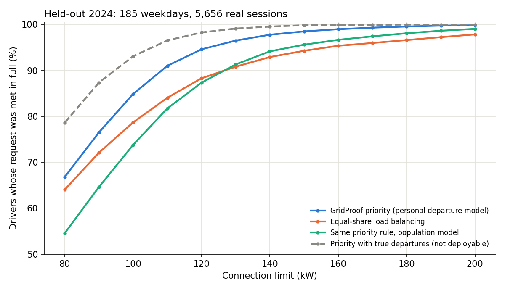

# Car-park departure-risk evaluation (derived)

Protocol: [protocol.json](protocol.json). Selection on 127 days of 2023 H2 (2023-07-03 to 2023-12-29); test on 185 weekday site days of 2024 with 5,656 real sessions, run once with the frozen selection. Session behaviour is real (Utrecht office car park, rails E+M); the grid day is the same-weekday 2025 GB day; building load and tariff are synthetic; chargers are simulated.

Selected service policy: **EDF with the personal LightGBM departure model, ready-by target at the 20% departure quantile**. Selected carbon-flex LP: risk penalty 3.0, hard promise None.

## Connection needed for a service level

| Policy | >=95% requests met in full | >=98% | >=99% |
|---|---:|---:|---:|
| Carbon-flex LP with true departures (not deployable) | 150 | >200 / n.a. | >200 / n.a. |
| Equal-share load balancing | 160 | >200 / n.a. | >200 / n.a. |
| GridProof carbon-flex LP | >200 / n.a. | >200 / n.a. | >200 / n.a. |
| GridProof priority (personal departure model) | 130 | 150 | 170 |
| Priority with true departures (not deployable) | 110 | 120 | 130 |
| Same priority rule, population model | 150 | 180 | 200 |
| Uncontrolled, ignores the cap (reference) | 80 | 80 | 80 |

LP policies were run only at 100, 120 and 150 kW; their 'n.a.' entries mean not reached at those caps. Uncontrolled charging always serves everyone because it ignores the limit.

## 100 kW connection

| Policy | Requests met in full | Energy short | kgCO2/day | g/kWh delivered (site) | GBP/day | Mean peak kW | Slots over cap |
|---|---:|---:|---:|---:|---:|---:|---:|
| Equal-share load balancing | 78.70% | 10.05% | 103.08 | 169.3 | 170.36 | 94.7 | 0 |
| GridProof priority (personal departure model) | 84.88% | 7.06% | 105.73 | 168.0 | 175.43 | 94.7 | 0 |
| Same priority rule, population model | 73.80% | 10.29% | 103.01 | 169.6 | 169.98 | 94.7 | 0 |
| GridProof carbon-flex LP | 78.77% | 8.11% | 104.21 | 167.5 | 175.80 | 93.5 | 0 |
| Priority with true departures (not deployable) | 93.10% | 3.87% | 108.55 | 166.8 | 181.08 | 94.7 | 0 |
| Carbon-flex LP with true departures (not deployable) | 67.47% | 10.72% | 99.41 | 164.5 | 177.94 | 81.7 | 0 |
| Uncontrolled, ignores the cap (reference) | 100.00% | 0.00% | 115.15 | 170.1 | 184.67 | 179.8 | 1114 |

## 120 kW connection

| Policy | Requests met in full | Energy short | kgCO2/day | g/kWh delivered (site) | GBP/day | Mean peak kW | Slots over cap |
|---|---:|---:|---:|---:|---:|---:|---:|
| Equal-share load balancing | 88.30% | 4.77% | 108.10 | 167.7 | 177.80 | 111.4 | 0 |
| GridProof priority (personal departure model) | 94.61% | 2.56% | 110.08 | 166.9 | 181.42 | 111.4 | 0 |
| Same priority rule, population model | 87.34% | 5.21% | 107.88 | 168.1 | 177.11 | 111.4 | 0 |
| GridProof carbon-flex LP | 89.09% | 3.45% | 108.36 | 165.8 | 182.19 | 109.8 | 0 |
| Priority with true departures (not deployable) | 98.29% | 0.79% | 111.53 | 166.1 | 184.42 | 111.4 | 0 |
| Carbon-flex LP with true departures (not deployable) | 87.04% | 3.61% | 105.00 | 160.9 | 188.63 | 89.6 | 0 |
| Uncontrolled, ignores the cap (reference) | 100.00% | 0.00% | 115.15 | 170.1 | 184.67 | 179.8 | 874 |

## 150 kW connection

| Policy | Requests met in full | Energy short | kgCO2/day | g/kWh delivered (site) | GBP/day | Mean peak kW | Slots over cap |
|---|---:|---:|---:|---:|---:|---:|---:|
| Equal-share load balancing | 94.29% | 1.65% | 111.87 | 168.0 | 182.25 | 133.8 | 0 |
| GridProof priority (personal departure model) | 98.51% | 0.57% | 112.80 | 167.6 | 183.96 | 133.8 | 0 |
| Same priority rule, population model | 95.62% | 2.07% | 111.71 | 168.5 | 181.61 | 133.8 | 0 |
| GridProof carbon-flex LP | 94.22% | 1.58% | 110.65 | 166.1 | 184.83 | 132.0 | 0 |
| Priority with true departures (not deployable) | 99.86% | 0.05% | 113.19 | 167.3 | 184.80 | 133.8 | 0 |
| Carbon-flex LP with true departures (not deployable) | 97.54% | 0.59% | 106.86 | 158.8 | 192.78 | 94.2 | 0 |
| Uncontrolled, ignores the cap (reference) | 100.00% | 0.00% | 115.15 | 170.1 | 184.67 | 179.8 | 587 |

## Paired day-level differences (A minus B)

Moving-block bootstrap, blocks of 5 site days, 2,000 resamples. Exploratory; no multiple-comparison correction.

| Cap | A | B | Metric | Mean/day | 95% CI | Days A better | Days A worse |
|---:|---|---|---|---:|---|---:|---:|
| 100 | gridproof_priority | equal_share | served | +1.892 | [+1.492, +2.259] | 123 | 15 |
| 100 | gridproof_priority | equal_share | unserved_kwh | -20.225 | [-23.866, -16.199] | 135 | 16 |
| 100 | gridproof_priority | equal_share | emissions_kgco2 | +2.651 | [+1.981, +3.311] | 19 | 148 |
| 100 | gridproof_priority | equal_share | cost_gbp | +5.065 | [+4.029, +6.019] | 16 | 135 |
| 100 | gridproof_priority | equal_share | peak_import_kw | -0.002 | [-0.007, -0.000] | 1 | 0 |
| 100 | gridproof_priority | priority_population_model | served | +3.389 | [+2.714, +4.087] | 128 | 5 |
| 100 | gridproof_priority | priority_population_model | unserved_kwh | -21.841 | [-25.275, -18.039] | 127 | 16 |
| 100 | gridproof_priority | priority_population_model | emissions_kgco2 | +2.715 | [+2.086, +3.309] | 30 | 131 |
| 100 | gridproof_priority | priority_population_model | cost_gbp | +5.444 | [+4.471, +6.300] | 16 | 127 |
| 100 | gridproof_priority | priority_population_model | peak_import_kw | -0.002 | [-0.007, +0.000] | 1 | 0 |
| 100 | gridproof_carbon_flex | equal_share | served | +0.022 | [-0.346, +0.368] | 70 | 68 |
| 100 | gridproof_carbon_flex | equal_share | unserved_kwh | -13.141 | [-16.991, -9.281] | 112 | 55 |
| 100 | gridproof_carbon_flex | equal_share | emissions_kgco2 | +1.131 | [+0.400, +1.918] | 97 | 88 |
| 100 | gridproof_carbon_flex | equal_share | cost_gbp | +5.435 | [+4.537, +6.339] | 25 | 157 |
| 100 | gridproof_carbon_flex | equal_share | peak_import_kw | -1.202 | [-1.658, -0.811] | 70 | 14 |
| 100 | gridproof_carbon_flex | gridproof_priority | served | -1.870 | [-2.227, -1.497] | 5 | 135 |
| 100 | gridproof_carbon_flex | gridproof_priority | unserved_kwh | +7.084 | [+5.030, +9.026] | 39 | 118 |
| 100 | gridproof_carbon_flex | gridproof_priority | emissions_kgco2 | -1.520 | [-1.864, -1.158] | 157 | 28 |
| 100 | gridproof_carbon_flex | gridproof_priority | cost_gbp | +0.370 | [-0.119, +0.866] | 65 | 114 |
| 100 | gridproof_carbon_flex | gridproof_priority | peak_import_kw | -1.200 | [-1.656, -0.808] | 70 | 14 |
| 120 | gridproof_priority | equal_share | served | +1.930 | [+1.578, +2.276] | 120 | 1 |
| 120 | gridproof_priority | equal_share | unserved_kwh | -14.916 | [-18.294, -11.370] | 117 | 13 |
| 120 | gridproof_priority | equal_share | emissions_kgco2 | +1.976 | [+1.420, +2.539] | 17 | 130 |
| 120 | gridproof_priority | equal_share | cost_gbp | +3.616 | [+2.755, +4.486] | 13 | 117 |
| 120 | gridproof_priority | equal_share | peak_import_kw | +0.003 | [-0.000, +0.008] | 0 | 1 |
| 120 | gridproof_priority | priority_population_model | served | +2.222 | [+1.703, +2.746] | 109 | 5 |
| 120 | gridproof_priority | priority_population_model | unserved_kwh | -17.889 | [-21.968, -13.694] | 111 | 12 |
| 120 | gridproof_priority | priority_population_model | emissions_kgco2 | +2.193 | [+1.569, +2.837] | 23 | 122 |
| 120 | gridproof_priority | priority_population_model | cost_gbp | +4.301 | [+3.280, +5.307] | 12 | 111 |
| 120 | gridproof_priority | priority_population_model | peak_import_kw | +0.003 | [-0.000, +0.008] | 0 | 1 |
| 120 | gridproof_carbon_flex | equal_share | served | +0.243 | [-0.038, +0.546] | 65 | 58 |
| 120 | gridproof_carbon_flex | equal_share | unserved_kwh | -8.937 | [-12.495, -5.388] | 91 | 64 |
| 120 | gridproof_carbon_flex | equal_share | emissions_kgco2 | +0.256 | [-0.366, +0.917] | 123 | 62 |
| 120 | gridproof_carbon_flex | equal_share | cost_gbp | +4.392 | [+3.644, +5.159] | 22 | 156 |
| 120 | gridproof_carbon_flex | equal_share | peak_import_kw | -1.669 | [-2.361, -1.090] | 85 | 18 |
| 120 | gridproof_carbon_flex | gridproof_priority | served | -1.686 | [-2.011, -1.373] | 6 | 134 |
| 120 | gridproof_carbon_flex | gridproof_priority | unserved_kwh | +5.979 | [+4.458, +7.450] | 27 | 120 |
| 120 | gridproof_carbon_flex | gridproof_priority | emissions_kgco2 | -1.720 | [-1.995, -1.412] | 172 | 13 |
| 120 | gridproof_carbon_flex | gridproof_priority | cost_gbp | +0.777 | [+0.292, +1.242] | 61 | 117 |
| 120 | gridproof_carbon_flex | gridproof_priority | peak_import_kw | -1.672 | [-2.369, -1.094] | 85 | 18 |
| 150 | gridproof_priority | equal_share | served | +1.292 | [+1.027, +1.568] | 103 | 2 |
| 150 | gridproof_priority | equal_share | unserved_kwh | -7.318 | [-9.419, -5.215] | 101 | 12 |
| 150 | gridproof_priority | equal_share | emissions_kgco2 | +0.931 | [+0.636, +1.239] | 21 | 112 |
| 150 | gridproof_priority | equal_share | cost_gbp | +1.710 | [+1.225, +2.209] | 12 | 101 |
| 150 | gridproof_priority | equal_share | peak_import_kw | -0.000 | [-0.000, -0.000] | 0 | 0 |
| 150 | gridproof_priority | priority_population_model | served | +0.886 | [+0.632, +1.146] | 71 | 7 |
| 150 | gridproof_priority | priority_population_model | unserved_kwh | -10.135 | [-13.397, -7.090] | 77 | 13 |
| 150 | gridproof_priority | priority_population_model | emissions_kgco2 | +1.093 | [+0.722, +1.483] | 41 | 83 |
| 150 | gridproof_priority | priority_population_model | cost_gbp | +2.352 | [+1.644, +3.112] | 13 | 77 |
| 150 | gridproof_priority | priority_population_model | peak_import_kw | -0.000 | [-0.000, +0.000] | 0 | 0 |
| 150 | gridproof_carbon_flex | equal_share | served | -0.022 | [-0.227, +0.195] | 54 | 65 |
| 150 | gridproof_carbon_flex | equal_share | unserved_kwh | -0.476 | [-2.517, +1.437] | 59 | 89 |
| 150 | gridproof_carbon_flex | equal_share | emissions_kgco2 | -1.216 | [-1.560, -0.824] | 153 | 32 |
| 150 | gridproof_carbon_flex | equal_share | cost_gbp | +2.581 | [+2.095, +3.044] | 34 | 144 |
| 150 | gridproof_carbon_flex | equal_share | peak_import_kw | -1.759 | [-2.656, -0.960] | 79 | 27 |
| 150 | gridproof_carbon_flex | gridproof_priority | served | -1.314 | [-1.535, -1.081] | 4 | 124 |
| 150 | gridproof_carbon_flex | gridproof_priority | unserved_kwh | +6.842 | [+5.315, +8.244] | 9 | 123 |
| 150 | gridproof_carbon_flex | gridproof_priority | emissions_kgco2 | -2.147 | [-2.455, -1.800] | 178 | 7 |
| 150 | gridproof_carbon_flex | gridproof_priority | cost_gbp | +0.871 | [+0.393, +1.334] | 58 | 120 |
| 150 | gridproof_carbon_flex | gridproof_priority | peak_import_kw | -1.759 | [-2.656, -0.960] | 79 | 27 |

## Days where GridProof priority met fewer requests in full than equal share

| Cap | Day | GridProof | Equal share | GridProof kWh short | Equal share kWh short |
|---:|---|---:|---:|---:|---:|
| 100 | 2024-01-29 | 23/37 | 24/37 | 152.99 | 193.49 |
| 100 | 2024-02-13 | 15/42 | 24/42 | 264.80 | 292.47 |
| 100 | 2024-02-28 | 22/44 | 29/44 | 213.82 | 237.53 |
| 100 | 2024-03-01 | 18/19 | 19/19 | 0.65 | 0.00 |
| 100 | 2024-03-04 | 30/47 | 32/47 | 113.25 | 176.35 |
| 100 | 2024-03-07 | 24/49 | 32/49 | 146.60 | 200.93 |
| 100 | 2024-04-02 | 16/39 | 18/39 | 263.41 | 297.60 |
| 100 | 2024-04-03 | 28/38 | 30/38 | 69.70 | 102.16 |
| 100 | 2024-04-17 | 24/50 | 25/50 | 317.72 | 376.11 |
| 100 | 2024-04-25 | 23/45 | 24/45 | 216.67 | 253.61 |
| 100 | 2024-05-28 | 29/31 | 30/31 | 4.05 | 12.06 |
| 100 | 2024-06-10 | 25/30 | 27/30 | 29.54 | 26.27 |
| 100 | 2024-09-09 | 18/40 | 21/40 | 314.02 | 309.63 |
| 100 | 2024-09-11 | 19/44 | 26/44 | 207.06 | 233.01 |
| 100 | 2024-09-12 | 18/44 | 22/44 | 238.27 | 274.04 |
| 120 | 2024-09-19 | 31/33 | 32/33 | 22.48 | 1.79 |
| 150 | 2024-02-01 | 40/41 | 41/41 | 7.36 | 0.00 |
| 150 | 2024-07-29 | 24/25 | 25/25 | 1.28 | 0.00 |

## Departure-model calibration on 2024 (share leaving before each predicted quantile)

| Level | Personal model, site | Personal model, all rails | Population model, site |
|---:|---:|---:|---:|
| 0.02 | 0.017 | 0.018 | 0.010 |
| 0.05 | 0.045 | 0.051 | 0.042 |
| 0.10 | 0.101 | 0.108 | 0.098 |
| 0.20 | 0.202 | 0.222 | 0.203 |
| 0.35 | 0.379 | 0.397 | 0.362 |
| 0.50 | 0.544 | 0.562 | 0.506 |
| 0.70 | 0.745 | 0.750 | 0.716 |
| 0.90 | 0.921 | 0.916 | 0.903 |

## Sensitivity of the frozen policies (share of requests met in full)

From `scripts/sensitivity_carpark.py`; one assumption changed at a time for every policy; nothing re-selected.

| Case | Cap kW | Equal share | GridProof priority | Priority, population model |
|---|---:|---:|---:|---:|
| building_load_x2 | 100 | 70.39% | 74.19% | 62.09% |
| building_load_x2 | 120 | 83.10% | 89.55% | 80.25% |
| building_load_x2 | 150 | 92.49% | 97.52% | 93.56% |
| decision_delay_30min | 100 | 75.80% | 81.61% | 70.49% |
| decision_delay_30min | 120 | 84.99% | 93.28% | 84.51% |
| decision_delay_30min | 150 | 92.52% | 98.06% | 94.48% |
| nominal | 100 | 78.70% | 84.88% | 73.80% |
| nominal | 120 | 88.30% | 94.61% | 87.34% |
| nominal | 150 | 94.29% | 98.51% | 95.62% |
| requests_unknown | 100 | 78.70% | 86.74% | 79.81% |
| requests_unknown | 120 | 88.30% | 95.01% | 90.05% |
| requests_unknown | 150 | 94.29% | 98.51% | 96.38% |
| slow_cars_7kw | 100 | 74.73% | 85.57% | 75.11% |
| slow_cars_7kw | 120 | 84.00% | 94.50% | 88.14% |
| slow_cars_7kw | 150 | 92.68% | 98.69% | 96.61% |

With requests unknown, priority does slightly better than nominal at tight caps: the nominal tie-break (largest remaining request first) is probably not ideal. Observed on the test year, so it is reported and not tuned.

## Reading these results honestly

- The service gain comes from ordering: with a cap, someone must wait, and knowing who is likely to leave first decides who that is. Equal share and the population model order badly.
- Modelled emissions rise with GridProof priority because more energy is delivered; per delivered kWh the site intensity is essentially unchanged. This is not a carbon-reduction result.
- Carbon-flex is roughly as good as equal share on service at 150 kW and lowers modelled emissions about 1%, at higher illustrative cost and noticeably worse service than priority. Early-departure risk limits load shifting at a workplace.
- The LP is myopic about arrivals it cannot foresee. It shifts current cars into later, cleaner or flatter hours; under a hard cap, morning capacity left idle is lost, and later arrivals find the afternoon committed. Even with true departures it meets only 67.5% at 100 kW versus 93.1% of requests in full for greedy priority. An arrival forecast would be needed before load shifting can be recommended at tight caps; this was found on the test year and is reported, not tuned away.
- The oracle rows show the value of better departure information (for example drivers confirming their departure). They are not achievable by the model alone.
- Excluded test days and reasons: 2024-01-02 (no mapped 2025 grid day), 2024-01-03 (no mapped 2025 grid day), 2024-01-04 (no mapped 2025 grid day), 2024-01-05 (no mapped 2025 grid day), 2024-01-08 (no mapped 2025 grid day), 2024-01-09 (no mapped 2025 grid day), 2024-01-15 (incomplete grid outcomes), 2024-08-12 (incomplete grid outcomes).
- One site, one population, Dutch behaviour on GB grid days, 11 kW per car unless a session shows more, requests assumed known at plug-in, whole half-hour presence, no stationary battery, simulated chargers.

Wall time of the test stage: 120 s. Environment: Python 3.11.14.
