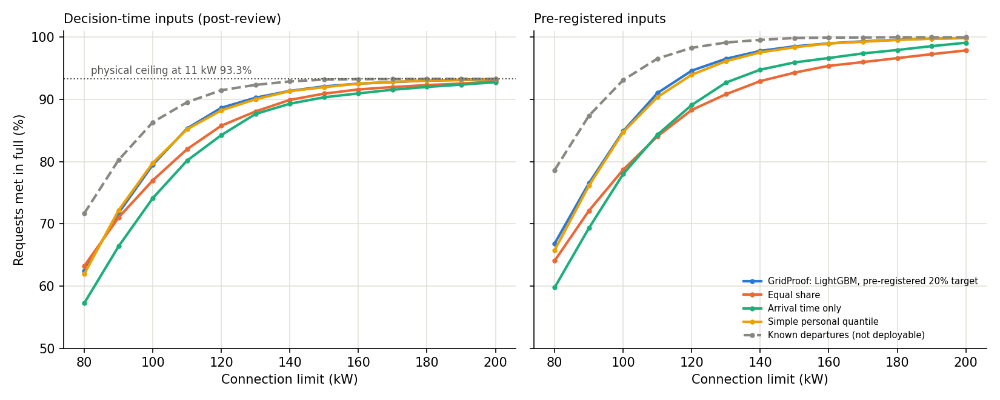

# Post-review follow-up (exploratory)

Protocol: [protocol.json](protocol.json). Written after two external reviews and after the 2024 test year had been examined once, so **these are exploratory checks, not independent validation**. The published results in `experiments/carpark` are unchanged.

185 2024 weekdays, 5,671 sessions. Under decision-time inputs **380 requests (6.7%) could not be met at 11 kW before the real departure by any schedule**; they stay in every denominator.

## Selection on 2023 H2 (decision-time inputs, each family separately)

| Family | Chosen | Level | Mean met in full, 100-160 kW | Mean energy short |
|---|---|---:|---:|---:|
| lightgbm | lightgbm | 0.35 | 93.30% | 1.95% |
| personal_0 | personal_0 | 0.2 | 93.13% | 1.91% |
| personal_k | personal_8 | 0.2 | 93.14% | 1.88% |
| population | population | 0.35 | 91.39% | 2.77% |

## decision time: requests met in full

| Policy | 100 kW | 120 kW | 150 kW |
|---|---:|---:|---:|
| Equal share | 76.99% (11.19% kWh short) | 85.77% (5.98% kWh short) | 90.92% (2.90% kWh short) |
| Arrival time only | 74.13% (11.45% kWh short) | 84.25% (6.25% kWh short) | 90.34% (3.10% kWh short) |
| Simple personal quantile | 79.79% (9.03% kWh short) | 88.24% (4.12% kWh short) | 91.96% (1.88% kWh short) |
| Personal shrinkage | 78.56% (9.00% kWh short) | 88.03% (4.07% kWh short) | 92.10% (1.87% kWh short) |
| LightGBM, re-selected target | 81.34% (8.63% kWh short) | 88.52% (3.91% kWh short) | 91.89% (1.90% kWh short) |
| GridProof: LightGBM, pre-registered 20% target | 79.49% (8.40% kWh short) | 88.64% (3.89% kWh short) | 92.08% (1.87% kWh short) |
| Carbon-flex LP | 75.54% (9.18% kWh short) | 85.22% (4.51% kWh short) | 89.86% (2.58% kWh short) |
| Known departures (not deployable) | 86.33% (5.39% kWh short) | 91.47% (2.13% kWh short) | 93.18% (1.33% kWh short) |

## original: requests met in full

| Policy | 100 kW | 120 kW | 150 kW |
|---|---:|---:|---:|
| Equal share | 78.70% (10.05% kWh short) | 88.30% (4.77% kWh short) | 94.29% (1.65% kWh short) |
| Arrival time only | 77.99% (10.31% kWh short) | 89.09% (5.08% kWh short) | 95.93% (1.88% kWh short) |
| Simple personal quantile | 84.74% (7.70% kWh short) | 93.95% (2.80% kWh short) | 98.37% (0.59% kWh short) |
| Personal shrinkage | 83.47% (7.63% kWh short) | 93.67% (2.75% kWh short) | 98.55% (0.59% kWh short) |
| LightGBM, re-selected target | 86.92% (7.23% kWh short) | 94.73% (2.58% kWh short) | 98.32% (0.61% kWh short) |
| GridProof: LightGBM, pre-registered 20% target | 84.88% (7.06% kWh short) | 94.61% (2.56% kWh short) | 98.51% (0.57% kWh short) |
| Known departures (not deployable) | 93.10% (3.87% kWh short) | 98.29% (0.79% kWh short) | 99.86% (0.05% kWh short) |

## decision time past requests: requests met in full

| Policy | 100 kW | 120 kW | 150 kW |
|---|---:|---:|---:|
| Equal share | 76.99% (11.19% kWh short) | 85.77% (5.98% kWh short) | 90.92% (2.90% kWh short) |
| Arrival time only | 78.10% (11.53% kWh short) | 85.73% (6.17% kWh short) | 90.74% (2.99% kWh short) |
| Simple personal quantile | 80.90% (9.00% kWh short) | 88.24% (4.07% kWh short) | 92.05% (1.86% kWh short) |
| Personal shrinkage | 80.55% (8.97% kWh short) | 88.22% (4.03% kWh short) | 92.21% (1.84% kWh short) |
| LightGBM, re-selected target | 82.10% (8.40% kWh short) | 88.84% (3.81% kWh short) | 92.03% (1.84% kWh short) |
| GridProof: LightGBM, pre-registered 20% target | 81.45% (8.40% kWh short) | 88.91% (3.81% kWh short) | 92.06% (1.81% kWh short) |

## Connection needed

| Regime | Policy | >=90% | >=95% | >=98% |
|---|---|---:|---:|---:|
| decision_time | LightGBM, re-selected target | 130 | >200 | >200 |
| decision_time | GridProof: LightGBM, pre-registered 20% target | 130 | >200 | >200 |
| decision_time | Known departures (not deployable) | 120 | >200 | >200 |
| decision_time | Simple personal quantile | 130 | >200 | >200 |
| decision_time | Arrival time only | 150 | >200 | >200 |
| decision_time | Personal shrinkage | 130 | >200 | >200 |
| decision_time | Equal share | 150 | >200 | >200 |
| original | LightGBM, re-selected target | 110 | 130 | 150 |
| original | GridProof: LightGBM, pre-registered 20% target | 110 | 130 | 150 |
| original | Known departures (not deployable) | 100 | 110 | 120 |
| original | Simple personal quantile | 110 | 130 | 150 |
| original | Arrival time only | 130 | 150 | 190 |
| original | Personal shrinkage | 110 | 130 | 150 |
| original | Equal share | 130 | 160 | >200 |

## Paired day-level differences (A minus B), drivers with request met per day unless stated

| Regime | Cap | A | B | Metric | Mean/day | 95% CI | Days A better | Days A worse |
|---|---:|---|---|---|---:|---|---:|---:|
| decision_time | 100 | edf_lightgbm | equal_share | served | +1.335 | [+0.995, +1.681] | 94 | 25 |
| decision_time | 100 | edf_lightgbm | equal_share | unserved_kwh | -17.568 | [-21.601, -13.347] | 132 | 19 |
| decision_time | 100 | edf_lightgbm | equal_share | emissions_kgco2 | +2.421 | [+1.767, +3.133] | 24 | 143 |
| decision_time | 100 | edf_shrinkage | equal_share | served | +0.481 | [+0.157, +0.784] | 77 | 39 |
| decision_time | 100 | edf_shrinkage | equal_share | unserved_kwh | -15.012 | [-18.375, -11.564] | 126 | 26 |
| decision_time | 100 | edf_shrinkage | equal_share | emissions_kgco2 | +2.063 | [+1.478, +2.693] | 33 | 134 |
| decision_time | 100 | edf_personal_quantile | equal_share | served | +0.859 | [+0.546, +1.173] | 90 | 30 |
| decision_time | 100 | edf_personal_quantile | equal_share | unserved_kwh | -14.782 | [-17.980, -11.402] | 127 | 25 |
| decision_time | 100 | edf_personal_quantile | equal_share | emissions_kgco2 | +1.979 | [+1.456, +2.570] | 33 | 134 |
| decision_time | 100 | edf_lightgbm | edf_shrinkage | served | +0.854 | [+0.503, +1.200] | 74 | 35 |
| decision_time | 100 | edf_lightgbm | edf_shrinkage | unserved_kwh | -2.556 | [-4.372, -0.605] | 72 | 60 |
| decision_time | 100 | edf_lightgbm | edf_shrinkage | emissions_kgco2 | +0.359 | [+0.101, +0.617] | 69 | 90 |
| decision_time | 100 | edf_lightgbm | edf_personal_quantile | served | +0.476 | [+0.184, +0.778] | 74 | 40 |
| decision_time | 100 | edf_lightgbm | edf_personal_quantile | unserved_kwh | -2.786 | [-4.619, -0.872] | 78 | 56 |
| decision_time | 100 | edf_lightgbm | edf_personal_quantile | emissions_kgco2 | +0.442 | [+0.183, +0.712] | 67 | 92 |
| decision_time | 100 | edf_shrinkage | edf_population | served | +1.357 | [+0.946, +1.805] | 100 | 19 |
| decision_time | 100 | edf_shrinkage | edf_population | unserved_kwh | -16.769 | [-19.961, -13.343] | 119 | 25 |
| decision_time | 100 | edf_shrinkage | edf_population | emissions_kgco2 | +2.168 | [+1.608, +2.775] | 38 | 123 |
| decision_time | 100 | edf_lightgbm | edf_population | served | +2.211 | [+1.654, +2.789] | 113 | 12 |
| decision_time | 100 | edf_lightgbm | edf_population | unserved_kwh | -19.325 | [-22.975, -15.418] | 124 | 19 |
| decision_time | 100 | edf_lightgbm | edf_population | emissions_kgco2 | +2.527 | [+1.866, +3.188] | 32 | 128 |
| decision_time | 100 | carbon_flex | equal_share | served | -0.443 | [-0.811, -0.097] | 50 | 72 |
| decision_time | 100 | carbon_flex | equal_share | unserved_kwh | -13.794 | [-17.600, -9.925] | 112 | 54 |
| decision_time | 100 | carbon_flex | equal_share | emissions_kgco2 | +1.206 | [+0.476, +1.991] | 97 | 88 |
| decision_time | 100 | edf_lightgbm_original_choice | equal_share | served | +0.768 | [+0.432, +1.086] | 86 | 31 |
| decision_time | 100 | edf_lightgbm_original_choice | equal_share | unserved_kwh | -19.152 | [-22.725, -15.304] | 135 | 16 |
| decision_time | 100 | edf_lightgbm_original_choice | equal_share | emissions_kgco2 | +2.528 | [+1.896, +3.178] | 21 | 146 |
| decision_time | 100 | edf_lightgbm_original_choice | edf_personal_quantile | served | -0.092 | [-0.389, +0.211] | 54 | 47 |
| decision_time | 100 | edf_lightgbm_original_choice | edf_personal_quantile | unserved_kwh | -4.370 | [-6.102, -2.484] | 87 | 43 |
| decision_time | 100 | edf_lightgbm_original_choice | edf_personal_quantile | emissions_kgco2 | +0.549 | [+0.271, +0.819] | 57 | 101 |
| decision_time | 100 | edf_personal_quantile | edf_population | served | +1.735 | [+1.195, +2.324] | 105 | 20 |
| decision_time | 100 | edf_personal_quantile | edf_population | unserved_kwh | -16.539 | [-19.765, -12.987] | 117 | 27 |
| decision_time | 100 | edf_personal_quantile | edf_population | emissions_kgco2 | +2.085 | [+1.543, +2.662] | 44 | 119 |
| decision_time | 100 | edf_lightgbm_original_choice | edf_population | served | +1.643 | [+1.211, +2.097] | 111 | 16 |
| decision_time | 100 | edf_lightgbm_original_choice | edf_population | unserved_kwh | -20.910 | [-24.455, -16.954] | 125 | 18 |
| decision_time | 100 | edf_lightgbm_original_choice | edf_population | emissions_kgco2 | +2.634 | [+1.989, +3.269] | 34 | 127 |
| decision_time | 120 | edf_lightgbm | equal_share | served | +0.843 | [+0.535, +1.162] | 74 | 25 |
| decision_time | 120 | edf_lightgbm | equal_share | unserved_kwh | -14.141 | [-17.422, -10.689] | 115 | 16 |
| decision_time | 120 | edf_lightgbm | equal_share | emissions_kgco2 | +1.895 | [+1.347, +2.441] | 19 | 128 |
| decision_time | 120 | edf_shrinkage | equal_share | served | +0.692 | [+0.449, +0.957] | 72 | 19 |
| decision_time | 120 | edf_shrinkage | equal_share | unserved_kwh | -13.048 | [-16.168, -9.970] | 113 | 17 |
| decision_time | 120 | edf_shrinkage | equal_share | emissions_kgco2 | +1.783 | [+1.244, +2.309] | 24 | 123 |
| decision_time | 120 | edf_personal_quantile | equal_share | served | +0.757 | [+0.503, +1.027] | 73 | 17 |
| decision_time | 120 | edf_personal_quantile | equal_share | unserved_kwh | -12.697 | [-15.833, -9.539] | 110 | 20 |
| decision_time | 120 | edf_personal_quantile | equal_share | emissions_kgco2 | +1.737 | [+1.221, +2.259] | 25 | 122 |
| decision_time | 120 | edf_lightgbm | edf_shrinkage | served | +0.151 | [-0.011, +0.319] | 42 | 28 |
| decision_time | 120 | edf_lightgbm | edf_shrinkage | unserved_kwh | -1.093 | [-2.664, +0.619] | 54 | 42 |
| decision_time | 120 | edf_lightgbm | edf_shrinkage | emissions_kgco2 | +0.113 | [-0.091, +0.295] | 59 | 85 |
| decision_time | 120 | edf_lightgbm | edf_personal_quantile | served | +0.086 | [-0.081, +0.249] | 37 | 30 |
| decision_time | 120 | edf_lightgbm | edf_personal_quantile | unserved_kwh | -1.444 | [-3.035, +0.284] | 52 | 43 |
| decision_time | 120 | edf_lightgbm | edf_personal_quantile | emissions_kgco2 | +0.158 | [-0.072, +0.363] | 63 | 82 |
| decision_time | 120 | edf_shrinkage | edf_population | served | +1.157 | [+0.816, +1.497] | 84 | 12 |
| decision_time | 120 | edf_shrinkage | edf_population | unserved_kwh | -14.894 | [-18.144, -11.588] | 107 | 14 |
| decision_time | 120 | edf_shrinkage | edf_population | emissions_kgco2 | +1.848 | [+1.355, +2.369] | 35 | 110 |
| decision_time | 120 | edf_lightgbm | edf_population | served | +1.308 | [+0.946, +1.665] | 93 | 13 |
| decision_time | 120 | edf_lightgbm | edf_population | unserved_kwh | -15.987 | [-19.599, -12.326] | 104 | 18 |
| decision_time | 120 | edf_lightgbm | edf_population | emissions_kgco2 | +1.960 | [+1.420, +2.517] | 34 | 110 |
| decision_time | 120 | carbon_flex | equal_share | served | -0.168 | [-0.427, +0.108] | 48 | 69 |
| decision_time | 120 | carbon_flex | equal_share | unserved_kwh | -10.026 | [-13.584, -6.451] | 97 | 56 |
| decision_time | 120 | carbon_flex | equal_share | emissions_kgco2 | +0.387 | [-0.257, +1.061] | 123 | 62 |
| decision_time | 120 | edf_lightgbm_original_choice | equal_share | served | +0.881 | [+0.605, +1.173] | 80 | 17 |
| decision_time | 120 | edf_lightgbm_original_choice | equal_share | unserved_kwh | -14.317 | [-17.782, -10.906] | 116 | 14 |
| decision_time | 120 | edf_lightgbm_original_choice | equal_share | emissions_kgco2 | +1.910 | [+1.362, +2.456] | 19 | 128 |
| decision_time | 120 | edf_lightgbm_original_choice | edf_personal_quantile | served | +0.124 | [-0.005, +0.254] | 33 | 25 |
| decision_time | 120 | edf_lightgbm_original_choice | edf_personal_quantile | unserved_kwh | -1.619 | [-3.037, -0.178] | 57 | 33 |
| decision_time | 120 | edf_lightgbm_original_choice | edf_personal_quantile | emissions_kgco2 | +0.173 | [-0.018, +0.354] | 61 | 83 |
| decision_time | 120 | edf_personal_quantile | edf_population | served | +1.222 | [+0.870, +1.557] | 88 | 16 |
| decision_time | 120 | edf_personal_quantile | edf_population | unserved_kwh | -14.543 | [-17.977, -11.049] | 104 | 17 |
| decision_time | 120 | edf_personal_quantile | edf_population | emissions_kgco2 | +1.802 | [+1.296, +2.342] | 39 | 106 |
| decision_time | 120 | edf_lightgbm_original_choice | edf_population | served | +1.346 | [+1.000, +1.686] | 95 | 11 |
| decision_time | 120 | edf_lightgbm_original_choice | edf_population | unserved_kwh | -16.162 | [-19.778, -12.426] | 106 | 16 |
| decision_time | 120 | edf_lightgbm_original_choice | edf_population | emissions_kgco2 | +1.975 | [+1.432, +2.536] | 29 | 115 |
| decision_time | 150 | edf_lightgbm | equal_share | served | +0.297 | [+0.162, +0.449] | 45 | 15 |
| decision_time | 150 | edf_lightgbm | equal_share | unserved_kwh | -6.853 | [-8.987, -4.777] | 100 | 13 |
| decision_time | 150 | edf_lightgbm | equal_share | emissions_kgco2 | +0.860 | [+0.587, +1.152] | 23 | 110 |
| decision_time | 150 | edf_shrinkage | equal_share | served | +0.362 | [+0.211, +0.524] | 48 | 14 |
| decision_time | 150 | edf_shrinkage | equal_share | unserved_kwh | -7.072 | [-9.331, -4.874] | 98 | 15 |
| decision_time | 150 | edf_shrinkage | equal_share | emissions_kgco2 | +0.885 | [+0.588, +1.200] | 26 | 107 |
| decision_time | 150 | edf_personal_quantile | equal_share | served | +0.319 | [+0.168, +0.476] | 46 | 18 |
| decision_time | 150 | edf_personal_quantile | equal_share | unserved_kwh | -7.050 | [-9.239, -4.847] | 99 | 14 |
| decision_time | 150 | edf_personal_quantile | equal_share | emissions_kgco2 | +0.879 | [+0.585, +1.181] | 25 | 108 |
| decision_time | 150 | edf_lightgbm | edf_shrinkage | served | -0.065 | [-0.157, +0.022] | 13 | 20 |
| decision_time | 150 | edf_lightgbm | edf_shrinkage | unserved_kwh | +0.219 | [-0.688, +1.225] | 28 | 27 |
| decision_time | 150 | edf_lightgbm | edf_shrinkage | emissions_kgco2 | -0.025 | [-0.118, +0.066] | 58 | 70 |
| decision_time | 150 | edf_lightgbm | edf_personal_quantile | served | -0.022 | [-0.114, +0.070] | 15 | 18 |
| decision_time | 150 | edf_lightgbm | edf_personal_quantile | unserved_kwh | +0.198 | [-0.570, +1.104] | 30 | 28 |
| decision_time | 150 | edf_lightgbm | edf_personal_quantile | emissions_kgco2 | -0.019 | [-0.103, +0.060] | 60 | 66 |
| decision_time | 150 | edf_shrinkage | edf_population | served | +0.541 | [+0.368, +0.714] | 55 | 9 |
| decision_time | 150 | edf_shrinkage | edf_population | unserved_kwh | -8.407 | [-10.922, -6.030] | 73 | 8 |
| decision_time | 150 | edf_shrinkage | edf_population | emissions_kgco2 | +0.874 | [+0.579, +1.175] | 44 | 83 |
| decision_time | 150 | edf_lightgbm | edf_population | served | +0.476 | [+0.319, +0.633] | 55 | 9 |
| decision_time | 150 | edf_lightgbm | edf_population | unserved_kwh | -8.188 | [-10.712, -5.726] | 75 | 7 |
| decision_time | 150 | edf_lightgbm | edf_population | emissions_kgco2 | +0.849 | [+0.560, +1.145] | 46 | 84 |
| decision_time | 150 | carbon_flex | equal_share | served | -0.324 | [-0.454, -0.189] | 23 | 70 |
| decision_time | 150 | carbon_flex | equal_share | unserved_kwh | -2.235 | [-4.368, -0.127] | 67 | 78 |
| decision_time | 150 | carbon_flex | equal_share | emissions_kgco2 | -1.021 | [-1.392, -0.614] | 150 | 35 |
| decision_time | 150 | edf_lightgbm_original_choice | equal_share | served | +0.357 | [+0.195, +0.519] | 51 | 18 |
| decision_time | 150 | edf_lightgbm_original_choice | equal_share | unserved_kwh | -7.106 | [-9.191, -5.055] | 101 | 12 |
| decision_time | 150 | edf_lightgbm_original_choice | equal_share | emissions_kgco2 | +0.903 | [+0.608, +1.213] | 21 | 112 |
| decision_time | 150 | edf_lightgbm_original_choice | edf_personal_quantile | served | +0.038 | [-0.049, +0.119] | 18 | 14 |
| decision_time | 150 | edf_lightgbm_original_choice | edf_personal_quantile | unserved_kwh | -0.056 | [-1.060, +1.091] | 31 | 25 |
| decision_time | 150 | edf_lightgbm_original_choice | edf_personal_quantile | emissions_kgco2 | +0.024 | [-0.092, +0.131] | 49 | 76 |
| decision_time | 150 | edf_personal_quantile | edf_population | served | +0.497 | [+0.324, +0.676] | 54 | 12 |
| decision_time | 150 | edf_personal_quantile | edf_population | unserved_kwh | -8.386 | [-10.844, -6.002] | 73 | 9 |
| decision_time | 150 | edf_personal_quantile | edf_population | emissions_kgco2 | +0.868 | [+0.573, +1.163] | 45 | 84 |
| decision_time | 150 | edf_lightgbm_original_choice | edf_population | served | +0.535 | [+0.357, +0.719] | 56 | 9 |
| decision_time | 150 | edf_lightgbm_original_choice | edf_population | unserved_kwh | -8.442 | [-11.056, -5.981] | 73 | 11 |
| decision_time | 150 | edf_lightgbm_original_choice | edf_population | emissions_kgco2 | +0.892 | [+0.589, +1.205] | 42 | 82 |
| original | 100 | edf_lightgbm | equal_share | served | +2.514 | [+2.092, +2.908] | 132 | 8 |
| original | 100 | edf_lightgbm | equal_share | unserved_kwh | -19.073 | [-23.143, -14.745] | 135 | 16 |
| original | 100 | edf_lightgbm | equal_share | emissions_kgco2 | +2.573 | [+1.894, +3.297] | 22 | 145 |
| original | 100 | edf_shrinkage | equal_share | served | +1.459 | [+1.108, +1.789] | 115 | 20 |
| original | 100 | edf_shrinkage | equal_share | unserved_kwh | -16.375 | [-19.825, -12.713] | 128 | 24 |
| original | 100 | edf_shrinkage | equal_share | emissions_kgco2 | +2.222 | [+1.622, +2.874] | 30 | 137 |
| original | 100 | edf_personal_quantile | equal_share | served | +1.849 | [+1.486, +2.184] | 123 | 15 |
| original | 100 | edf_personal_quantile | equal_share | unserved_kwh | -15.916 | [-19.204, -12.446] | 131 | 21 |
| original | 100 | edf_personal_quantile | equal_share | emissions_kgco2 | +2.120 | [+1.577, +2.731] | 29 | 138 |
| original | 100 | edf_lightgbm | edf_shrinkage | served | +1.054 | [+0.692, +1.416] | 81 | 31 |
| original | 100 | edf_lightgbm | edf_shrinkage | unserved_kwh | -2.698 | [-4.537, -0.776] | 77 | 56 |
| original | 100 | edf_lightgbm | edf_shrinkage | emissions_kgco2 | +0.350 | [+0.107, +0.604] | 65 | 94 |
| original | 100 | edf_lightgbm | edf_personal_quantile | served | +0.665 | [+0.368, +0.968] | 76 | 43 |
| original | 100 | edf_lightgbm | edf_personal_quantile | unserved_kwh | -3.157 | [-5.021, -1.173] | 75 | 59 |
| original | 100 | edf_lightgbm | edf_personal_quantile | emissions_kgco2 | +0.453 | [+0.198, +0.711] | 69 | 89 |
| original | 100 | edf_shrinkage | edf_population | served | +1.676 | [+1.297, +2.070] | 113 | 17 |
| original | 100 | edf_shrinkage | edf_population | unserved_kwh | -18.148 | [-21.409, -14.440] | 119 | 25 |
| original | 100 | edf_shrinkage | edf_population | emissions_kgco2 | +2.347 | [+1.764, +2.962] | 36 | 124 |
| original | 100 | edf_lightgbm | edf_population | served | +2.730 | [+2.157, +3.303] | 124 | 5 |
| original | 100 | edf_lightgbm | edf_population | unserved_kwh | -20.846 | [-24.699, -16.760] | 127 | 16 |
| original | 100 | edf_lightgbm | edf_population | emissions_kgco2 | +2.697 | [+1.999, +3.379] | 28 | 132 |
| original | 100 | edf_lightgbm_original_choice | equal_share | served | +1.892 | [+1.492, +2.259] | 123 | 15 |
| original | 100 | edf_lightgbm_original_choice | equal_share | unserved_kwh | -20.225 | [-23.866, -16.199] | 135 | 16 |
| original | 100 | edf_lightgbm_original_choice | equal_share | emissions_kgco2 | +2.651 | [+1.981, +3.311] | 19 | 148 |
| original | 100 | edf_lightgbm_original_choice | edf_personal_quantile | served | +0.043 | [-0.270, +0.346] | 61 | 45 |
| original | 100 | edf_lightgbm_original_choice | edf_personal_quantile | unserved_kwh | -4.309 | [-6.067, -2.413] | 89 | 41 |
| original | 100 | edf_lightgbm_original_choice | edf_personal_quantile | emissions_kgco2 | +0.531 | [+0.260, +0.796] | 57 | 101 |
| original | 100 | edf_personal_quantile | edf_population | served | +2.065 | [+1.546, +2.611] | 116 | 17 |
| original | 100 | edf_personal_quantile | edf_population | unserved_kwh | -17.689 | [-20.998, -14.090] | 121 | 23 |
| original | 100 | edf_personal_quantile | edf_population | emissions_kgco2 | +2.244 | [+1.678, +2.854] | 40 | 123 |
| original | 100 | edf_lightgbm_original_choice | edf_population | served | +2.108 | [+1.681, +2.541] | 124 | 11 |
| original | 100 | edf_lightgbm_original_choice | edf_population | unserved_kwh | -21.998 | [-25.658, -17.925] | 126 | 17 |
| original | 100 | edf_lightgbm_original_choice | edf_population | emissions_kgco2 | +2.775 | [+2.114, +3.427] | 33 | 127 |
| original | 120 | edf_lightgbm | equal_share | served | +1.968 | [+1.573, +2.346] | 119 | 4 |
| original | 120 | edf_lightgbm | equal_share | unserved_kwh | -14.783 | [-18.141, -11.278] | 116 | 15 |
| original | 120 | edf_lightgbm | equal_share | emissions_kgco2 | +1.961 | [+1.404, +2.513] | 19 | 128 |
| original | 120 | edf_shrinkage | equal_share | served | +1.643 | [+1.330, +1.946] | 114 | 7 |
| original | 120 | edf_shrinkage | equal_share | unserved_kwh | -13.636 | [-16.846, -10.483] | 114 | 16 |
| original | 120 | edf_shrinkage | equal_share | emissions_kgco2 | +1.856 | [+1.311, +2.393] | 24 | 123 |
| original | 120 | edf_personal_quantile | equal_share | served | +1.730 | [+1.416, +2.022] | 116 | 4 |
| original | 120 | edf_personal_quantile | equal_share | unserved_kwh | -13.327 | [-16.625, -10.045] | 112 | 18 |
| original | 120 | edf_personal_quantile | equal_share | emissions_kgco2 | +1.813 | [+1.281, +2.351] | 23 | 124 |
| original | 120 | edf_lightgbm | edf_shrinkage | served | +0.324 | [+0.151, +0.503] | 46 | 23 |
| original | 120 | edf_lightgbm | edf_shrinkage | unserved_kwh | -1.147 | [-2.719, +0.518] | 54 | 41 |
| original | 120 | edf_lightgbm | edf_shrinkage | emissions_kgco2 | +0.105 | [-0.096, +0.286] | 59 | 85 |
| original | 120 | edf_lightgbm | edf_personal_quantile | served | +0.238 | [+0.059, +0.405] | 42 | 30 |
| original | 120 | edf_lightgbm | edf_personal_quantile | unserved_kwh | -1.456 | [-3.044, +0.199] | 51 | 44 |
| original | 120 | edf_lightgbm | edf_personal_quantile | emissions_kgco2 | +0.148 | [-0.082, +0.358] | 63 | 82 |
| original | 120 | edf_shrinkage | edf_population | served | +1.400 | [+1.049, +1.724] | 96 | 12 |
| original | 120 | edf_shrinkage | edf_population | unserved_kwh | -15.750 | [-19.199, -12.143] | 106 | 14 |
| original | 120 | edf_shrinkage | edf_population | emissions_kgco2 | +1.942 | [+1.426, +2.487] | 35 | 110 |
| original | 120 | edf_lightgbm | edf_population | served | +1.724 | [+1.308, +2.114] | 104 | 9 |
| original | 120 | edf_lightgbm | edf_population | unserved_kwh | -16.897 | [-20.750, -12.989] | 105 | 16 |
| original | 120 | edf_lightgbm | edf_population | emissions_kgco2 | +2.047 | [+1.484, +2.621] | 34 | 110 |
| original | 120 | edf_lightgbm_original_choice | equal_share | served | +1.930 | [+1.578, +2.276] | 120 | 1 |
| original | 120 | edf_lightgbm_original_choice | equal_share | unserved_kwh | -14.916 | [-18.294, -11.370] | 117 | 13 |
| original | 120 | edf_lightgbm_original_choice | equal_share | emissions_kgco2 | +1.976 | [+1.420, +2.539] | 17 | 130 |
| original | 120 | edf_lightgbm_original_choice | edf_personal_quantile | served | +0.200 | [+0.065, +0.346] | 36 | 26 |
| original | 120 | edf_lightgbm_original_choice | edf_personal_quantile | unserved_kwh | -1.588 | [-2.969, -0.152] | 57 | 33 |
| original | 120 | edf_lightgbm_original_choice | edf_personal_quantile | emissions_kgco2 | +0.163 | [-0.025, +0.347] | 61 | 83 |
| original | 120 | edf_personal_quantile | edf_population | served | +1.486 | [+1.130, +1.816] | 94 | 13 |
| original | 120 | edf_personal_quantile | edf_population | unserved_kwh | -15.441 | [-19.171, -11.597] | 103 | 17 |
| original | 120 | edf_personal_quantile | edf_population | emissions_kgco2 | +1.899 | [+1.356, +2.465] | 38 | 107 |
| original | 120 | edf_lightgbm_original_choice | edf_population | served | +1.686 | [+1.314, +2.043] | 107 | 8 |
| original | 120 | edf_lightgbm_original_choice | edf_population | unserved_kwh | -17.029 | [-21.007, -13.047] | 105 | 16 |
| original | 120 | edf_lightgbm_original_choice | edf_population | emissions_kgco2 | +2.062 | [+1.487, +2.654] | 29 | 115 |
| original | 150 | edf_lightgbm | equal_share | served | +1.232 | [+0.978, +1.492] | 103 | 2 |
| original | 150 | edf_lightgbm | equal_share | unserved_kwh | -7.003 | [-9.162, -4.939] | 101 | 12 |
| original | 150 | edf_lightgbm | equal_share | emissions_kgco2 | +0.887 | [+0.607, +1.184] | 23 | 110 |
| original | 150 | edf_shrinkage | equal_share | served | +1.303 | [+1.032, +1.573] | 105 | 3 |
| original | 150 | edf_shrinkage | equal_share | unserved_kwh | -7.157 | [-9.469, -4.949] | 98 | 15 |
| original | 150 | edf_shrinkage | equal_share | emissions_kgco2 | +0.906 | [+0.606, +1.221] | 25 | 108 |
| original | 150 | edf_personal_quantile | equal_share | served | +1.249 | [+0.984, +1.524] | 104 | 3 |
| original | 150 | edf_personal_quantile | equal_share | unserved_kwh | -7.192 | [-9.422, -4.949] | 99 | 14 |
| original | 150 | edf_personal_quantile | equal_share | emissions_kgco2 | +0.906 | [+0.611, +1.211] | 24 | 109 |
| original | 150 | edf_lightgbm | edf_shrinkage | served | -0.070 | [-0.168, +0.027] | 14 | 22 |
| original | 150 | edf_lightgbm | edf_shrinkage | unserved_kwh | +0.155 | [-0.710, +1.071] | 27 | 26 |
| original | 150 | edf_lightgbm | edf_shrinkage | emissions_kgco2 | -0.019 | [-0.107, +0.065] | 56 | 72 |
| original | 150 | edf_lightgbm | edf_personal_quantile | served | -0.016 | [-0.119, +0.081] | 17 | 21 |
| original | 150 | edf_lightgbm | edf_personal_quantile | unserved_kwh | +0.189 | [-0.549, +1.017] | 28 | 28 |
| original | 150 | edf_lightgbm | edf_personal_quantile | emissions_kgco2 | -0.019 | [-0.097, +0.055] | 61 | 66 |
| original | 150 | edf_shrinkage | edf_population | served | +0.800 | [+0.578, +1.032] | 68 | 6 |
| original | 150 | edf_shrinkage | edf_population | unserved_kwh | -8.734 | [-11.313, -6.267] | 72 | 10 |
| original | 150 | edf_shrinkage | edf_population | emissions_kgco2 | +0.915 | [+0.601, +1.231] | 45 | 83 |
| original | 150 | edf_lightgbm | edf_population | served | +0.730 | [+0.540, +0.930] | 64 | 5 |
| original | 150 | edf_lightgbm | edf_population | unserved_kwh | -8.580 | [-11.177, -6.056] | 74 | 8 |
| original | 150 | edf_lightgbm | edf_population | emissions_kgco2 | +0.896 | [+0.598, +1.198] | 47 | 84 |
| original | 150 | edf_lightgbm_original_choice | equal_share | served | +1.292 | [+1.027, +1.568] | 103 | 2 |
| original | 150 | edf_lightgbm_original_choice | equal_share | unserved_kwh | -7.318 | [-9.419, -5.215] | 101 | 12 |
| original | 150 | edf_lightgbm_original_choice | equal_share | emissions_kgco2 | +0.931 | [+0.636, +1.239] | 21 | 112 |
| original | 150 | edf_lightgbm_original_choice | edf_personal_quantile | served | +0.043 | [-0.054, +0.135] | 23 | 18 |
| original | 150 | edf_lightgbm_original_choice | edf_personal_quantile | unserved_kwh | -0.126 | [-1.046, +0.946] | 29 | 26 |
| original | 150 | edf_lightgbm_original_choice | edf_personal_quantile | emissions_kgco2 | +0.026 | [-0.083, +0.128] | 48 | 77 |
| original | 150 | edf_personal_quantile | edf_population | served | +0.746 | [+0.530, +0.968] | 65 | 6 |
| original | 150 | edf_personal_quantile | edf_population | unserved_kwh | -8.769 | [-11.356, -6.276] | 73 | 10 |
| original | 150 | edf_personal_quantile | edf_population | emissions_kgco2 | +0.914 | [+0.602, +1.223] | 45 | 84 |
| original | 150 | edf_lightgbm_original_choice | edf_population | served | +0.789 | [+0.557, +1.011] | 66 | 7 |
| original | 150 | edf_lightgbm_original_choice | edf_population | unserved_kwh | -8.895 | [-11.561, -6.353] | 73 | 12 |
| original | 150 | edf_lightgbm_original_choice | edf_population | emissions_kgco2 | +0.940 | [+0.626, +1.263] | 42 | 83 |
| decision_time_past_requests | 100 | edf_lightgbm | equal_share | served | +1.568 | [+1.205, +1.914] | 103 | 16 |
| decision_time_past_requests | 100 | edf_lightgbm | equal_share | unserved_kwh | -19.109 | [-23.072, -14.975] | 141 | 11 |
| decision_time_past_requests | 100 | edf_lightgbm | equal_share | emissions_kgco2 | +2.557 | [+1.894, +3.272] | 15 | 152 |
| decision_time_past_requests | 100 | edf_shrinkage | equal_share | served | +1.092 | [+0.843, +1.357] | 92 | 23 |
| decision_time_past_requests | 100 | edf_shrinkage | equal_share | unserved_kwh | -15.198 | [-18.540, -11.822] | 129 | 23 |
| decision_time_past_requests | 100 | edf_shrinkage | equal_share | emissions_kgco2 | +2.087 | [+1.495, +2.718] | 30 | 137 |
| decision_time_past_requests | 100 | edf_personal_quantile | equal_share | served | +1.200 | [+0.924, +1.481] | 99 | 19 |
| decision_time_past_requests | 100 | edf_personal_quantile | equal_share | unserved_kwh | -14.986 | [-18.125, -11.668] | 132 | 20 |
| decision_time_past_requests | 100 | edf_personal_quantile | equal_share | emissions_kgco2 | +2.007 | [+1.466, +2.600] | 28 | 139 |
| decision_time_past_requests | 100 | edf_lightgbm | edf_shrinkage | served | +0.476 | [+0.254, +0.697] | 65 | 31 |
| decision_time_past_requests | 100 | edf_lightgbm | edf_shrinkage | unserved_kwh | -3.911 | [-5.826, -2.001] | 77 | 54 |
| decision_time_past_requests | 100 | edf_lightgbm | edf_shrinkage | emissions_kgco2 | +0.470 | [+0.222, +0.719] | 66 | 93 |
| decision_time_past_requests | 100 | edf_lightgbm | edf_personal_quantile | served | +0.368 | [+0.146, +0.579] | 69 | 35 |
| decision_time_past_requests | 100 | edf_lightgbm | edf_personal_quantile | unserved_kwh | -4.123 | [-6.014, -2.222] | 79 | 53 |
| decision_time_past_requests | 100 | edf_lightgbm | edf_personal_quantile | emissions_kgco2 | +0.550 | [+0.273, +0.837] | 62 | 97 |
| decision_time_past_requests | 100 | edf_shrinkage | edf_population | served | +0.751 | [+0.465, +1.043] | 89 | 28 |
| decision_time_past_requests | 100 | edf_shrinkage | edf_population | unserved_kwh | -17.531 | [-21.017, -13.904] | 121 | 21 |
| decision_time_past_requests | 100 | edf_shrinkage | edf_population | emissions_kgco2 | +2.244 | [+1.668, +2.873] | 37 | 128 |
| decision_time_past_requests | 100 | edf_lightgbm | edf_population | served | +1.227 | [+0.886, +1.562] | 101 | 19 |
| decision_time_past_requests | 100 | edf_lightgbm | edf_population | unserved_kwh | -21.442 | [-25.368, -17.256] | 127 | 13 |
| decision_time_past_requests | 100 | edf_lightgbm | edf_population | emissions_kgco2 | +2.714 | [+2.041, +3.429] | 29 | 136 |
| decision_time_past_requests | 100 | edf_lightgbm_original_choice | equal_share | served | +1.368 | [+1.076, +1.665] | 101 | 17 |
| decision_time_past_requests | 100 | edf_lightgbm_original_choice | equal_share | unserved_kwh | -19.096 | [-22.526, -15.368] | 134 | 17 |
| decision_time_past_requests | 100 | edf_lightgbm_original_choice | equal_share | emissions_kgco2 | +2.489 | [+1.874, +3.095] | 22 | 145 |
| decision_time_past_requests | 100 | edf_lightgbm_original_choice | edf_personal_quantile | served | +0.168 | [-0.027, +0.368] | 55 | 39 |
| decision_time_past_requests | 100 | edf_lightgbm_original_choice | edf_personal_quantile | unserved_kwh | -4.110 | [-5.717, -2.318] | 86 | 43 |
| decision_time_past_requests | 100 | edf_lightgbm_original_choice | edf_personal_quantile | emissions_kgco2 | +0.482 | [+0.197, +0.738] | 59 | 98 |
| decision_time_past_requests | 100 | edf_personal_quantile | edf_population | served | +0.859 | [+0.562, +1.157] | 93 | 26 |
| decision_time_past_requests | 100 | edf_personal_quantile | edf_population | unserved_kwh | -17.319 | [-20.815, -13.605] | 117 | 23 |
| decision_time_past_requests | 100 | edf_personal_quantile | edf_population | emissions_kgco2 | +2.164 | [+1.614, +2.774] | 39 | 127 |
| decision_time_past_requests | 100 | edf_lightgbm_original_choice | edf_population | served | +1.027 | [+0.735, +1.330] | 91 | 21 |
| decision_time_past_requests | 100 | edf_lightgbm_original_choice | edf_population | unserved_kwh | -21.429 | [-25.240, -17.301] | 125 | 14 |
| decision_time_past_requests | 100 | edf_lightgbm_original_choice | edf_population | emissions_kgco2 | +2.647 | [+2.001, +3.274] | 32 | 133 |
| decision_time_past_requests | 120 | edf_lightgbm | equal_share | served | +0.941 | [+0.643, +1.249] | 79 | 19 |
| decision_time_past_requests | 120 | edf_lightgbm | equal_share | unserved_kwh | -14.819 | [-18.137, -11.338] | 119 | 12 |
| decision_time_past_requests | 120 | edf_lightgbm | equal_share | emissions_kgco2 | +1.988 | [+1.428, +2.551] | 15 | 132 |
| decision_time_past_requests | 120 | edf_shrinkage | equal_share | served | +0.751 | [+0.503, +1.011] | 74 | 17 |
| decision_time_past_requests | 120 | edf_shrinkage | equal_share | unserved_kwh | -13.362 | [-16.499, -10.203] | 112 | 18 |
| decision_time_past_requests | 120 | edf_shrinkage | equal_share | emissions_kgco2 | +1.814 | [+1.282, +2.337] | 24 | 123 |
| decision_time_past_requests | 120 | edf_personal_quantile | equal_share | served | +0.757 | [+0.492, +1.027] | 73 | 19 |
| decision_time_past_requests | 120 | edf_personal_quantile | equal_share | unserved_kwh | -13.047 | [-16.128, -9.959] | 111 | 19 |
| decision_time_past_requests | 120 | edf_personal_quantile | equal_share | emissions_kgco2 | +1.766 | [+1.253, +2.290] | 27 | 120 |
| decision_time_past_requests | 120 | edf_lightgbm | edf_shrinkage | served | +0.189 | [+0.049, +0.324] | 40 | 24 |
| decision_time_past_requests | 120 | edf_lightgbm | edf_shrinkage | unserved_kwh | -1.457 | [-2.879, +0.067] | 54 | 43 |
| decision_time_past_requests | 120 | edf_lightgbm | edf_shrinkage | emissions_kgco2 | +0.174 | [-0.003, +0.331] | 59 | 83 |
| decision_time_past_requests | 120 | edf_lightgbm | edf_personal_quantile | served | +0.184 | [+0.043, +0.319] | 39 | 25 |
| decision_time_past_requests | 120 | edf_lightgbm | edf_personal_quantile | unserved_kwh | -1.772 | [-3.177, -0.258] | 52 | 45 |
| decision_time_past_requests | 120 | edf_lightgbm | edf_personal_quantile | emissions_kgco2 | +0.222 | [+0.015, +0.420] | 66 | 78 |
| decision_time_past_requests | 120 | edf_shrinkage | edf_population | served | +0.762 | [+0.508, +1.011] | 78 | 18 |
| decision_time_past_requests | 120 | edf_shrinkage | edf_population | unserved_kwh | -14.660 | [-17.876, -11.267] | 106 | 12 |
| decision_time_past_requests | 120 | edf_shrinkage | edf_population | emissions_kgco2 | +1.779 | [+1.285, +2.270] | 35 | 111 |
| decision_time_past_requests | 120 | edf_lightgbm | edf_population | served | +0.951 | [+0.681, +1.200] | 83 | 13 |
| decision_time_past_requests | 120 | edf_lightgbm | edf_population | unserved_kwh | -16.117 | [-19.536, -12.506] | 101 | 18 |
| decision_time_past_requests | 120 | edf_lightgbm | edf_population | emissions_kgco2 | +1.953 | [+1.409, +2.479] | 35 | 111 |
| decision_time_past_requests | 120 | edf_lightgbm_original_choice | equal_share | served | +0.962 | [+0.670, +1.270] | 81 | 19 |
| decision_time_past_requests | 120 | edf_lightgbm_original_choice | equal_share | unserved_kwh | -14.815 | [-18.222, -11.431] | 116 | 14 |
| decision_time_past_requests | 120 | edf_lightgbm_original_choice | equal_share | emissions_kgco2 | +1.969 | [+1.392, +2.550] | 17 | 130 |
| decision_time_past_requests | 120 | edf_lightgbm_original_choice | edf_personal_quantile | served | +0.205 | [+0.070, +0.335] | 34 | 21 |
| decision_time_past_requests | 120 | edf_lightgbm_original_choice | edf_personal_quantile | unserved_kwh | -1.767 | [-3.292, -0.254] | 57 | 32 |
| decision_time_past_requests | 120 | edf_lightgbm_original_choice | edf_personal_quantile | emissions_kgco2 | +0.203 | [+0.015, +0.413] | 66 | 79 |
| decision_time_past_requests | 120 | edf_personal_quantile | edf_population | served | +0.768 | [+0.514, +1.005] | 77 | 19 |
| decision_time_past_requests | 120 | edf_personal_quantile | edf_population | unserved_kwh | -14.345 | [-17.582, -11.009] | 102 | 16 |
| decision_time_past_requests | 120 | edf_personal_quantile | edf_population | emissions_kgco2 | +1.730 | [+1.228, +2.240] | 36 | 110 |
| decision_time_past_requests | 120 | edf_lightgbm_original_choice | edf_population | served | +0.973 | [+0.692, +1.249] | 84 | 18 |
| decision_time_past_requests | 120 | edf_lightgbm_original_choice | edf_population | unserved_kwh | -16.112 | [-19.669, -12.545] | 101 | 18 |
| decision_time_past_requests | 120 | edf_lightgbm_original_choice | edf_population | emissions_kgco2 | +1.934 | [+1.378, +2.476] | 33 | 113 |
| decision_time_past_requests | 150 | edf_lightgbm | equal_share | served | +0.341 | [+0.200, +0.492] | 49 | 12 |
| decision_time_past_requests | 150 | edf_lightgbm | equal_share | unserved_kwh | -7.299 | [-9.480, -5.187] | 103 | 8 |
| decision_time_past_requests | 150 | edf_lightgbm | equal_share | emissions_kgco2 | +0.907 | [+0.614, +1.217] | 21 | 112 |
| decision_time_past_requests | 150 | edf_shrinkage | equal_share | served | +0.395 | [+0.249, +0.557] | 51 | 9 |
| decision_time_past_requests | 150 | edf_shrinkage | equal_share | unserved_kwh | -7.269 | [-9.512, -5.034] | 99 | 14 |
| decision_time_past_requests | 150 | edf_shrinkage | equal_share | emissions_kgco2 | +0.897 | [+0.599, +1.213] | 27 | 106 |
| decision_time_past_requests | 150 | edf_personal_quantile | equal_share | served | +0.346 | [+0.205, +0.503] | 47 | 13 |
| decision_time_past_requests | 150 | edf_personal_quantile | equal_share | unserved_kwh | -7.167 | [-9.402, -4.930] | 100 | 13 |
| decision_time_past_requests | 150 | edf_personal_quantile | equal_share | emissions_kgco2 | +0.892 | [+0.597, +1.199] | 24 | 109 |
| decision_time_past_requests | 150 | edf_lightgbm | edf_shrinkage | served | -0.054 | [-0.135, +0.022] | 13 | 16 |
| decision_time_past_requests | 150 | edf_lightgbm | edf_shrinkage | unserved_kwh | -0.030 | [-0.934, +0.921] | 27 | 25 |
| decision_time_past_requests | 150 | edf_lightgbm | edf_shrinkage | emissions_kgco2 | +0.010 | [-0.085, +0.120] | 62 | 67 |
| decision_time_past_requests | 150 | edf_lightgbm | edf_personal_quantile | served | -0.005 | [-0.076, +0.060] | 15 | 15 |
| decision_time_past_requests | 150 | edf_lightgbm | edf_personal_quantile | unserved_kwh | -0.132 | [-0.977, +0.761] | 28 | 26 |
| decision_time_past_requests | 150 | edf_lightgbm | edf_personal_quantile | emissions_kgco2 | +0.015 | [-0.072, +0.113] | 59 | 66 |
| decision_time_past_requests | 150 | edf_shrinkage | edf_population | served | +0.449 | [+0.297, +0.611] | 50 | 7 |
| decision_time_past_requests | 150 | edf_shrinkage | edf_population | unserved_kwh | -7.827 | [-10.397, -5.384] | 70 | 10 |
| decision_time_past_requests | 150 | edf_shrinkage | edf_population | emissions_kgco2 | +0.832 | [+0.540, +1.130] | 44 | 87 |
| decision_time_past_requests | 150 | edf_lightgbm | edf_population | served | +0.395 | [+0.249, +0.557] | 48 | 9 |
| decision_time_past_requests | 150 | edf_lightgbm | edf_population | unserved_kwh | -7.857 | [-10.541, -5.380] | 71 | 10 |
| decision_time_past_requests | 150 | edf_lightgbm | edf_population | emissions_kgco2 | +0.842 | [+0.545, +1.144] | 43 | 88 |
| decision_time_past_requests | 150 | edf_lightgbm_original_choice | equal_share | served | +0.351 | [+0.205, +0.508] | 48 | 14 |
| decision_time_past_requests | 150 | edf_lightgbm_original_choice | equal_share | unserved_kwh | -7.500 | [-9.658, -5.420] | 102 | 11 |
| decision_time_past_requests | 150 | edf_lightgbm_original_choice | equal_share | emissions_kgco2 | +0.928 | [+0.637, +1.234] | 20 | 113 |
| decision_time_past_requests | 150 | edf_lightgbm_original_choice | edf_personal_quantile | served | +0.005 | [-0.059, +0.070] | 14 | 14 |
| decision_time_past_requests | 150 | edf_lightgbm_original_choice | edf_personal_quantile | unserved_kwh | -0.333 | [-1.283, +0.736] | 30 | 23 |
| decision_time_past_requests | 150 | edf_lightgbm_original_choice | edf_personal_quantile | emissions_kgco2 | +0.036 | [-0.068, +0.143] | 56 | 70 |
| decision_time_past_requests | 150 | edf_personal_quantile | edf_population | served | +0.400 | [+0.254, +0.562] | 47 | 11 |
| decision_time_past_requests | 150 | edf_personal_quantile | edf_population | unserved_kwh | -7.725 | [-10.413, -5.269] | 68 | 14 |
| decision_time_past_requests | 150 | edf_personal_quantile | edf_population | emissions_kgco2 | +0.827 | [+0.530, +1.135] | 44 | 87 |
| decision_time_past_requests | 150 | edf_lightgbm_original_choice | edf_population | served | +0.405 | [+0.254, +0.573] | 47 | 9 |
| decision_time_past_requests | 150 | edf_lightgbm_original_choice | edf_population | unserved_kwh | -8.058 | [-10.688, -5.592] | 70 | 12 |
| decision_time_past_requests | 150 | edf_lightgbm_original_choice | edf_population | emissions_kgco2 | +0.864 | [+0.568, +1.170] | 44 | 87 |

## Answers

- **Q1, decision-time inputs.** The gain over equal share survives but is about half as large as in the pre-registered setup, which capped requests and set power using the real departure. GridProof (pre-registered configuration) meets +0.77, +0.88 and +0.36 more requests in full per day at 100, 120 and 150 kW; all intervals exclude zero. It also holds when the controller only knows each driver's typical past request.
- **Q2, simple personal history.** Personal history is the source of the value: every personal-history estimator beats arrival-time-only by a wide margin. LightGBM is not distinguishable from the simple personal quantile at 120 or 150 kW; it is ahead of the shrinkage estimator only at the tightest cap. LightGBM remains the product model because the pre-registered and the follow-up validation selections both chose it, but the claim is now 'personal history', not 'LightGBM'.
- **Carbon-flex** meets fewer requests in full than equal share under decision-time inputs at 100 and 150 kW, for about 1% lower modelled emissions at 150 kW. It is labelled experimental and not recommended.
- The selection levels differ slightly between regimes (LightGBM 35% here, 20% pre-registered); the product keeps the pre-registered 20% target, whose results are reported above.

Wall time: 125 s.
