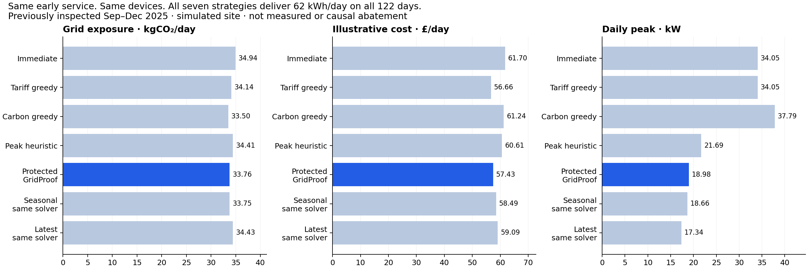

# Service-readiness evaluation (derived)

Previously inspected historical period; new fixed synthetic scenarios are scenario generalization only. Full protocol and raw rows accompany this report.

| Case | Policy | Complete / attempted | Carbon kg/day (valid only) | Cost £/day (valid only) | Peak kW (valid only) | Unserved kWh/day |
|---|---|---:|---:|---:|---:|---:|
| validation | protected_as_available | 60/60 | 26.918 | 46.582 | 17.112 | 0.000 |
| historical_protected | immediate | 122/122 | 34.945 | 61.703 | 34.053 | 0.000 |
| historical_protected | greedy_cost | 122/122 | 34.142 | 56.656 | 34.053 | 0.000 |
| historical_protected | greedy_carbon | 122/122 | 33.496 | 61.244 | 37.790 | 0.000 |
| historical_protected | peak_heuristic | 122/122 | 34.409 | 60.605 | 21.690 | 0.000 |
| historical_protected | protected_lightgbm | 122/122 | 33.759 | 57.425 | 18.983 | 0.000 |
| historical_protected | protected_seasonal | 122/122 | 33.749 | 58.491 | 18.657 | 0.000 |
| historical_protected | protected_latest | 122/122 | 34.435 | 59.086 | 17.341 | 0.000 |
| old_plan_early_departure | old_peak_aware | 0/122 | nan | nan | nan | 27.533 |
| old_nominal | old_peak_aware | 122/122 | 33.491 | 56.785 | 18.517 | 0.000 |
| zero_actual_pv | immediate | 122/122 | 37.853 | 67.620 | 36.000 | 0.000 |
| zero_actual_pv | greedy_cost | 122/122 | 37.049 | 62.571 | 36.000 | 0.000 |
| zero_actual_pv | greedy_carbon | 122/122 | 36.392 | 67.147 | 40.882 | 0.000 |
| zero_actual_pv | peak_heuristic | 122/122 | 37.317 | 66.523 | 22.600 | 0.000 |
| zero_actual_pv | protected_lightgbm | 122/122 | 36.666 | 63.340 | 19.797 | 0.000 |
| reversed_actual_ci | immediate | 122/122 | 35.268 | 61.703 | 34.053 | 0.000 |
| reversed_actual_ci | greedy_cost | 122/122 | 34.755 | 56.656 | 34.053 | 0.000 |
| reversed_actual_ci | greedy_carbon | 122/122 | 33.985 | 61.244 | 37.790 | 0.000 |
| reversed_actual_ci | peak_heuristic | 122/122 | 34.336 | 60.605 | 21.690 | 0.000 |
| reversed_actual_ci | protected_lightgbm | 122/122 | 34.739 | 57.425 | 18.983 | 0.000 |
| departure_before_promise | protected_lightgbm | 0/122 | nan | nan | nan | 17.960 |
| demand_update_0800 | event_replan | 36/122 | 37.024 | 58.901 | 19.495 | 4.230 |
| demand_update_0800 | keep_original_plan | 0/122 | nan | nan | nan | 6.000 |
| shared-11kw | immediate | 0/122 | nan | nan | nan | 62.000 |
| shared-11kw | greedy_cost | 122/122 | 34.440 | 59.178 | 24.097 | 0.000 |
| shared-11kw | greedy_carbon | 41/122 | 29.977 | 60.844 | 23.149 | 41.164 |
| shared-11kw | peak_heuristic | 122/122 | 34.475 | 61.154 | 20.717 | 0.000 |
| shared-11kw | protected_lightgbm | 122/122 | 34.110 | 59.814 | 19.453 | 0.000 |
| shared-11kw | protected_seasonal | 122/122 | 34.174 | 60.447 | 19.172 | 0.000 |
| shared-11kw | protected_latest | 122/122 | 34.515 | 59.648 | 19.219 | 0.000 |
| four-vehicle-shifts | immediate | 122/122 | 37.905 | 65.153 | 28.732 | 0.000 |
| four-vehicle-shifts | greedy_cost | 122/122 | 36.886 | 58.619 | 28.732 | 0.000 |
| four-vehicle-shifts | greedy_carbon | 122/122 | 36.423 | 65.784 | 36.725 | 0.000 |
| four-vehicle-shifts | peak_heuristic | 122/122 | 37.768 | 64.983 | 20.742 | 0.000 |
| four-vehicle-shifts | protected_lightgbm | 122/122 | 36.381 | 59.895 | 20.820 | 0.000 |
| four-vehicle-shifts | protected_seasonal | 122/122 | 36.458 | 60.755 | 19.797 | 0.000 |
| four-vehicle-shifts | protected_latest | 122/122 | 36.944 | 61.066 | 18.393 | 0.000 |
| no-storage | immediate | 122/122 | 35.674 | 63.083 | 37.090 | 0.000 |
| no-storage | greedy_cost | 122/122 | 35.674 | 63.083 | 37.090 | 0.000 |
| no-storage | greedy_carbon | 122/122 | 35.081 | 64.174 | 33.500 | 0.000 |
| no-storage | peak_heuristic | 122/122 | 35.478 | 63.083 | 23.113 | 0.000 |
| no-storage | protected_lightgbm | 122/122 | 35.161 | 63.921 | 22.461 | 0.000 |
| no-storage | protected_seasonal | 122/122 | 35.189 | 64.106 | 22.263 | 0.000 |
| no-storage | protected_latest | 122/122 | 35.478 | 63.083 | 23.113 | 0.000 |
| no-solar | immediate | 0/122 | nan | nan | nan | 62.000 |
| no-solar | greedy_cost | 122/122 | 37.044 | 62.571 | 35.000 | 0.000 |
| no-solar | greedy_carbon | 120/122 | 36.321 | 67.037 | 35.000 | 1.016 |
| no-solar | peak_heuristic | 122/122 | 37.317 | 66.523 | 22.600 | 0.000 |
| no-solar | protected_lightgbm | 122/122 | 36.660 | 63.336 | 19.823 | 0.000 |
| no-solar | protected_seasonal | 122/122 | 36.649 | 64.408 | 19.329 | 0.000 |
| no-solar | protected_latest | 122/122 | 37.360 | 65.003 | 17.400 | 0.000 |

Unserved for a policy returning no schedule means no schedule was executed in that comparison, not a claim that zero energy was physically attainable. Rejected demand updates retain original controls and prior delivery. Invalid rows are excluded from savings comparisons. Each cost/carbon/peak mean uses only that policy’s valid days; use paired_comparisons.json for matched-policy differences.

Execution: 305.81 s; 6160 rows. Old 122-day peak-aware metrics reproduce within 0.

