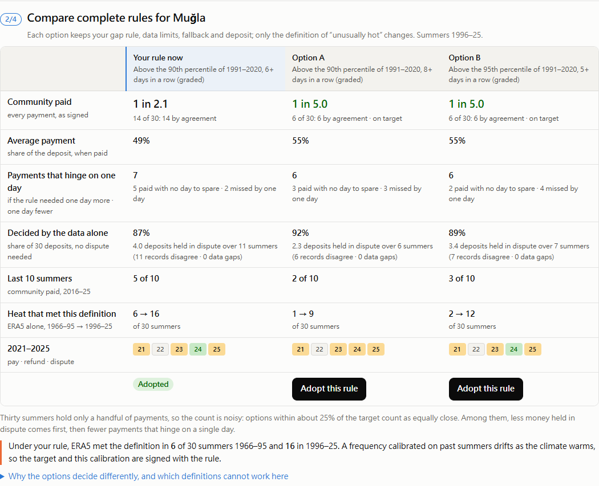
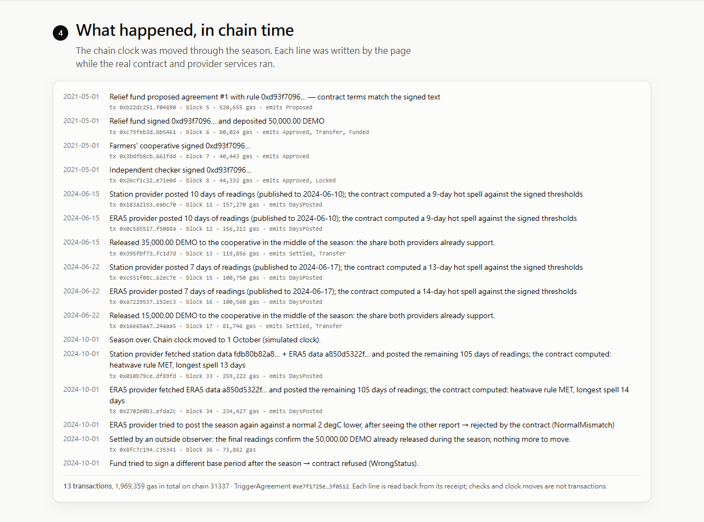
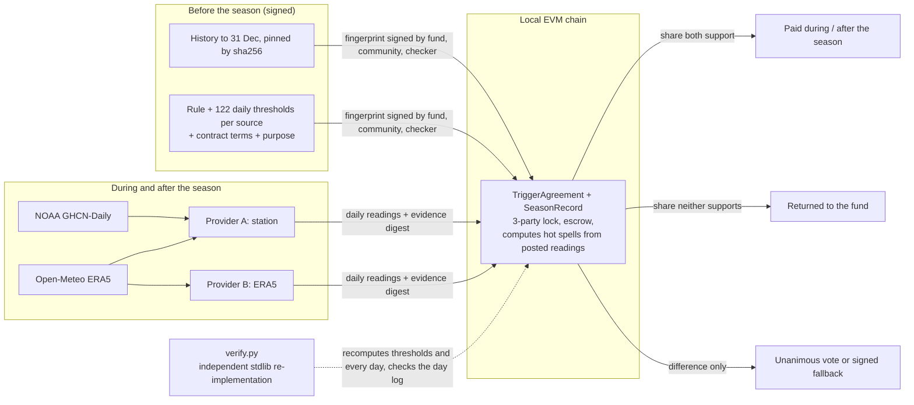

# ExtremeProof

**Choose a heatwave relief rule by what it would have paid, lock it before the season, and release the money while the heatwave is still happening — the share both weather records already support, that week — disputing only the difference, with every step checkable by anyone.**

IEEE ClimateChain Global Hackathon 2026 · Track 4, Climate Data & Environmental Monitoring ("Environmental data is fragmented and difficult to verify" → a climate data verification platform).


**In 30 seconds**

- **The climate problem.** Whether a summer counts as a heatwave depends on which 30 years are "normal", which thermometer and how its gaps are filled. In Antalya 9 summers flip on the base period alone; in Muğla 2021 the station saw a 4-day hot spell and ERA5 a 10-day one.
- **What it does.** A relief fund, a farmers' cooperative and an independent checker choose a rule by what it would have paid, then sign it before the season together with its 122 daily "unusually hot" thresholds. Providers post the daily readings on chain and **the contract computes the heatwave itself**. It releases money while the heat is happening (in a 2021–2025 replay at 10 Turkish stations, 96 % of the relief both records agreed on before the season ended) and disputes only the difference between the records.
- **Why trust it.** Every number is recomputed from pinned public data. A standard-library verifier, sharing no code with the engine, reproduces every verdict and matches the contract's on-chain record day by day.

---

## The climate problem

Climate is the long-run statistics of weather in a place: the mean and variability of temperature, rain and wind, classically over 30 years (IPCC AR6 Glossary; WMO). Heatwaves, droughts and floods are the tails of those statistics, and they are where people get hurt.

More and more aid is promised **before** disasters: humanitarian anticipatory action and small climate-risk schemes pay out automatically when an agreed index crosses an agreed line. Whether a summer "counts" depends on choices that look technical but decide who gets paid:

- **Which 30 years are "normal".** WMO's current standard normal is 1991–2020; 1961–1990 is kept for assessing long-term change. In Antalya, with the same rule and the same ERA5 data, 9 summers since 1966 flip between "heatwave" and "not" depending only on that choice.
- **Which thermometer.** The Antalya station and ERA5 correlate at r = 0.97 day to day, but in summer ERA5 runs 2.3 °C warmer; at Muğla in 2021 the complete station record shows a 4-day hot spell, ERA5 a 10-day one.
- **How gaps are filled.** In summer 2024 the Antalya station reported only 31 of 122 days. Filled by linear correction the longest spell is 7 days; filled by quantile mapping, 13.

Today these choices are usually made and computed by the side that pays. The people the money is for cannot recompute them. In 2016 Malawi's drought cover did not trigger at first because the model assumed a different maize variety than farmers were growing; the payout came after a re-assessment, months later ([Artemis](https://www.artemis.bm/news/2016/11/17/african-risk-capacity-in-8m-parametric-insurance-payout-to-malawi/), [ALNAP/ActionAid](https://alnap.org/help-library/resources/the-wrong-model-for-resilience-how-g7-backed-drought-insurance-failed-malawi-and-what/)).

ExtremeProof is **adaptation**, not mitigation. It does not reduce emissions. It makes the climate statistics behind pre-arranged relief correct, fixed in advance and checkable by anyone. Every number above is recomputed from pinned raw files in [docs/FACTS.md](docs/FACTS.md).

## What it does

Who uses it: a **relief fund** that deposits the money, a **community representative** (here a farmers' cooperative) and an **independent checker**, who all sign the same rule; and two **data providers** (a station record and a reanalysis) who report after the season. Everything runs on a local chain with simulated parties.

1. **Choose a rule by its purpose.** Say how often the community should be paid (about 1 summer in 3, 5 or 10), how much (all or nothing, or graded: 40 % of the deposit at the minimum spell, 70 % three days longer, 100 % six days longer) and what an unresolved dispute does (refund or pay). ExtremeProof searches 32 complete rules (base period × percentile × minimum spell) and compares the best ones on 1996–2025: how often the community was paid, split into "both records agree" and "paid by the fallback"; disputes; the last 10 summers; and how often ERA5 met the definition in 1966–1995 versus 1996–2025 (under the default rule, 6 → 16 of 30 summers: a calibration drifts as the climate warms).
   **Stability check.** Thirty summers hold only a handful of payments, so a count fitted to them is noisy. For every option the finder shows the summers whose payment *hinges on one day*: paid with no day to spare, or missed by one day. Options within about 25 % of the target count as equally close; among them less money held in dispute ranks first, then fewer hinging summers. Example: in Antalya with a 1-in-3 target and a refunding fallback the finder used to offer a rule paying 10 of 30 summers with 10 disputes; it now offers one paying 8 of 30 with 3. The hinge counts are signed with the rule, so the parties sign knowing how fragile the calibration is.
   
2. **See where the records disagree.** For 2021–2025, station-only, ERA5-only and the two-source agreement side by side, summer by summer, with the payment and modelled wait. Then the same rule at 10 Turkish GHCN stations, each against its own normal: where both records can define a 1991–2020 normal, station and ERA5 give opposite answers in 46 of 358 summers (13 %); at 4 of the 10 the public station record holds under 60 % of 1991–2020, so a station-only scheme could not run at all.
3. **Lock the rule before the season.** The rule and every term the contract executes (parties, amount, quorum, provider per source, windows, data limits, fallback, purpose) become one canonical-JSON text and fingerprint. It pins **only what exists at signing**: each record's history up to 31 December of the previous year, by sha256, and **the climate statistics computed from it: for each source, the "unusually hot" threshold for every one of the 122 season days**. The contract stores the fingerprint of each provider's thresholds. For the season itself the text names the publisher and URL, because that data does not exist yet. The three parties sign the fingerprint; the fund's signature deposits the money; the contract refuses to lock once the season has started. The cooperative can download a one-page plain-language summary (English and Turkish) generated from the exact text.
4. **The contract reads the heat, during the season and after it.** Providers post the season's **daily readings** on chain (thousandths of a degree; observed, gap-filled or missing). The contract compares each with the signed threshold for that day and keeps the hot spell, the longest spell and the filled and missing counts itself, so a provider cannot claim a spell its readings do not show. Days are append-only and a day that has not ended cannot be posted, so a spell only grows: each week a provider posts the newly published days (5 days behind) when they lengthen its spell, and anyone can call `release` to pay the share both providers' readings already support; released money is never taken back. In Antalya 2024 the 50,000 DEMO reached the cooperative on 15 and 22 June (35,000 and 15,000) instead of after 30 September. Replaying 2021–2025 at all 10 stations under the default rule, 96 % of the money both records agreed on would have been released before 1 October, in 10 of the 19 paying summers by the end of July ([experiments/inseason_release.json](experiments/inseason_release.json)). After the season each provider posts the rest of the season with the sha256 of its evidence, which names every file it fetched. The contract applies the signed ladder: **the share both providers support is paid at once, the share neither supports goes back at once, only the difference is disputed** (unanimous vote of the three parties, or after 30 days the signed fallback). Muğla 2021 (station 4 days, ERA5 10): a graded rule returns 15,000 at once and disputes 35,000; all or nothing would dispute all 50,000. A disputed agreement takes 10 transactions, about 1.7 million gas, on the local chain; every receipt is shown.
   
5. **Try to cheat.** Re-sign the rule with another normal after the heatwave, have a provider lower the signed "unusually hot" line by 2 °C to stretch a heatwave, edit one temperature in the fetched data, flip a verdict, drop the evidence. The contract or the verifier refuses each one.
6. **Check it yourself.** Download the bundle (signed rule, pinned history, the season data each provider fetched, evidence, chain snapshot) and run one standard-library Python file. It recomputes the thresholds and every day, and checks them against the on-chain record. With `--refetch` it also downloads the season again from NOAA and Open-Meteo and compares every value with what the providers posted.

## How it works



- **Climate engine** (`climate/`, standard-library Python): ETCCDI calendar-day percentiles (5-day window, Hyndman–Fan type 8), Zhang et al. (2005) bootstrap for in-base years, TX90p, WSDI and seasonal hot spells; checked against **xclim 0.58** on real station data with gaps (agreement better than 1e-9). Gap filling is fitted only on years before the season.
- **Contract** (`contracts/`, Solidity 0.8.28): `TriggerAgreement` stores the fingerprint, the payout ladder, the data limits and each provider's threshold fingerprint, and holds the deposit. `SeasonRecord` takes each provider's daily readings in order, checks the thresholds it is given against the signed fingerprint, refuses days that have not ended, and computes the spells and filled/missing counts; `reportOf` turns them into met, not met or "too little data" (an empty final post when the source has no valid normal). Readings during the season can be released by `release` (never clawed back); the final post completes the season before a 14-day deadline (silence counts as absent, never as "no"). Every day is folded into an on-chain keccak log.
- **Providers** (`providers/`): one process per provider with its own key. It refuses a spec whose hash differs from the one approved on chain or whose thresholds differ from the ones the pinned history gives, posts newly published days during the season when they lengthen its spell, and after it fetches the full season and posts the rest. The fetch is simulated offline by default, or live from the publishers with `EP_LIVE_FETCH=1`.
- **Verifier** (`verifier/verify.py`): shares no code with the engine (percentiles, gap filling, spells, canonical hashing and Keccak for ABI selectors are implemented again). It checks that every executed term equals the signed text; that the spec pins only pre-season history and that history's hash; that the signed thresholds equal the ones the pinned history gives and match their on-chain fingerprint; that every provider on chain is accounted for and its evidence hashes to the digest it posted; that the fetched files are the ones its evidence names; that the readings on chain are exactly the recomputed days (the contract's day log); recomputes every verdict, spell, daily value and threshold; and checks the settlement — offline from the bundle, against the live chain with `--rpc`, and against the publishers with `--refetch`.

### Why a blockchain here, and what it does not do

Four kinds of parties with opposite interests (funder, community, checker, data providers) and nobody all of them trust to hold the rule and the money. The verdict itself is public arithmetic: anyone with the rule and the data can recompute it, and the verifier does. What the chain adds is what recomputation cannot:

- **One version of the rule, fixed before the season.** A signature shows who signed a text, not that they did not sign another one for someone else. One ordered public record of the fingerprint, which the contract refuses to lock after the season starts, does.
- **The money is already there, and moves by rule.** The deposit is escrowed at lock. After the season the part both providers support is released without anyone's approval; the fund cannot hold it back or reopen the choice of normal, and the community cannot claim more than the records support.
- **The contract, not a provider, decides whether the heat counted.** The thresholds are fixed by the signed fingerprint; only the named providers can post readings, a day once posted cannot be changed, and the verdict is arithmetic the contract runs on the readings. A provider is left with one thing to vouch for, its readings, and they are public: the other provider and anyone with `verify.py --refetch` can compare them with the publisher. Disagreement cannot be settled by any one party.

What it does **not** do: it does not make data true. The contract cannot see whether a publisher's file is correct, and a provider's post proves which bytes it used, not that the publisher served them on that day (`--refetch` shows only what is served now, and publishers revise data). Two sources and public recomputation reduce that risk; they do not remove it. There is no commit–reveal: the readings are public data and the verdict is arithmetic on them, so hiding them would not stop anyone predicting it. Readings and thresholds are compared as integers in thousandths of a degree (thresholds rounded down); on about 500,000 station and ERA5 summer days at the 10 stations, 1966–2026, it gives exactly the same hot days as the real-number comparison. And if all parties already trust one institution, a database plus signatures is enough.

### What the AI does

The AI has one narrow job: when the station is missing a day, estimate what the station would have read, from ERA5 and seasonal context. It **never** decides whether a disaster happened; with 18–23 qualifying heatwaves in 60 years there is far too little to learn that. The trigger is always the published rule. The model is adopted only if, under a protocol frozen before any results, it keeps trigger verdicts closer to the truth than three standard baselines; otherwise the best baseline is the default.

**Result: the AI was not adopted.** It had the lowest average daily error (0.97 °C vs 1.07 °C) but missed 3 of 9 heatwaves, because a model trained on average error pulls hot days toward typical values. Quantile-mapped ERA5, which preserves the hot tail, got all 9 verdicts right and is the default gap-filling rule. The evidence is thin (3 complete station-summers qualified), and a post-hoc check agrees for stations with history. Details and failure cases: [ml/REPORT.md](ml/REPORT.md).

## Run it

Requirements: Python 3.11+, Node 24. No accounts, API keys or internet needed once set up (raw data are committed).

```powershell
# one-time
powershell -ExecutionPolicy Bypass -File extremeproof\scripts\setup.ps1     # or: sh extremeproof/scripts/setup.sh
# every time, from the repository root
extremeproof\.venv\Scripts\python -m extremeproof.scripts.stack            # chain, contract, 2 providers, hub, web
```

Open http://127.0.0.1:3000 and pick a ready-made case (a heatwave that pays · sources that disagree · too little data), or walk through the steps. The chain clock starts on 1 May 2021 (simulated), so each summer 2021–2026 can be locked before it starts; picking a ready-made case or the one-click demo rolls the local chain back by itself when that summer has passed (**Reset demo chain** does it by hand). Headless alternative: `python -m extremeproof.scripts.demo_flow --site antalya --year 2024`.

Reproduce the numbers on the page (each runs the UI's own TypeScript module and re-checks it against the Python engine on the raw files):

| Script | Checks |
|---|---|
| `python -m extremeproof.scripts.rule_finder` | 420 candidate-summer outcomes and 770 one-day-neighbour outcomes; hinge counts reproduced ([experiments/rule_finder.json](experiments/rule_finder.json)) |
| `python -m extremeproof.scripts.compare_relief` | 200 source/policy rows ([experiments/decision_comparison.json](experiments/decision_comparison.json)) |
| `python -m extremeproof.scripts.inseason` | weekly in-season release replayed for 10 stations, 2021–2025 ([experiments/inseason_release.json](experiments/inseason_release.json)) |
| `python -m extremeproof.scripts.region_scan` | 100 source verdicts at 10 stations ([experiments/region_scan.json](experiments/region_scan.json)) |
| `python -m extremeproof.scripts.reproduce_facts` | every number in [docs/FACTS.md](docs/FACTS.md) |

### Static edition (no install)

A static page that needs no chain or server: the rule finder, comparison and climate charts run in the browser, and steps 3–6 replay three cases recorded from a real run of the stack. Each case links its verification bundle and `verify.py`; `python verify.py too-little-data.zip` checks it offline with system Python (30/30 checks for that case; with `--refetch` the season values are also compared with NOAA and Open-Meteo).

```powershell
cd extremeproof\web
node scripts\record-runs.mjs        # stack running: records public/recorded/ (resets the demo chain)
node scripts\build-static.mjs       # out-static/ (EP_BASE_PATH=/sub/path for a sub-path host); restores the live build
python -m http.server 4173 -d out-static
```

## Data and licences

| Data | Source | Licence / terms | Used for |
|---|---|---|---|
| GHCN-Daily, 10 Turkish stations | NOAA NCEI, [readme](https://www.ncei.noaa.gov/pub/data/ghcn/daily/readme.txt) | No licence text published; citation requested (Menne et al. 2012, doi:10.7289/V5D21VHZ); no use restrictions stated | Station TX |
| ERA5 and ERA5-Land, daily, 1950–2026-09 | [Open-Meteo historical API](https://open-meteo.com/en/docs/historical-weather-api) (Copernicus C3S / ECMWF) | CC BY 4.0; free tier non-commercial | Reanalysis TX, gap filling |
| ETCCDI index definitions | [ETCCDI](https://etccdi.pacificclimate.org/list_27_indices.shtml) | public definitions | TX90p, WSDI, spells |

Every file's URL, retrieval time and sha256 are in [data/manifest.json](data/manifest.json); `scripts/fetch_data.py` re-downloads and re-pins them.

## Limitations

- Scope: release during the season as soon as an observed spell reaches a rung, final settlement after it, under a rule fixed before it. Observed data only: no forecast trigger, so money follows the heat by about a week (the assumed 5-day publication lag plus the weekly check), not before it. Money cannot reach people before the data show the heat.
- By default the season fetch is simulated so the demo runs offline: both the pinned history and the "fetched" season are cut from one download made in October 2026. With `EP_LIVE_FETCH=1` the providers download the season from NOAA and Open-Meteo themselves (tested for Muğla 2021: same spells, same verdicts). Publication delay and revisions between signing and settlement are not modelled. `--refetch` against the real publishers matched every value for the recorded Muğla 2021 case.
- A provider's report proves which bytes it used, not that the publisher served them; a dishonest provider that fabricates data is caught only if someone re-downloads (the verifier's `--refetch`) or the other provider disagrees.
- The two providers are not fully independent observations: provider A fills station gaps with ERA5, which is provider B's source. A real deployment would add an independent feed such as the national met service.
- The payment frequency is calibrated on 30 past summers with a handful of events. The finder shows how many payments hinge on one day; it does not forecast future frequency, which rises as the climate warms.
- The default graded ladder (40 / 70 / 100 %) is an example; the parties can set their own rungs (days and shares) before signing, and the contract and verifier use whatever they signed. No loss data are used here to calibrate it. Over 30 summers it pays about half as much in total as all or nothing for the same deposit, and it does not always reduce money held in dispute (Muğla, 6-day rule: 4.0 deposits either way; Antalya: 3.0 → 2.4). What it changes is that the payment follows severity and a one-day difference moves one step, not the whole deposit.
- Parties, providers, DEMO money and the chain clock are simulated on one machine. No real users; not deployed to a public network.
- Heat only (daily maximum temperature). Station records are not homogenised; ERA5 before the late 1970s rests on fewer observations.
- This is a design for pre-arranged relief, not an insurance product.

## Repository map

```
extremeproof/
  climate/      engine.py (percentiles, bootstrap, indices), sources.py (QC), fill.py, trigger.py (spec + verdict),
                archive.py (what can be pinned at signing; simulated season fetch), specs.py
  contracts/    TriggerAgreement.sol, SeasonRecord.sol (daily readings, spells), DemoToken.sol
  providers/    service.py   one process per provider: fetch the season, report once
  server/       hub.py       spec registry, verification bundles, verifier runs (no authority)
  verifier/     verify.py    standalone, standard library only
  ml/           protocol.json (frozen), evaluate.py, REPORT.md
  web/          Next.js app (lib/finder.ts: rule finder and one-day stability check)
  experiments/  decision_comparison.json, region_scan.json, rule_finder.json
  data/         raw/ (pinned files), manifest.json, stations.json
  docs/         FACTS.md, DECISION_REVIEW.md, DEVPOST.md, VIDEO_SCRIPT.md
```
